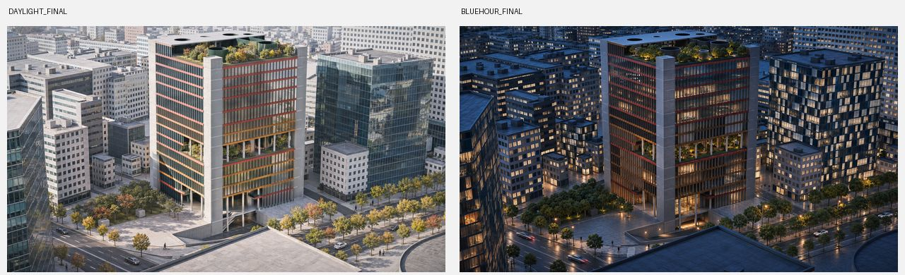

# Connector-inspectable visual review packet

Generated from original image pixels, not a style reinterpretation.

Each tile is **lossless PNG at native pixel scale**. Coordinates are from the top-left of each original image.

## DAYLIGHT_FINAL

Original name: `G002_A_Urban_Daylight_PHOTOSHOP_FINAL.png`
SHA256: `b99cc66cdadd72be52461c25b0002cbb5ab08add26dc3a7933e3f1e4f12af80b`
Dimensions: 4800×2700 pixels

Native-resolution tiles:

- (0,0)..(400,400) [PNG](images/DAYLIGHT_FINAL/tiles/x00000_y00000_w0400_h0400.png) · SHA256 `3aa7a85e113945d03da9b9a327ad97a15f4a1d941e32a6029f94189c7fc3395e`
- (0,400)..(400,800) [PNG](images/DAYLIGHT_FINAL/tiles/x00000_y00400_w0400_h0400.png) · SHA256 `97e1c0a5cab43218aca87d4697b687511d24752f1bada7d7a6ae2889c971a3c8`
- (400,0)..(800,400) [PNG](images/DAYLIGHT_FINAL/tiles/x00400_y00000_w0400_h0400.png) · SHA256 `3282186354dbc359b96d36fd96bfa5f6cc922e37d659c9d3c641f3e8055086d5`
- (400,400)..(800,800) [PNG](images/DAYLIGHT_FINAL/tiles/x00400_y00400_w0400_h0400.png) · SHA256 `306b1e74486b9f5be6afd17c96c52c0a14ff51a69fd0338b983c23f866711be6`
- (800,0)..(1200,400) [PNG](images/DAYLIGHT_FINAL/tiles/x00800_y00000_w0400_h0400.png) · SHA256 `85a72cb4bafc5d6233e0c6bf8fc7f4f5bb89cdde8c8a8986b5de927547ef4bd6`
- (800,400)..(1200,800) [PNG](images/DAYLIGHT_FINAL/tiles/x00800_y00400_w0400_h0400.png) · SHA256 `bd18b604d887f6ce7cfc430eb47649d140a35fa80506244544eacc93b72fe69c`
- (1200,0)..(1600,400) [PNG](images/DAYLIGHT_FINAL/tiles/x01200_y00000_w0400_h0400.png) · SHA256 `279375b7c764b5bff364473beea2bfa473f163868ca5b3ec575efffc0dd3b558`
- (1200,400)..(1600,800) [PNG](images/DAYLIGHT_FINAL/tiles/x01200_y00400_w0400_h0400.png) · SHA256 `dc1f2366782fe9e0caa7aa7c0c844e64ddb57d6e2e116679c3286b6e0f3ed42d`
- (1600,0)..(2000,400) [PNG](images/DAYLIGHT_FINAL/tiles/x01600_y00000_w0400_h0400.png) · SHA256 `95327a4b36392408780a73dd09ae8e25ddfe6eaacf0b39776f4396ff7e54bc8e`
- (1600,400)..(2000,800) [PNG](images/DAYLIGHT_FINAL/tiles/x01600_y00400_w0400_h0400.png) · SHA256 `e2e42e1cb4f3394c68e24c36e78f8af7e46c092b1bd8a1f83c5de76d128e5947`
- (2000,0)..(2400,400) [PNG](images/DAYLIGHT_FINAL/tiles/x02000_y00000_w0400_h0400.png) · SHA256 `9768ea0d0c7c8e86ac38e8302abab6a6cf7da8960bc41f8ddaeed27b8cb60447`
- (2000,400)..(2400,800) [PNG](images/DAYLIGHT_FINAL/tiles/x02000_y00400_w0400_h0400.png) · SHA256 `a9352fe971128f1dd2cb6924de711d620d934ca017776a9ea36e7df4cb4c34f4`
- (2400,0)..(2800,400) [PNG](images/DAYLIGHT_FINAL/tiles/x02400_y00000_w0400_h0400.png) · SHA256 `8ff2d8f27a0557414cea9a82e30e28da6fd5fd546d21dabdda7a116228679566`
- (2400,400)..(2800,800) [PNG](images/DAYLIGHT_FINAL/tiles/x02400_y00400_w0400_h0400.png) · SHA256 `8a4c714cdd454d87481e5e74bee96b7359eaeb7257f4142cf12a77ad29ee971c`
- (2800,0)..(3200,400) [PNG](images/DAYLIGHT_FINAL/tiles/x02800_y00000_w0400_h0400.png) · SHA256 `45d9b6e600dcc8a44935bb1f6d783b3cecf54a57e1ef61d45820e68fe8fa2d88`
- (2800,400)..(3200,800) [PNG](images/DAYLIGHT_FINAL/tiles/x02800_y00400_w0400_h0400.png) · SHA256 `a6683f4a41666443dba65b99505aa4fdaa13a15ba5aee4cac142b206bafc0912`
- (3200,0)..(3600,400) [PNG](images/DAYLIGHT_FINAL/tiles/x03200_y00000_w0400_h0400.png) · SHA256 `16f857f3cece5ae597f9c1243ac8a4955aa8ce9ecaa4ae4ca60355accfb82815`
- (3200,400)..(3600,800) [PNG](images/DAYLIGHT_FINAL/tiles/x03200_y00400_w0400_h0400.png) · SHA256 `f679d560605deeef15134baab2caedfe7fbbd67dc23f7e8512a7a09ac5175924`
- (3600,0)..(4000,400) [PNG](images/DAYLIGHT_FINAL/tiles/x03600_y00000_w0400_h0400.png) · SHA256 `a6747867b9ac0d74c5a043495d2dad69737c1ec91f4a6ff204c9ea20c106ae31`
- (3600,400)..(4000,800) [PNG](images/DAYLIGHT_FINAL/tiles/x03600_y00400_w0400_h0400.png) · SHA256 `26c034c42485d9c23842a580aea01ecaaea2e4c427c58700bd46d5d5fd381f2e`
- (4000,0)..(4400,400) [PNG](images/DAYLIGHT_FINAL/tiles/x04000_y00000_w0400_h0400.png) · SHA256 `4f86e5a67552bc214b98c20c44acb587b3a7e64ebc0a2f4650b7fd3e7b298345`
- (4000,400)..(4400,800) [PNG](images/DAYLIGHT_FINAL/tiles/x04000_y00400_w0400_h0400.png) · SHA256 `55fc3f589241bcb37e82a7736c4366de01c100803e870e1d18d0cc7553ea24d5`
- (4400,0)..(4800,400) [PNG](images/DAYLIGHT_FINAL/tiles/x04400_y00000_w0400_h0400.png) · SHA256 `cc8c69390a9e6a18676996fe361a87562cf96857543f0b52e91b812040b3670f`
- (4400,400)..(4800,800) [PNG](images/DAYLIGHT_FINAL/tiles/x04400_y00400_w0400_h0400.png) · SHA256 `0d736be1be0edef6ebfea426ea8bc348728c07089ef64b8f4ecbb0574c1563fc`
- (0,800)..(400,1200) [PNG](images/DAYLIGHT_FINAL/tiles/x00000_y00800_w0400_h0400.png) · SHA256 `da8a8310389962094b6c6aec9bbd1cc78497f7b5a7d8880f3c014567935f63c1`
- (0,1200)..(400,1600) [PNG](images/DAYLIGHT_FINAL/tiles/x00000_y01200_w0400_h0400.png) · SHA256 `6044feb5c2870eae7ff55bbedd77c9e7cf8193956c88a8e5cba1ed5af688401c`
- (400,800)..(800,1200) [PNG](images/DAYLIGHT_FINAL/tiles/x00400_y00800_w0400_h0400.png) · SHA256 `3c1caba9bf39ec37a454234b7d4a284b77d1a299edc162873455d9427611e042`
- (400,1200)..(800,1600) [PNG](images/DAYLIGHT_FINAL/tiles/x00400_y01200_w0400_h0400.png) · SHA256 `65fa1c1b631d91c2aa24b465862be0f95783851e14ec2636d1cc00e5ce60b03a`
- (800,800)..(1200,1200) [PNG](images/DAYLIGHT_FINAL/tiles/x00800_y00800_w0400_h0400.png) · SHA256 `42e4c9e2c0e1678c812efeb01a9ebff075eb05ec8bd2398bfb0fc795c8781ddd`
- (800,1200)..(1200,1600) [PNG](images/DAYLIGHT_FINAL/tiles/x00800_y01200_w0400_h0400.png) · SHA256 `46c93e4e509d10c82cc7c5d18cb0a424928cabe777e7111f35a50598ae6a9d7e`
- (1200,800)..(1600,1200) [PNG](images/DAYLIGHT_FINAL/tiles/x01200_y00800_w0400_h0400.png) · SHA256 `27abb6adf8ab3b4bd2f4bfb5968dd52d54d004205452225802d1f624a87b4337`
- (1200,1200)..(1600,1600) [PNG](images/DAYLIGHT_FINAL/tiles/x01200_y01200_w0400_h0400.png) · SHA256 `b300292aeba6db33657502259a81cb97786cbcd7bcae951b790dcf1f6cfebd27`
- (1600,800)..(2000,1200) [PNG](images/DAYLIGHT_FINAL/tiles/x01600_y00800_w0400_h0400.png) · SHA256 `2e73c3e2ab7b95cedcdc3b117c548200f9b267816d6fb50c8b8bc4ec273f9865`
- (1600,1200)..(2000,1600) [PNG](images/DAYLIGHT_FINAL/tiles/x01600_y01200_w0400_h0400.png) · SHA256 `4c5d64d4e0c1698b67b3dad7305ba89158d9f4ed07f4c2dcc03986b7b1be91a0`
- (2000,800)..(2400,1200) [PNG](images/DAYLIGHT_FINAL/tiles/x02000_y00800_w0400_h0400.png) · SHA256 `a4c9586cf791ec9413a0067d59298007b44e1ba20734f294932267fc848ff46c`
- (2000,1200)..(2400,1600) [PNG](images/DAYLIGHT_FINAL/tiles/x02000_y01200_w0400_h0400.png) · SHA256 `19f6259c16743a16663fda6a953fe56602e88e047b8b91638437f95dc7dfb729`
- (2400,800)..(2800,1200) [PNG](images/DAYLIGHT_FINAL/tiles/x02400_y00800_w0400_h0400.png) · SHA256 `13ad16936c9eb35631b686063b5131b21520f8fece8bdb46794c761d591e214a`
- (2400,1200)..(2800,1600) [PNG](images/DAYLIGHT_FINAL/tiles/x02400_y01200_w0400_h0400.png) · SHA256 `163068b8f3021ba6f48a2aff09aa0e8430247967de17d9fac2cdd514e314f263`
- (2800,800)..(3200,1200) [PNG](images/DAYLIGHT_FINAL/tiles/x02800_y00800_w0400_h0400.png) · SHA256 `e31de5384f161692667d036ced45dba10e65462a92a404c276eff5d41c801ae9`
- (2800,1200)..(3200,1600) [PNG](images/DAYLIGHT_FINAL/tiles/x02800_y01200_w0400_h0400.png) · SHA256 `676cd640f4dad0c12110aca74420b95d6e0de2c13c7dde0a843eeec1e64208ea`
- (3200,800)..(3600,1200) [PNG](images/DAYLIGHT_FINAL/tiles/x03200_y00800_w0400_h0400.png) · SHA256 `2e3eb1f5f7a2266e3a4ed535248a20e00fa43d5545b63b1411cdc653c8c87457`
- (3200,1200)..(3600,1600) [PNG](images/DAYLIGHT_FINAL/tiles/x03200_y01200_w0400_h0400.png) · SHA256 `61b038baceeb0cf9dfc78b5240070e0d0b31a4480c90cbc8df38ca2d049d566a`
- (3600,800)..(4000,1200) [PNG](images/DAYLIGHT_FINAL/tiles/x03600_y00800_w0400_h0400.png) · SHA256 `f8b7b87f6fb5f323533f0d06e63e2c46da5855d1fb80e9f67156e0981b543af0`
- (3600,1200)..(4000,1600) [PNG](images/DAYLIGHT_FINAL/tiles/x03600_y01200_w0400_h0400.png) · SHA256 `ab3dc390bb934932090fc6af9152ca2178f81a5b00507b536a6c3f3b3648ba50`
- (4000,800)..(4400,1200) [PNG](images/DAYLIGHT_FINAL/tiles/x04000_y00800_w0400_h0400.png) · SHA256 `342a94d0e7ccc7bbc3f0f2cc0b9c63ef2e741ae1c388f50dff2423a2389843cf`
- (4000,1200)..(4400,1600) [PNG](images/DAYLIGHT_FINAL/tiles/x04000_y01200_w0400_h0400.png) · SHA256 `be2225e3f59b2f9aaeca8c0f2f7c3f18f21ab1300eb3f173b0d188ff5276bad5`
- (4400,800)..(4800,1200) [PNG](images/DAYLIGHT_FINAL/tiles/x04400_y00800_w0400_h0400.png) · SHA256 `1efc06b01327b91e8e08c02942417bd9262933b07e151e6ea7f7f85fe9fd5416`
- (4400,1200)..(4800,1600) [PNG](images/DAYLIGHT_FINAL/tiles/x04400_y01200_w0400_h0400.png) · SHA256 `eca93182ea4cb5e3dcdc6b18960b108169912836f98558834943a57e852856ac`
- (0,1600)..(400,2000) [PNG](images/DAYLIGHT_FINAL/tiles/x00000_y01600_w0400_h0400.png) · SHA256 `47193316253918003b68b42b398fa5702fffe8278724eb04773503ded1f3e3ee`
- (0,2000)..(400,2400) [PNG](images/DAYLIGHT_FINAL/tiles/x00000_y02000_w0400_h0400.png) · SHA256 `d6c9e2bac3fb6ecea955cb174fa3c6ee823f14c758f70b36da34dc884df166b8`
- (400,1600)..(800,2000) [PNG](images/DAYLIGHT_FINAL/tiles/x00400_y01600_w0400_h0400.png) · SHA256 `913428be6f72e3c5b2d1ae52cb243c483977905d41ec060ee9b7fc8ea3e2576c`
- (400,2000)..(800,2400) [PNG](images/DAYLIGHT_FINAL/tiles/x00400_y02000_w0400_h0400.png) · SHA256 `583f4ba37ab7c2ab0a5fc0b0f21ee8db6a641ddab46d41e0680a604e64bd9160`
- (800,1600)..(1200,2000) [PNG](images/DAYLIGHT_FINAL/tiles/x00800_y01600_w0400_h0400.png) · SHA256 `16b5f55bffddd7a96c096d0f2643834583a1db18aa9862ebd68be78dc1b839dd`
- (800,2000)..(1200,2400) [PNG](images/DAYLIGHT_FINAL/tiles/x00800_y02000_w0400_h0400.png) · SHA256 `4351612ed6c203c04f30eda82983786eb0a87e57ba0821210c35a250c30096c4`
- (1200,1600)..(1600,2000) [PNG](images/DAYLIGHT_FINAL/tiles/x01200_y01600_w0400_h0400.png) · SHA256 `d4784f807b5af01305fe5b28da0f7f16a742c1887d042134acdc51f2d760500c`
- (1200,2000)..(1600,2400) [PNG](images/DAYLIGHT_FINAL/tiles/x01200_y02000_w0400_h0400.png) · SHA256 `4131f0ad303dbf3f72ca7db2306b25911b2856f26f21d21df0e4df280e6ba015`
- (1600,1600)..(2000,2000) [PNG](images/DAYLIGHT_FINAL/tiles/x01600_y01600_w0400_h0400.png) · SHA256 `5b797a1ae3f2378a48fff4a0b12f0d1019324947b3f9c8b7cb4c24fcb7ac5d10`
- (1600,2000)..(2000,2400) [PNG](images/DAYLIGHT_FINAL/tiles/x01600_y02000_w0400_h0400.png) · SHA256 `9dfb7818b44632214a60706ee24f32c7fcf7c5f2beda170c1c5334b0b847dba3`
- (2000,1600)..(2400,2000) [PNG](images/DAYLIGHT_FINAL/tiles/x02000_y01600_w0400_h0400.png) · SHA256 `31b9ac29f7d66fea3242ecb43ea9f1ed679e77b47fd4b42db3ad73901e763c1a`
- (2000,2000)..(2400,2400) [PNG](images/DAYLIGHT_FINAL/tiles/x02000_y02000_w0400_h0400.png) · SHA256 `0b5fab15f9d60848261d1720acaec98a1cc9062e10d31715028ee91c7099f74a`
- (2400,1600)..(2800,2000) [PNG](images/DAYLIGHT_FINAL/tiles/x02400_y01600_w0400_h0400.png) · SHA256 `16a595121bb2ff91b84a43b1d72daf991abb0ebdebbece7d1d92e40d1b13e128`
- (2400,2000)..(2800,2400) [PNG](images/DAYLIGHT_FINAL/tiles/x02400_y02000_w0400_h0400.png) · SHA256 `bd6415e6a3de93f5e3c317a5ecad5d95ddbb761e76739195eef70aef124f497b`
- (2800,1600)..(3200,2000) [PNG](images/DAYLIGHT_FINAL/tiles/x02800_y01600_w0400_h0400.png) · SHA256 `f42f149a43ed81ec01c83b5910eb6188496bfb785ac83e53f33bc24716a8d3cf`
- (2800,2000)..(3200,2400) [PNG](images/DAYLIGHT_FINAL/tiles/x02800_y02000_w0400_h0400.png) · SHA256 `4646e55058cc5f23238a577ff9daa171744597ff4ce7ee73c627af438687526f`
- (3200,1600)..(3600,2000) [PNG](images/DAYLIGHT_FINAL/tiles/x03200_y01600_w0400_h0400.png) · SHA256 `725dbf61acc4dfb77c1de93982a4523d913d14de07b00e88fa0b7f92d9bab0b1`
- (3200,2000)..(3600,2400) [PNG](images/DAYLIGHT_FINAL/tiles/x03200_y02000_w0400_h0400.png) · SHA256 `0a7677d6ce1def535acc2a69ee862d9d2d0ed0f29e9176cfc1fa1a665b3ec015`
- (3600,1600)..(4000,2000) [PNG](images/DAYLIGHT_FINAL/tiles/x03600_y01600_w0400_h0400.png) · SHA256 `06711d7fd6828cb4e1c276bbdaa95c60c038a92806c24d41b3328d830afccb16`
- (3600,2000)..(4000,2400) [PNG](images/DAYLIGHT_FINAL/tiles/x03600_y02000_w0400_h0400.png) · SHA256 `2a3a3b6e67f657cdb98488461898bfbb3693d454d23416706a6a517ddb356aff`
- (4000,1600)..(4400,2000) [PNG](images/DAYLIGHT_FINAL/tiles/x04000_y01600_w0400_h0400.png) · SHA256 `b6303c457552b661379b4188e7c167cd08b6049caa9ec74b1303a6b01208b525`
- (4000,2000)..(4400,2400) [PNG](images/DAYLIGHT_FINAL/tiles/x04000_y02000_w0400_h0400.png) · SHA256 `23b4ee6513e7c06b63fd7cbecd81c7fb7e09216d0f9685a3ea993e59e538e9d7`
- (4400,1600)..(4800,2000) [PNG](images/DAYLIGHT_FINAL/tiles/x04400_y01600_w0400_h0400.png) · SHA256 `69b51a15762b7d929fed95735a25942e87a889b0a18eef806bef413b87e3d1d4`
- (4400,2000)..(4800,2400) [PNG](images/DAYLIGHT_FINAL/tiles/x04400_y02000_w0400_h0400.png) · SHA256 `f7dff05e92a98afb6dd81c223e582217ee645216c24540cf943a68704c7ad313`
- (0,2400)..(800,2700) [PNG](images/DAYLIGHT_FINAL/tiles/x00000_y02400_w0800_h0300.png) · SHA256 `1b09397c799223cf497dd57703db0d6a377dcad413b63aee1bc1a90d8f99526d`
- (800,2400)..(1600,2700) [PNG](images/DAYLIGHT_FINAL/tiles/x00800_y02400_w0800_h0300.png) · SHA256 `740977f4670fc6f29d48b9905985258f7ff79ee33e2db863a23e81c39edff16b`
- (1600,2400)..(2400,2700) [PNG](images/DAYLIGHT_FINAL/tiles/x01600_y02400_w0800_h0300.png) · SHA256 `3da34deedbf3578a9df7d3b917449ec25ac422d9bfbb8aacda85d33787f102d4`
- (2400,2400)..(3200,2700) [PNG](images/DAYLIGHT_FINAL/tiles/x02400_y02400_w0800_h0300.png) · SHA256 `6d7e01f5e60052f0dba48f457fa3b2f04b089a13f42040e9e834563abb7a5a98`
- (3200,2400)..(4000,2700) [PNG](images/DAYLIGHT_FINAL/tiles/x03200_y02400_w0800_h0300.png) · SHA256 `bf49f964514cef0d6ebb651602d0e5061a9537754136c31776bf8a00b186ad5e`
- (4000,2400)..(4800,2700) [PNG](images/DAYLIGHT_FINAL/tiles/x04000_y02400_w0800_h0300.png) · SHA256 `76b9abbe1b25db07f17acf44176a9eb9b21f51973b411ff7791fea40a8612ed1`

## BLUEHOUR_FINAL

Original name: `G002_B_Blue_Hour_PHOTOSHOP_FINAL.png`
SHA256: `ad5b9b07033ab258201173b48042849d3cf6575756511d103c6f3970129b1f57`
Dimensions: 4800×2700 pixels

Native-resolution tiles:

- (0,0)..(400,800) [PNG](images/BLUEHOUR_FINAL/tiles/x00000_y00000_w0400_h0800.png) · SHA256 `5362b9e9809da47319243bd030f516e6437ff71ecda9656f9c0c772292eeee64`
- (400,0)..(800,400) [PNG](images/BLUEHOUR_FINAL/tiles/x00400_y00000_w0400_h0400.png) · SHA256 `8c6dc49382e977efd3044a634cfd52f0fadb95703a7905eb322f020097f1bad8`
- (400,400)..(800,800) [PNG](images/BLUEHOUR_FINAL/tiles/x00400_y00400_w0400_h0400.png) · SHA256 `c8c47da2a6bc775ae780fcb9c50ee8315e35ef48a102a09b9b3524fd1f5259e4`
- (800,0)..(1200,400) [PNG](images/BLUEHOUR_FINAL/tiles/x00800_y00000_w0400_h0400.png) · SHA256 `14cc70003700e75c44eee693758fb7b01a7e761a5f463a4df3234909a1a237c8`
- (800,400)..(1200,800) [PNG](images/BLUEHOUR_FINAL/tiles/x00800_y00400_w0400_h0400.png) · SHA256 `6215a0a63f58284870ee2d351e1226c5301e764c854583b806c2d7f81e5d8ac6`
- (1200,0)..(1600,400) [PNG](images/BLUEHOUR_FINAL/tiles/x01200_y00000_w0400_h0400.png) · SHA256 `e43e4396c2a12bd83c2feec997e02b77f0b1eccfd1e882dca2b9c635146c2a91`
- (1200,400)..(1600,800) [PNG](images/BLUEHOUR_FINAL/tiles/x01200_y00400_w0400_h0400.png) · SHA256 `5f7531a9ddab0b381b17839446bf24a98c6a74f7fcfd505ab19a57c6beefa84d`
- (1600,0)..(2000,400) [PNG](images/BLUEHOUR_FINAL/tiles/x01600_y00000_w0400_h0400.png) · SHA256 `459a8f62f8d46b9714d4bb9d90af1f9fbc28482178ccfd3fa2c6179ab2641267`
- (1600,400)..(2000,800) [PNG](images/BLUEHOUR_FINAL/tiles/x01600_y00400_w0400_h0400.png) · SHA256 `e254e17f148b02ecdeeebd0d9d68b085fd87f8b796815e22dce7bd10e08399cc`
- (2000,0)..(2400,400) [PNG](images/BLUEHOUR_FINAL/tiles/x02000_y00000_w0400_h0400.png) · SHA256 `0946637580d4ff83f5c90003c52c87e34ada69af41edca41319c433091df018e`
- (2000,400)..(2400,800) [PNG](images/BLUEHOUR_FINAL/tiles/x02000_y00400_w0400_h0400.png) · SHA256 `b7e8c6242b3f574209ad186d32075931562db53cc762c64485545172871ecf1e`
- (2400,0)..(2800,400) [PNG](images/BLUEHOUR_FINAL/tiles/x02400_y00000_w0400_h0400.png) · SHA256 `15e24341bdc825b7fa1c4abb977a2ecd4b6f00f628cb1355bc2ae15d16cd7ef2`
- (2400,400)..(2800,800) [PNG](images/BLUEHOUR_FINAL/tiles/x02400_y00400_w0400_h0400.png) · SHA256 `64e34fe276d28017b6b4fee06a8c68217680a4cda260bf6f3ff68ffd7d3a3905`
- (2800,0)..(3200,400) [PNG](images/BLUEHOUR_FINAL/tiles/x02800_y00000_w0400_h0400.png) · SHA256 `9e977a3022f5615ad1d8065e5d4e5ee2eef25913929619527ecbd2e0a9ebcdd5`
- (2800,400)..(3200,800) [PNG](images/BLUEHOUR_FINAL/tiles/x02800_y00400_w0400_h0400.png) · SHA256 `8514eb8f566f0a2fd7104a6034edb551ec71dd1e96095cc7c5012001ce0287a4`
- (3200,0)..(3600,400) [PNG](images/BLUEHOUR_FINAL/tiles/x03200_y00000_w0400_h0400.png) · SHA256 `047b7fddae17779e1c7ad943eee92f5dcf3db08a684d4f91cadaee57f8152002`
- (3200,400)..(3600,800) [PNG](images/BLUEHOUR_FINAL/tiles/x03200_y00400_w0400_h0400.png) · SHA256 `abc3929c4845859a9973170209f0d5e9781b2d62ab1961aac2ecc476728e5ce8`
- (3600,0)..(4000,400) [PNG](images/BLUEHOUR_FINAL/tiles/x03600_y00000_w0400_h0400.png) · SHA256 `42b00b5bc035ea06021de15f397f1f7e2447afd887e51d8eca61ab60c17c5d3d`
- (3600,400)..(4000,800) [PNG](images/BLUEHOUR_FINAL/tiles/x03600_y00400_w0400_h0400.png) · SHA256 `413c35969103f087b9b712b89dd75ac107b2818caad4398f09cd916a6d8ce841`
- (4000,0)..(4400,400) [PNG](images/BLUEHOUR_FINAL/tiles/x04000_y00000_w0400_h0400.png) · SHA256 `67a2cb994c95880972fceba4a75b2f58793112a31904ad868c5ed675881f58d2`
- (4000,400)..(4400,800) [PNG](images/BLUEHOUR_FINAL/tiles/x04000_y00400_w0400_h0400.png) · SHA256 `f0414bd8c1dd5d578418e900d20c5a722871ee07f3e2852317ed32d7646c27a3`
- (4400,0)..(4800,400) [PNG](images/BLUEHOUR_FINAL/tiles/x04400_y00000_w0400_h0400.png) · SHA256 `a86b442b985eafa6dac87df83e2546dc1d04c146efcfa7fa44318bfe97109780`
- (4400,400)..(4800,800) [PNG](images/BLUEHOUR_FINAL/tiles/x04400_y00400_w0400_h0400.png) · SHA256 `4d970fca3bbc86138f7be44d4b96be7e390a705491c582f2803e16ee5d8537f6`
- (0,800)..(400,1200) [PNG](images/BLUEHOUR_FINAL/tiles/x00000_y00800_w0400_h0400.png) · SHA256 `9227d2f9d91889b79e136ec9fc42d01076da325056ce173f906aea545ec9b406`
- (0,1200)..(400,1600) [PNG](images/BLUEHOUR_FINAL/tiles/x00000_y01200_w0400_h0400.png) · SHA256 `1514d508747c2441d14c753582f98e4980ddea6025b78fa9d0b233e71521cd2a`
- (400,800)..(800,1200) [PNG](images/BLUEHOUR_FINAL/tiles/x00400_y00800_w0400_h0400.png) · SHA256 `f1d2aa3e244944d21545c9d502190c99e3ade87e6ad9e6e75da574f862840311`
- (400,1200)..(800,1600) [PNG](images/BLUEHOUR_FINAL/tiles/x00400_y01200_w0400_h0400.png) · SHA256 `f63d976c055dbb4ec106bd452ff155ac9bd9f521b3e6ddbda8fe9ab634f25f19`
- (800,800)..(1200,1200) [PNG](images/BLUEHOUR_FINAL/tiles/x00800_y00800_w0400_h0400.png) · SHA256 `53187e245cb523d93c57cdeeb1f244f277ba9c7dd87f20e43f26745931fc5f0e`
- (800,1200)..(1200,1600) [PNG](images/BLUEHOUR_FINAL/tiles/x00800_y01200_w0400_h0400.png) · SHA256 `e348c1c7c8b704ca68c3cda5b1e24f68761c7229cfc5d33bb2242e106069d2e0`
- (1200,800)..(1600,1200) [PNG](images/BLUEHOUR_FINAL/tiles/x01200_y00800_w0400_h0400.png) · SHA256 `406989ad4929e142a10cd7386e79c5875e15b22e6bd838f6d5e2925366b7de22`
- (1200,1200)..(1600,1600) [PNG](images/BLUEHOUR_FINAL/tiles/x01200_y01200_w0400_h0400.png) · SHA256 `c5d294a7edb5f1417a1793c82201e27c12c48eb853344fca9490c6c0146d1275`
- (1600,800)..(2000,1200) [PNG](images/BLUEHOUR_FINAL/tiles/x01600_y00800_w0400_h0400.png) · SHA256 `874975f66b915c6035e4bae2cb152a4e74654c9cfde01f6f5c0e41a632647c90`
- (1600,1200)..(2000,1600) [PNG](images/BLUEHOUR_FINAL/tiles/x01600_y01200_w0400_h0400.png) · SHA256 `22194da0372f31c56470d043c8bb550af34f34934dea525303e0a7c635569d41`
- (2000,800)..(2400,1200) [PNG](images/BLUEHOUR_FINAL/tiles/x02000_y00800_w0400_h0400.png) · SHA256 `6626317386bbcb630ae718c4e3c3fed4bb93d22039728f977207beac751fd4b1`
- (2000,1200)..(2400,1600) [PNG](images/BLUEHOUR_FINAL/tiles/x02000_y01200_w0400_h0400.png) · SHA256 `1adc3f4a819b06e4063ea21f281129691f5c5cc9aaa7c3eeb45f591ac6cf8824`
- (2400,800)..(2800,1200) [PNG](images/BLUEHOUR_FINAL/tiles/x02400_y00800_w0400_h0400.png) · SHA256 `e3036a3b1e5366883709b4f583412e803d94e32b1c0157a5f1b6bf99f2d46f7b`
- (2400,1200)..(2800,1600) [PNG](images/BLUEHOUR_FINAL/tiles/x02400_y01200_w0400_h0400.png) · SHA256 `8d21e4f2918cf3961914312ceafa3be21d164ba7df7a8d7857bda0c7ed878146`
- (2800,800)..(3200,1200) [PNG](images/BLUEHOUR_FINAL/tiles/x02800_y00800_w0400_h0400.png) · SHA256 `ffe2d71973a5b4f1abe6d47a44a65c0f6b6d133f353a592d944a1fef6b3441b2`
- (2800,1200)..(3200,1600) [PNG](images/BLUEHOUR_FINAL/tiles/x02800_y01200_w0400_h0400.png) · SHA256 `845c3113956c145d4f51849442008af6decf69fd573ed6c4940bc6125ef63c73`
- (3200,800)..(3600,1200) [PNG](images/BLUEHOUR_FINAL/tiles/x03200_y00800_w0400_h0400.png) · SHA256 `21b947e91a611618dcc4ec518f63ea9c3a7875ff76a7f0adcc782384c69ed8c5`
- (3200,1200)..(3600,1600) [PNG](images/BLUEHOUR_FINAL/tiles/x03200_y01200_w0400_h0400.png) · SHA256 `5741209a90520875e85143958e1d3def54235e4381d9839b19f7417d3b8446f0`
- (3600,800)..(4000,1200) [PNG](images/BLUEHOUR_FINAL/tiles/x03600_y00800_w0400_h0400.png) · SHA256 `9e7a228abb03aae3a1f1ad663dbd5660e4db0438c90c7b12cbf5cc1193974a50`
- (3600,1200)..(4000,1600) [PNG](images/BLUEHOUR_FINAL/tiles/x03600_y01200_w0400_h0400.png) · SHA256 `d28279fc4cff3189b0f8da6e1a4ffdbf5cb001d3ce6317e5a06d11e0f542af7e`
- (4000,800)..(4400,1200) [PNG](images/BLUEHOUR_FINAL/tiles/x04000_y00800_w0400_h0400.png) · SHA256 `3e2f6047598d5a488975bb9c873f9ae0f03be32cf8ee167d313fba234d0b945b`
- (4000,1200)..(4400,1600) [PNG](images/BLUEHOUR_FINAL/tiles/x04000_y01200_w0400_h0400.png) · SHA256 `77503a4182d8086014c1046d247e06772523bd7617842b6b973e78741fd1e2f4`
- (4400,800)..(4800,1200) [PNG](images/BLUEHOUR_FINAL/tiles/x04400_y00800_w0400_h0400.png) · SHA256 `5e27b2c8128810045e68f0e7fe972853ee8ec446fc2bca5b67d4ce5478ace7fb`
- (4400,1200)..(4800,1600) [PNG](images/BLUEHOUR_FINAL/tiles/x04400_y01200_w0400_h0400.png) · SHA256 `9d5db9cc80726766b04e9fd21c9b4021df7f353bdda7d53d8078040f1335b667`
- (0,1600)..(400,2400) [PNG](images/BLUEHOUR_FINAL/tiles/x00000_y01600_w0400_h0800.png) · SHA256 `f58ca1ea200eebb7b84161f239476570a0b07970647cd1cba05daf13d61467fd`
- (400,1600)..(800,2000) [PNG](images/BLUEHOUR_FINAL/tiles/x00400_y01600_w0400_h0400.png) · SHA256 `aecc14276193be428e98a9a8363d75dd6823a403e1d095f69ebbcb9dec27024a`
- (400,2000)..(800,2400) [PNG](images/BLUEHOUR_FINAL/tiles/x00400_y02000_w0400_h0400.png) · SHA256 `5b00d8f2812a6acb6cd925fe3ed8b8e959b9cbe4b0087b4f414a6dd9f8badc22`
- (800,1600)..(1200,2000) [PNG](images/BLUEHOUR_FINAL/tiles/x00800_y01600_w0400_h0400.png) · SHA256 `4aa039b096754b201e533bda2403458fd93fd9b9414fed589aa0d8c5aad9270f`
- (800,2000)..(1200,2400) [PNG](images/BLUEHOUR_FINAL/tiles/x00800_y02000_w0400_h0400.png) · SHA256 `e85908f2e727a360f5caefd7cf1607682a3449a243f95141d1ca5dd239b38ebf`
- (1200,1600)..(1600,2000) [PNG](images/BLUEHOUR_FINAL/tiles/x01200_y01600_w0400_h0400.png) · SHA256 `10ed0b9b771942871d7e22e109a41875543f46ac780c01f715c564a379d22c81`
- (1200,2000)..(1600,2400) [PNG](images/BLUEHOUR_FINAL/tiles/x01200_y02000_w0400_h0400.png) · SHA256 `ad86f6933c20cdc32809540efe57231ffbd4c3f772a1db50856bae22cc8652bc`
- (1600,1600)..(2000,2000) [PNG](images/BLUEHOUR_FINAL/tiles/x01600_y01600_w0400_h0400.png) · SHA256 `cb7f29d3d3a85495529e819fde36cc989026abd18ad2fb3a79a2a21b8d98f2a9`
- (1600,2000)..(2000,2400) [PNG](images/BLUEHOUR_FINAL/tiles/x01600_y02000_w0400_h0400.png) · SHA256 `80524e396a8bf98bc149c615bd004b1d5208c6b40cabae4c5775797f442d6032`
- (2000,1600)..(2400,2000) [PNG](images/BLUEHOUR_FINAL/tiles/x02000_y01600_w0400_h0400.png) · SHA256 `612d94195bf9bad480d110e8d764fce24176443bed3d220da189da6993677ccf`
- (2000,2000)..(2400,2400) [PNG](images/BLUEHOUR_FINAL/tiles/x02000_y02000_w0400_h0400.png) · SHA256 `3dbdcd07f3f66c015ddcc808f3cc1a4eb4864c8b768c05f3d0b8a764aeb41331`
- (2400,1600)..(2800,2400) [PNG](images/BLUEHOUR_FINAL/tiles/x02400_y01600_w0400_h0800.png) · SHA256 `a69b248e3c0aa948191490a79b263663fc896539800f2b241475b5ece08c2216`
- (2800,1600)..(3200,2000) [PNG](images/BLUEHOUR_FINAL/tiles/x02800_y01600_w0400_h0400.png) · SHA256 `8a3ecb0b27b7054f7b51f20c0bc1a60d5cd6e876a641bc30f76e0c4e234277dd`
- (2800,2000)..(3200,2400) [PNG](images/BLUEHOUR_FINAL/tiles/x02800_y02000_w0400_h0400.png) · SHA256 `0ef0f892f59ddb83c4322204e80b5cdaaa60fbec4fe0adbf6d599d0d77a88b4d`
- (3200,1600)..(3600,2000) [PNG](images/BLUEHOUR_FINAL/tiles/x03200_y01600_w0400_h0400.png) · SHA256 `8e507b5a651433ee684def6e78500508dae10c31b0a8638a4eade85e95db99f1`
- (3200,2000)..(3600,2400) [PNG](images/BLUEHOUR_FINAL/tiles/x03200_y02000_w0400_h0400.png) · SHA256 `3bb3975f6ee796283f3df7e5a2ef0f5d0e270a82254e3442dfa2ddc34f7de571`
- (3600,1600)..(4000,2000) [PNG](images/BLUEHOUR_FINAL/tiles/x03600_y01600_w0400_h0400.png) · SHA256 `44206179862b766d1ea393aecb6a82fcd8fb348be671cbad143714158eea9ef1`
- (3600,2000)..(4000,2400) [PNG](images/BLUEHOUR_FINAL/tiles/x03600_y02000_w0400_h0400.png) · SHA256 `d3d54d1828763827e301114cb0cc319b3332c78724ef483af2a061f5220d18ba`
- (4000,1600)..(4400,2000) [PNG](images/BLUEHOUR_FINAL/tiles/x04000_y01600_w0400_h0400.png) · SHA256 `25535846a35f026fecb5d715b34563e5d4e84235d446a81e28352c035fe380a4`
- (4000,2000)..(4400,2400) [PNG](images/BLUEHOUR_FINAL/tiles/x04000_y02000_w0400_h0400.png) · SHA256 `15b27b939ec631d7c574a94eeb507c3a4eb77d0da4665a4c35b899c539bd2f4d`
- (4400,1600)..(4800,2000) [PNG](images/BLUEHOUR_FINAL/tiles/x04400_y01600_w0400_h0400.png) · SHA256 `3943518a8ffdbadcdd6afd3f330031b420cefafcfa1bbacd702ed02a0f57b346`
- (4400,2000)..(4800,2400) [PNG](images/BLUEHOUR_FINAL/tiles/x04400_y02000_w0400_h0400.png) · SHA256 `fd6b5f0f82ded962811337a9b7845b533c00e6a11fe2b3feb742de0aa0952a38`
- (0,2400)..(800,2700) [PNG](images/BLUEHOUR_FINAL/tiles/x00000_y02400_w0800_h0300.png) · SHA256 `55243ea1e764d105c15bdde3e0f9f0f5cf9fe34ec187314b85b8785f509f9935`
- (800,2400)..(1600,2700) [PNG](images/BLUEHOUR_FINAL/tiles/x00800_y02400_w0800_h0300.png) · SHA256 `a74364aad3798ae615b0dc690f5ff4d7e53cc735769cd75ebc0edeedfffc1444`
- (1600,2400)..(2400,2700) [PNG](images/BLUEHOUR_FINAL/tiles/x01600_y02400_w0800_h0300.png) · SHA256 `81c0b01e6f3b322ffc9ee1a6d889c80ee377086eac89aeb51ab61c40aad57883`
- (2400,2400)..(3200,2700) [PNG](images/BLUEHOUR_FINAL/tiles/x02400_y02400_w0800_h0300.png) · SHA256 `54f03dd59d7f4dbdb394b40d1757c8b3945ac89a2e6fd4aa48f98c90afabf0e0`
- (3200,2400)..(4000,2700) [PNG](images/BLUEHOUR_FINAL/tiles/x03200_y02400_w0800_h0300.png) · SHA256 `f1a02e250a0ab412c8e619aefee56e8f201e8fcc966674fdc795b34122c83e3b`
- (4000,2400)..(4800,2700) [PNG](images/BLUEHOUR_FINAL/tiles/x04000_y02400_w0800_h0300.png) · SHA256 `9e49cfc02da7e1c6b538b87dafb818b6e071926e2ef682d1fb2cd5f7fba22aca`

**Approval:** No architecture, material or print approval follows automatically from a successful byte/geometry packet validation.
