# Connector-inspectable visual review packet

Generated from original image pixels, not a style reinterpretation.

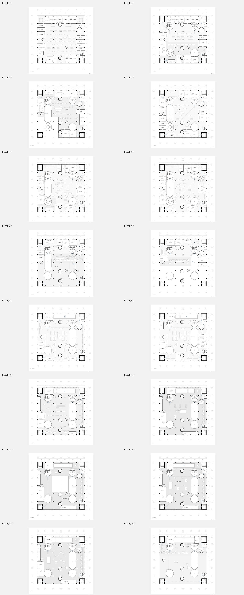

Each tile is **lossless PNG at native pixel scale**. Coordinates are from the top-left of each original image.

## FLOOR_B2

Original name: `FLOOR_B2.png`
SHA256: `4e7bd5a4446ddb4d84dd2812c6ddcb6484d84e3b30afe4c520f45291c1e95e69`
Dimensions: 2898×2976 pixels

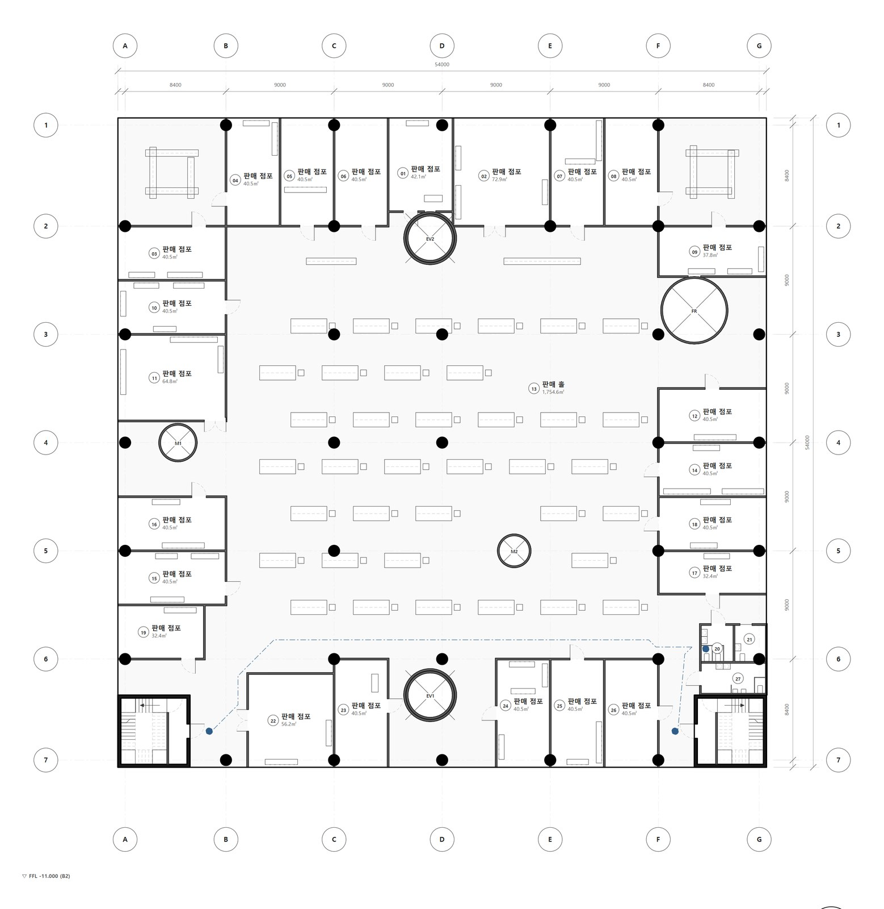

Native-resolution tiles:

- (0,0)..(800,800) [PNG](images/FLOOR_B2/tiles/x00000_y00000_w0800_h0800.png) · SHA256 `e568ab0f775d4226cdc912f88b1613f7937143740ce5a9da2e94be9c6923ac18`
- (800,0)..(1600,800) [PNG](images/FLOOR_B2/tiles/x00800_y00000_w0800_h0800.png) · SHA256 `78d7550bf4f5bb4c017c2a6f0af7ea8bb4fb53c362130b63fb0775efdda45baf`
- (1600,0)..(2400,800) [PNG](images/FLOOR_B2/tiles/x01600_y00000_w0800_h0800.png) · SHA256 `d4721019ad377bdf3d2973864b544b3050fd7fef967a7ac41819a80858f2fdf7`
- (2400,0)..(2898,800) [PNG](images/FLOOR_B2/tiles/x02400_y00000_w0498_h0800.png) · SHA256 `870afd6be9c645accc313440e1838a7ef64b476523f3a607a57827e2ddc4341a`
- (0,800)..(800,1600) [PNG](images/FLOOR_B2/tiles/x00000_y00800_w0800_h0800.png) · SHA256 `9e86029c424eb5807b60b66ba4c17de477d71b5dd914bfd05ac2167b71b64321`
- (800,800)..(1600,1600) [PNG](images/FLOOR_B2/tiles/x00800_y00800_w0800_h0800.png) · SHA256 `e83ce16bd68dbcc177e83e45a64289408293160dacefb06a362067bb50e6a9b5`
- (1600,800)..(2400,1600) [PNG](images/FLOOR_B2/tiles/x01600_y00800_w0800_h0800.png) · SHA256 `d2be1d8b30eb0c67374de9c4b01f23aff70e4081cecd93ff6cb954439d1c10bc`
- (2400,800)..(2898,1600) [PNG](images/FLOOR_B2/tiles/x02400_y00800_w0498_h0800.png) · SHA256 `92a420675305ea355fe6986faa0fbc0f22887800b41831c2ae8d514bdd011ec5`
- (0,1600)..(800,2400) [PNG](images/FLOOR_B2/tiles/x00000_y01600_w0800_h0800.png) · SHA256 `67e2cfb54b505d6993b2580381f0fdc8f9b3dcbf59d03d86f6782d723ada3060`
- (800,1600)..(1600,2400) [PNG](images/FLOOR_B2/tiles/x00800_y01600_w0800_h0800.png) · SHA256 `3dbc4c703e437b233c8f5236355f237ec562296b73b9ea21b0ff907bb79b596d`
- (1600,1600)..(2400,2400) [PNG](images/FLOOR_B2/tiles/x01600_y01600_w0800_h0800.png) · SHA256 `4df3ddceb1124a5717a21f071c62e0e6aaa999d2b055c2f03cd8f817ecddf971`
- (2400,1600)..(2898,2400) [PNG](images/FLOOR_B2/tiles/x02400_y01600_w0498_h0800.png) · SHA256 `ca55ab963025ac869a60944b3a276358d8853f57823019a1f5847276258084a3`
- (0,2400)..(800,2976) [PNG](images/FLOOR_B2/tiles/x00000_y02400_w0800_h0576.png) · SHA256 `fb3b799814c4b0641222b12c1a2e15da6f16f25bacd9d64fa785fecc25f7d393`
- (800,2400)..(1600,2976) [PNG](images/FLOOR_B2/tiles/x00800_y02400_w0800_h0576.png) · SHA256 `afdce4c5a15092017ca1e9f6d370ad0bae06d36b3df1ac90c3e752957f7ed8a1`
- (1600,2400)..(2400,2976) [PNG](images/FLOOR_B2/tiles/x01600_y02400_w0800_h0576.png) · SHA256 `7c44530c4af219bee7235078af3c4781f0f3946722617a6a4ac31ee7b1170b46`
- (2400,2400)..(2898,2976) [PNG](images/FLOOR_B2/tiles/x02400_y02400_w0498_h0576.png) · SHA256 `ab712b89ba14187559e1af1292a522c4f83df372d29ea0670f1f6cc0d5b81677`

## FLOOR_B1

Original name: `FLOOR_B1.png`
SHA256: `500ef5a5c10d5696fcd37768941f3b8995b978eb5328e745bfeb2f88fea68cdf`
Dimensions: 2898×2976 pixels

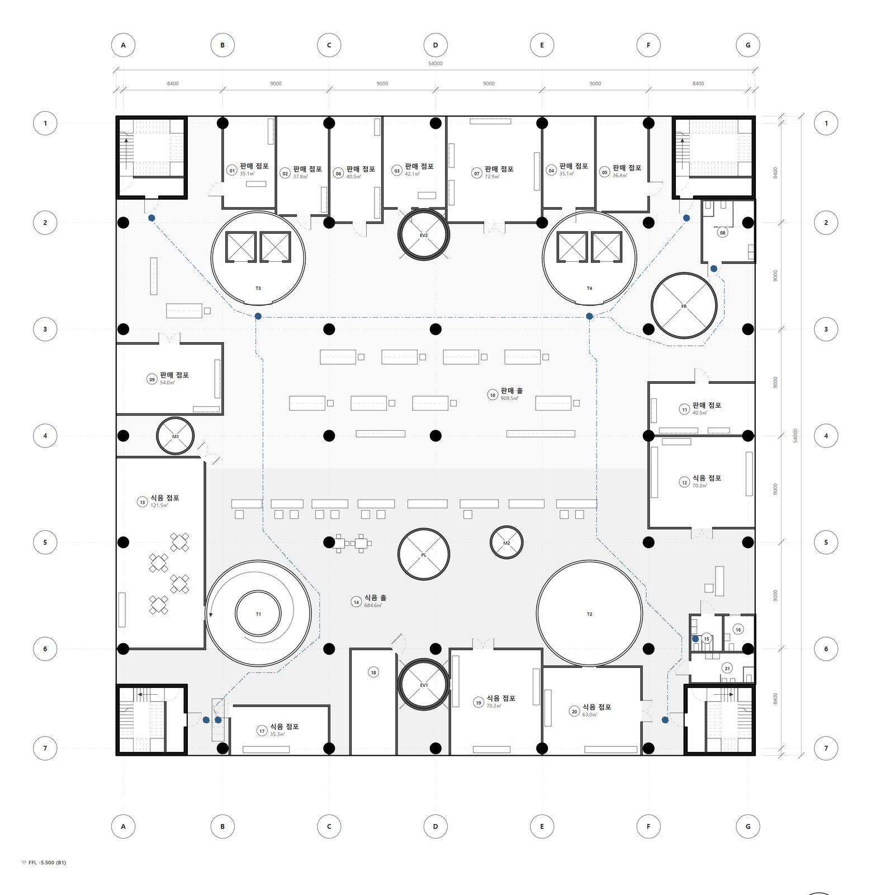

Native-resolution tiles:

- (0,0)..(800,800) [PNG](images/FLOOR_B1/tiles/x00000_y00000_w0800_h0800.png) · SHA256 `24edc7b6c8dcd2fe87313d408e39c41edce5ec187e7b802b1d3457532d3f318e`
- (800,0)..(1600,800) [PNG](images/FLOOR_B1/tiles/x00800_y00000_w0800_h0800.png) · SHA256 `14c0320393616575710bec1580f7b96a67730b534ffcc7955f6ee576ed8107d8`
- (1600,0)..(2400,800) [PNG](images/FLOOR_B1/tiles/x01600_y00000_w0800_h0800.png) · SHA256 `c05377da5e713268967d3b1d410ae783d472aa1f8daceeb8b83dfcb884487608`
- (2400,0)..(2898,800) [PNG](images/FLOOR_B1/tiles/x02400_y00000_w0498_h0800.png) · SHA256 `47f9c1ecda4a11f719b1bdcf3d55036ab8f277e8cedb6f54bf79217b4fac6c12`
- (0,800)..(800,1600) [PNG](images/FLOOR_B1/tiles/x00000_y00800_w0800_h0800.png) · SHA256 `185845b0bd613d04322c875b8f7c5cfd01923ce19f7bbddb7831914c8e2b8ca6`
- (800,800)..(1600,1600) [PNG](images/FLOOR_B1/tiles/x00800_y00800_w0800_h0800.png) · SHA256 `55322ececed17a6258a7b3b8f6bc222e0e4b03eef9dfb5b72927bf0d2ca3ca52`
- (1600,800)..(2400,1600) [PNG](images/FLOOR_B1/tiles/x01600_y00800_w0800_h0800.png) · SHA256 `3c168dcd904d2c09c649d9fa6fefe552205adb94addea0eb78615ac5b0228401`
- (2400,800)..(2898,1600) [PNG](images/FLOOR_B1/tiles/x02400_y00800_w0498_h0800.png) · SHA256 `aed7abb642be3820f3571a96bbe6573c9382c0d0d63750d1ef6244b48bf4274b`
- (0,1600)..(800,2400) [PNG](images/FLOOR_B1/tiles/x00000_y01600_w0800_h0800.png) · SHA256 `86ebb6224251826597ac5de19724c7b2a8afb00034c2e4734ac762fffa82acd8`
- (800,1600)..(1600,2400) [PNG](images/FLOOR_B1/tiles/x00800_y01600_w0800_h0800.png) · SHA256 `693157cafa7a40926563f5f271f03facdd35a328304bcf95e9fd6ccb18be9279`
- (1600,1600)..(2400,2400) [PNG](images/FLOOR_B1/tiles/x01600_y01600_w0800_h0800.png) · SHA256 `c5e9d912fab12c262b55ff408b5da81798483568cbc8aa4bff5da373a7e75c52`
- (2400,1600)..(2898,2400) [PNG](images/FLOOR_B1/tiles/x02400_y01600_w0498_h0800.png) · SHA256 `c788351556430aca02115a1cde32c84ad063688af18689fb5fec10d44f08d1ee`
- (0,2400)..(800,2976) [PNG](images/FLOOR_B1/tiles/x00000_y02400_w0800_h0576.png) · SHA256 `17a4cf08436311a58033c6aed0d887653002eaaf61625be202124b824436e30e`
- (800,2400)..(1600,2976) [PNG](images/FLOOR_B1/tiles/x00800_y02400_w0800_h0576.png) · SHA256 `93dae74c19d7d1ea869c784a4b98e135d7c5cb7ee26edd2d4e2901b349808487`
- (1600,2400)..(2400,2976) [PNG](images/FLOOR_B1/tiles/x01600_y02400_w0800_h0576.png) · SHA256 `6ba424777912c680e407345d4e1eb0ac99fc808dd5b1c97e0bca05d9f07542ee`
- (2400,2400)..(2898,2976) [PNG](images/FLOOR_B1/tiles/x02400_y02400_w0498_h0576.png) · SHA256 `1362bf81e317093a33ba8acb016cf81d4f570fdcda605f6f45fa70a021281fca`

## FLOOR_2F

Original name: `FLOOR_2F.png`
SHA256: `b863cad943a1b918bc0f55ce6aba6697c79dbb1ee26664d3cfc6ad4a55ec85cd`
Dimensions: 2898×2976 pixels

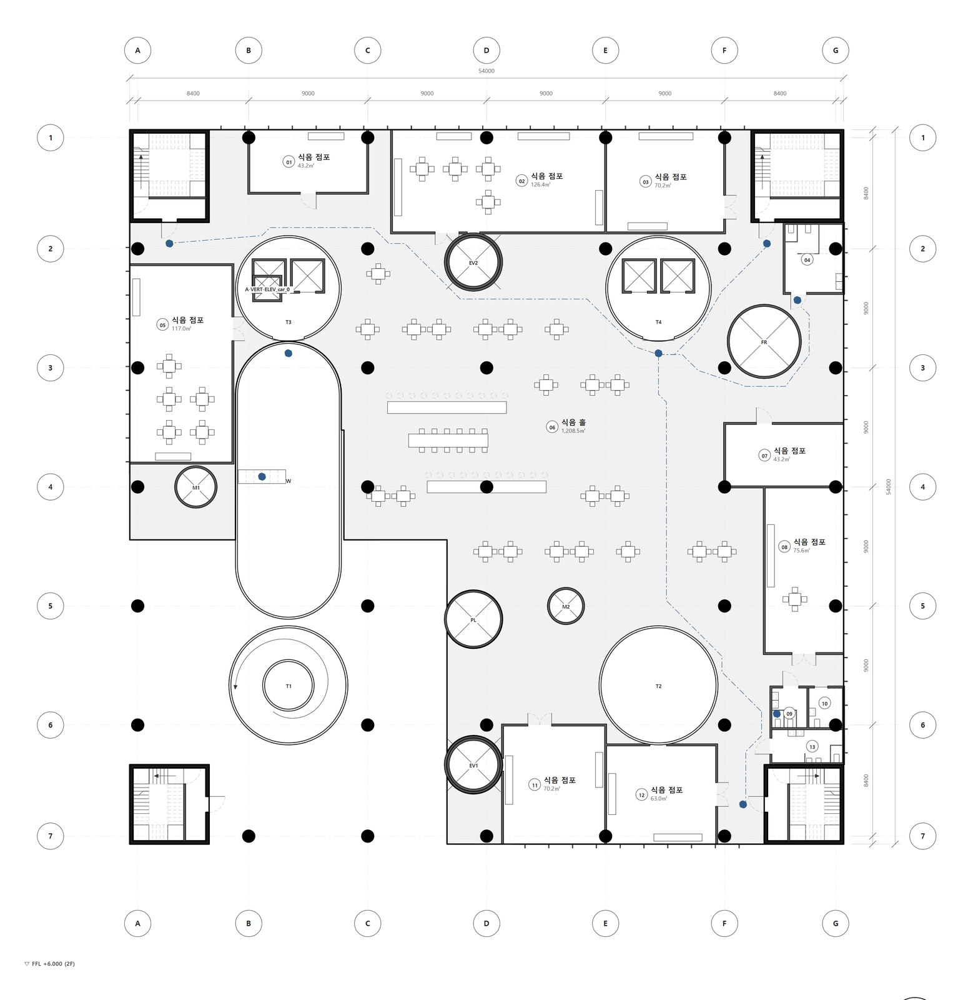

Native-resolution tiles:

- (0,0)..(800,800) [PNG](images/FLOOR_2F/tiles/x00000_y00000_w0800_h0800.png) · SHA256 `b2759d91e5a1980968223a952f3b9cddd4325ec0dfb136049a80caa97efe96c5`
- (800,0)..(1600,800) [PNG](images/FLOOR_2F/tiles/x00800_y00000_w0800_h0800.png) · SHA256 `52160142af022dc3ba64456545c4f7cffbfdfb24ef5140ebede6e18980c4ac25`
- (1600,0)..(2400,800) [PNG](images/FLOOR_2F/tiles/x01600_y00000_w0800_h0800.png) · SHA256 `77e33f3bc949d22891b195ec1048f7b625f5c7cffb70a3f9496f5a982747969c`
- (2400,0)..(2898,800) [PNG](images/FLOOR_2F/tiles/x02400_y00000_w0498_h0800.png) · SHA256 `11a2485eb20f05d73ecd5a508a43c6a72abdea80d87e66dacbe65fe09473bcd6`
- (0,800)..(800,1600) [PNG](images/FLOOR_2F/tiles/x00000_y00800_w0800_h0800.png) · SHA256 `058d5ea99e3e15b9f9c0a26522b13bd7964028307bf724f0d99b0a0302142a8f`
- (800,800)..(1600,1600) [PNG](images/FLOOR_2F/tiles/x00800_y00800_w0800_h0800.png) · SHA256 `a4909c7bd49c7e9762f9e1528f22a11adee08f620be9e3c98b3d62f25e663902`
- (1600,800)..(2400,1600) [PNG](images/FLOOR_2F/tiles/x01600_y00800_w0800_h0800.png) · SHA256 `bd97e1820e5fbd3572ee98db91c5f93050ff655f86579f0f2f30bac51c96645b`
- (2400,800)..(2898,1600) [PNG](images/FLOOR_2F/tiles/x02400_y00800_w0498_h0800.png) · SHA256 `eab8a39396eeacd15ac4e9ab44cc13178110f1e29d4af839ac70bbc6e9d809f3`
- (0,1600)..(800,2400) [PNG](images/FLOOR_2F/tiles/x00000_y01600_w0800_h0800.png) · SHA256 `7db4ec1707f0a08d5112edb725e3423a9275349ad74bf9688f80861e0289ec14`
- (800,1600)..(1600,2400) [PNG](images/FLOOR_2F/tiles/x00800_y01600_w0800_h0800.png) · SHA256 `9bbeb437616fe13f2790398f9092259d7c913106262e700a52feff8871cc7fc3`
- (1600,1600)..(2400,2400) [PNG](images/FLOOR_2F/tiles/x01600_y01600_w0800_h0800.png) · SHA256 `67a65c01b97f02ef2f1be541d042b6ea2b5647d29a9c994286da5463566064f6`
- (2400,1600)..(2898,2400) [PNG](images/FLOOR_2F/tiles/x02400_y01600_w0498_h0800.png) · SHA256 `6eca2fe5140a0b9f360575043ee357b6dfef0f8ebdab11e5bc6f95b75389449d`
- (0,2400)..(800,2976) [PNG](images/FLOOR_2F/tiles/x00000_y02400_w0800_h0576.png) · SHA256 `8daaa56076309edc60a0926cebdf054f63429d7e775bef4b123057a3ed2ecd5a`
- (800,2400)..(1600,2976) [PNG](images/FLOOR_2F/tiles/x00800_y02400_w0800_h0576.png) · SHA256 `e8995ed4f2d11fd6d444dea3bb0f7d05b0063be557410598e069a45f53455683`
- (1600,2400)..(2400,2976) [PNG](images/FLOOR_2F/tiles/x01600_y02400_w0800_h0576.png) · SHA256 `fa67f36c6d080e7f9b82d4f570303224305735996d1ef51ee9fe7ee6f8fac6d2`
- (2400,2400)..(2898,2976) [PNG](images/FLOOR_2F/tiles/x02400_y02400_w0498_h0576.png) · SHA256 `1362bf81e317093a33ba8acb016cf81d4f570fdcda605f6f45fa70a021281fca`

## FLOOR_3F

Original name: `FLOOR_3F.png`
SHA256: `ddde102d146cf2a2e5942b71ca19e061827eb9191107848df991cd51d1337c06`
Dimensions: 2898×2976 pixels

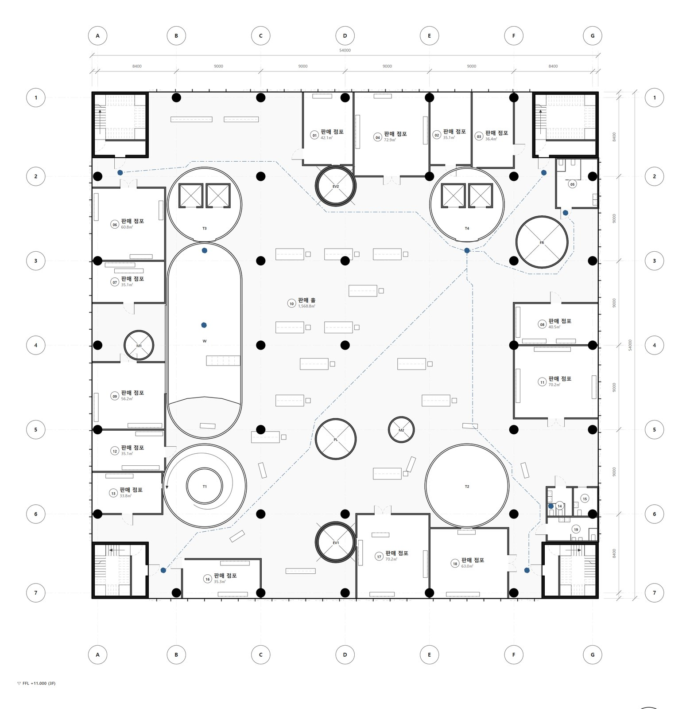

Native-resolution tiles:

- (0,0)..(800,800) [PNG](images/FLOOR_3F/tiles/x00000_y00000_w0800_h0800.png) · SHA256 `7d4207617e96c0fd1b3425c47ba597935a8f62f10ec25636a28e2a56a372a0b6`
- (800,0)..(1600,800) [PNG](images/FLOOR_3F/tiles/x00800_y00000_w0800_h0800.png) · SHA256 `c03693e7b2c511d0b66e40731802bd99bb6bcbe684e0b19c92aeefb49851f5e1`
- (1600,0)..(2400,800) [PNG](images/FLOOR_3F/tiles/x01600_y00000_w0800_h0800.png) · SHA256 `9af151ed0c57519c15840e22c19b0bb63953dad0066ff652b497c502a55d872c`
- (2400,0)..(2898,800) [PNG](images/FLOOR_3F/tiles/x02400_y00000_w0498_h0800.png) · SHA256 `1dd85e2b3b8bab10e30984ac720f21aed2b8da165101b6fff0bee14c1fb18e2c`
- (0,800)..(800,1600) [PNG](images/FLOOR_3F/tiles/x00000_y00800_w0800_h0800.png) · SHA256 `198ed88af4316bfb1de8d73ea47bd053176e0546293dda0bef9d6f83cce26649`
- (800,800)..(1600,1600) [PNG](images/FLOOR_3F/tiles/x00800_y00800_w0800_h0800.png) · SHA256 `e91a7083544bee67e585172ff8ca7fc197f56c50d8908dd6561ea013d797dab3`
- (1600,800)..(2400,1600) [PNG](images/FLOOR_3F/tiles/x01600_y00800_w0800_h0800.png) · SHA256 `8a01bae0b82a9fb6600428ad2f9e9bba370c16f333de9a148c28b26075ca448e`
- (2400,800)..(2898,1600) [PNG](images/FLOOR_3F/tiles/x02400_y00800_w0498_h0800.png) · SHA256 `bb16c68f858c1fa6bd8f14e87042b76eb341e5e4aa5045807f96d8d472fbb7cd`
- (0,1600)..(800,2400) [PNG](images/FLOOR_3F/tiles/x00000_y01600_w0800_h0800.png) · SHA256 `c6288c804ce57d99c6dda1756de9a55c39924eafc1cdb362c9c27c441e2df3e2`
- (800,1600)..(1600,2400) [PNG](images/FLOOR_3F/tiles/x00800_y01600_w0800_h0800.png) · SHA256 `ec42ded552951b87645640b0fe5b568e9c6ac3e6fac726fe5be7a51256ae2173`
- (1600,1600)..(2400,2400) [PNG](images/FLOOR_3F/tiles/x01600_y01600_w0800_h0800.png) · SHA256 `c2a3a1992825091fea167cbead01e12eedb93836593b1e1a36aca782111ee3c6`
- (2400,1600)..(2898,2400) [PNG](images/FLOOR_3F/tiles/x02400_y01600_w0498_h0800.png) · SHA256 `f03424c8ae3804fc0852b9a09ce0420e84ea740a148ad92ae9b8a3d3469c7956`
- (0,2400)..(800,2976) [PNG](images/FLOOR_3F/tiles/x00000_y02400_w0800_h0576.png) · SHA256 `ae8862ac452d004545c9d689a47ba6da7661bbccd9a4dc7be675bbbe3d436e94`
- (800,2400)..(1600,2976) [PNG](images/FLOOR_3F/tiles/x00800_y02400_w0800_h0576.png) · SHA256 `382e2fb41b78c95f6616abe04b96f992231cf9a218890ada186b4a10269a4a7e`
- (1600,2400)..(2400,2976) [PNG](images/FLOOR_3F/tiles/x01600_y02400_w0800_h0576.png) · SHA256 `0ee87ae309c478ec623f14dcd16b22f522bcf098893d21423387ea8df867969f`
- (2400,2400)..(2898,2976) [PNG](images/FLOOR_3F/tiles/x02400_y02400_w0498_h0576.png) · SHA256 `1362bf81e317093a33ba8acb016cf81d4f570fdcda605f6f45fa70a021281fca`

## FLOOR_4F

Original name: `FLOOR_4F.png`
SHA256: `274caa2043cee8602adefec0eec584175dc96525c6f91bc39d0d5bb9bf6f40a4`
Dimensions: 2898×2976 pixels

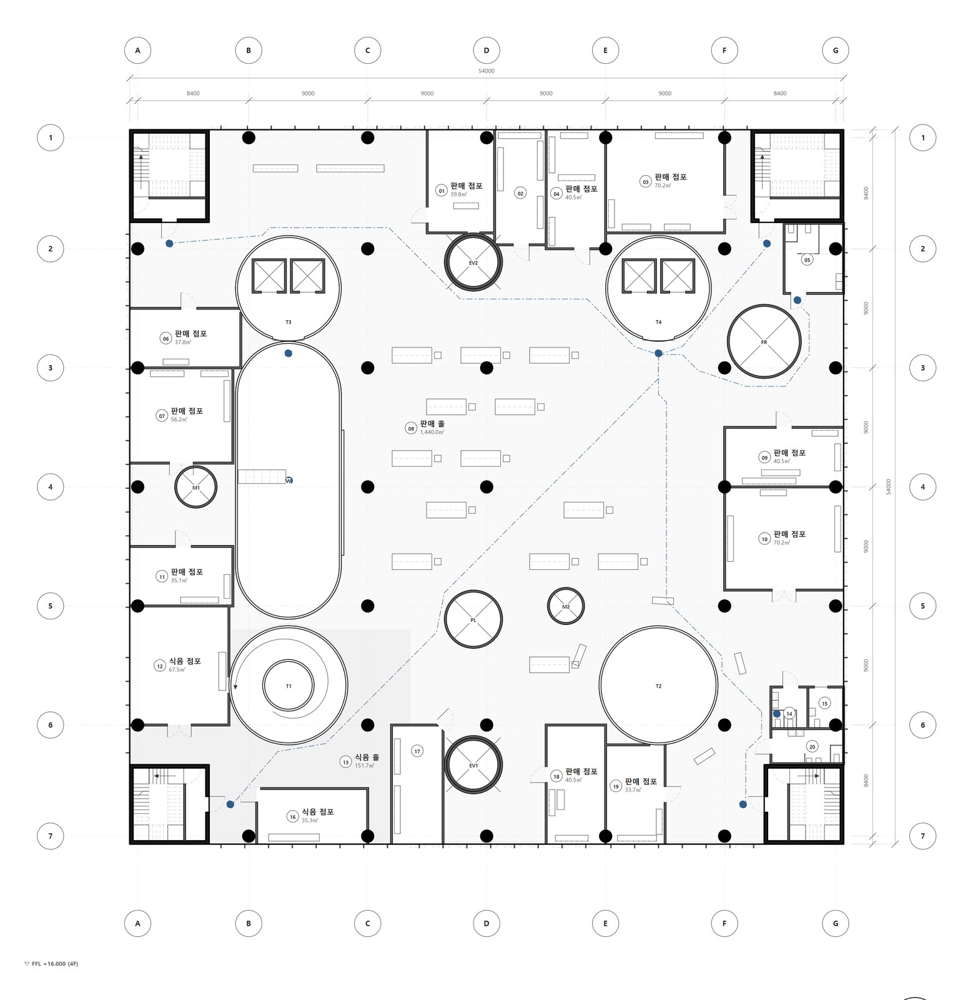

Native-resolution tiles:

- (0,0)..(800,800) [PNG](images/FLOOR_4F/tiles/x00000_y00000_w0800_h0800.png) · SHA256 `aacac400c23deafd1ecbc504596c56d0814dff5fd67b581d0913aacda914405f`
- (800,0)..(1600,800) [PNG](images/FLOOR_4F/tiles/x00800_y00000_w0800_h0800.png) · SHA256 `544b3ddcd9b65cbbcac801aad050e6b132ecccbdb7fbe9abf82dfcead191640e`
- (1600,0)..(2400,800) [PNG](images/FLOOR_4F/tiles/x01600_y00000_w0800_h0800.png) · SHA256 `e95dbbd6e181abce6fc9b132ff679d0dd18c306de40d7a386010b4504bc65805`
- (2400,0)..(2898,800) [PNG](images/FLOOR_4F/tiles/x02400_y00000_w0498_h0800.png) · SHA256 `2b12b72da0b4f694d6c78b2d01a64b97d14b4ee7aaa0b3bc2a9861c368597c10`
- (0,800)..(800,1600) [PNG](images/FLOOR_4F/tiles/x00000_y00800_w0800_h0800.png) · SHA256 `d88b9e68b0edd4eb747f854dde41a8a34073e447bbe63d4e9587ae1cee0e0c5b`
- (800,800)..(1600,1600) [PNG](images/FLOOR_4F/tiles/x00800_y00800_w0800_h0800.png) · SHA256 `e94855e57e3b8dfe97facbb9704be1d218c052ce55965318dd298aef9ece146c`
- (1600,800)..(2400,1600) [PNG](images/FLOOR_4F/tiles/x01600_y00800_w0800_h0800.png) · SHA256 `534e9decae30e5bf956776f60b0e118e5ff623eba35f99a8bbf432419c09dbd2`
- (2400,800)..(2898,1600) [PNG](images/FLOOR_4F/tiles/x02400_y00800_w0498_h0800.png) · SHA256 `11146b00a150e4b40b1e905dae42b1e8c35a99577201edf62c8c631da7f3f9a6`
- (0,1600)..(800,2400) [PNG](images/FLOOR_4F/tiles/x00000_y01600_w0800_h0800.png) · SHA256 `b2012e956b15a3d2ce02dbb0837fea427188373f20b90115a977766e133aa03f`
- (800,1600)..(1600,2400) [PNG](images/FLOOR_4F/tiles/x00800_y01600_w0800_h0800.png) · SHA256 `7dd35b7f196eaf2010ce96f07fd36917c6fdcb86abede4ef61526f989a464fee`
- (1600,1600)..(2400,2400) [PNG](images/FLOOR_4F/tiles/x01600_y01600_w0800_h0800.png) · SHA256 `b36ce03c77727a35db0a6f9d3f51596dcd72ae77aa933e513714d7bfdee73c89`
- (2400,1600)..(2898,2400) [PNG](images/FLOOR_4F/tiles/x02400_y01600_w0498_h0800.png) · SHA256 `4401fa6ced18878b0bbd9bdbfcece6974f5238f9fab6630e953b2e94f2282764`
- (0,2400)..(800,2976) [PNG](images/FLOOR_4F/tiles/x00000_y02400_w0800_h0576.png) · SHA256 `616bfdac930e994e63c3c3c83a285ac89498ff4736bc8995932c40fc8ad34b63`
- (800,2400)..(1600,2976) [PNG](images/FLOOR_4F/tiles/x00800_y02400_w0800_h0576.png) · SHA256 `527e02295aea14d8e6f3dc366d28863c85f3ec1e67292258c8de99e630efecaa`
- (1600,2400)..(2400,2976) [PNG](images/FLOOR_4F/tiles/x01600_y02400_w0800_h0576.png) · SHA256 `4e9aa5ed5ed532da16a623536490892db75d6c868824773af1728cfc3bf0512b`
- (2400,2400)..(2898,2976) [PNG](images/FLOOR_4F/tiles/x02400_y02400_w0498_h0576.png) · SHA256 `1362bf81e317093a33ba8acb016cf81d4f570fdcda605f6f45fa70a021281fca`

## FLOOR_5F

Original name: `FLOOR_5F.png`
SHA256: `7be0f5c2b7b1fd6df890c4fdb4cbb4bfe1fbad1829e68474d2e1f72e46993acc`
Dimensions: 2898×2976 pixels

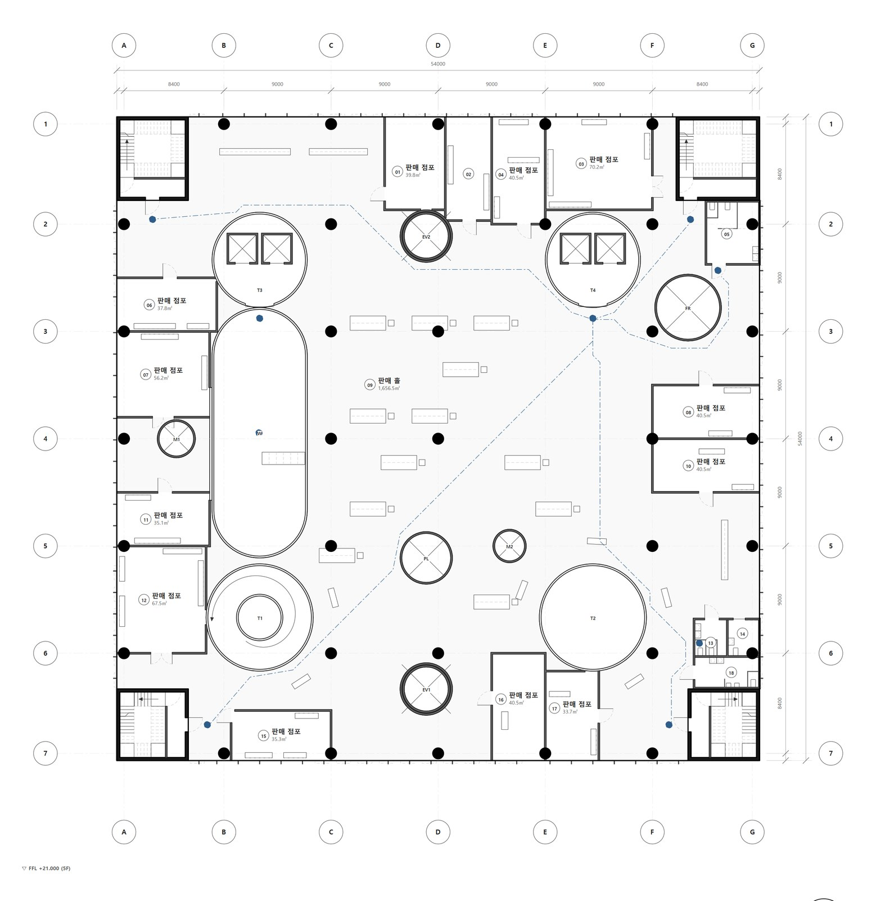

Native-resolution tiles:

- (0,0)..(800,800) [PNG](images/FLOOR_5F/tiles/x00000_y00000_w0800_h0800.png) · SHA256 `2ae5c4aeec36102167ebffc12591b141b4a79d253c3dbdf05e0ac075a6f3473e`
- (800,0)..(1600,800) [PNG](images/FLOOR_5F/tiles/x00800_y00000_w0800_h0800.png) · SHA256 `c647e2132c1faf335f6591f9816975d7bab61f61764bb1548b2261e89ef2e3ea`
- (1600,0)..(2400,800) [PNG](images/FLOOR_5F/tiles/x01600_y00000_w0800_h0800.png) · SHA256 `707c8d8caadaef653b01d361387be692bef0eb0c3c3810e0fb922136aac339c5`
- (2400,0)..(2898,800) [PNG](images/FLOOR_5F/tiles/x02400_y00000_w0498_h0800.png) · SHA256 `8a66d68facf514b44ec4d0e94865c09e04609271fae3518abf4f1ceddb92194a`
- (0,800)..(800,1600) [PNG](images/FLOOR_5F/tiles/x00000_y00800_w0800_h0800.png) · SHA256 `0ce0d0d9f617c9d2b50a2d0845740b9c362f522ce401216d1c2fd73fe5c61293`
- (800,800)..(1600,1600) [PNG](images/FLOOR_5F/tiles/x00800_y00800_w0800_h0800.png) · SHA256 `2d7a5480bdf3ecf7b5ed8815d90893b5eff4d64f6c50f3f76ec6ac906df6e063`
- (1600,800)..(2400,1600) [PNG](images/FLOOR_5F/tiles/x01600_y00800_w0800_h0800.png) · SHA256 `803a59029a5c9df0452e0e687627e169f42db5975b750b392a0177bebbb81009`
- (2400,800)..(2898,1600) [PNG](images/FLOOR_5F/tiles/x02400_y00800_w0498_h0800.png) · SHA256 `1967e59c2c1325c936422a3cb810d31a35ad47c08a40eb4689d537e671cb49b0`
- (0,1600)..(800,2400) [PNG](images/FLOOR_5F/tiles/x00000_y01600_w0800_h0800.png) · SHA256 `9a20f9086b7ef00ee56e580c50e1bec1ce9a221ee4cffaf36e26fca01ec02604`
- (800,1600)..(1600,2400) [PNG](images/FLOOR_5F/tiles/x00800_y01600_w0800_h0800.png) · SHA256 `4794ef1272fb524e99f4d243df140bef425f5b1e66efaf09ef4b72943a4b75e3`
- (1600,1600)..(2400,2400) [PNG](images/FLOOR_5F/tiles/x01600_y01600_w0800_h0800.png) · SHA256 `84020aecbbc3519246ec12335ea1a091310aacf745b4ab7385ae0203c742f951`
- (2400,1600)..(2898,2400) [PNG](images/FLOOR_5F/tiles/x02400_y01600_w0498_h0800.png) · SHA256 `784b55fdff48326d58b5982fcf525af62b494fe7ba2392d7ca5ab0bcd3aa05c5`
- (0,2400)..(800,2976) [PNG](images/FLOOR_5F/tiles/x00000_y02400_w0800_h0576.png) · SHA256 `187bbc4f999b71fb6fcf3b4569813bc637a21951ae5800276480a600cc448410`
- (800,2400)..(1600,2976) [PNG](images/FLOOR_5F/tiles/x00800_y02400_w0800_h0576.png) · SHA256 `9bbf4efa9b6ce7583eb63544b19fd7cc1718a2dd259e7ab014b7d29602ccf684`
- (1600,2400)..(2400,2976) [PNG](images/FLOOR_5F/tiles/x01600_y02400_w0800_h0576.png) · SHA256 `bd43e9f0bce4b0e089d3a91266ce8cd79d0337a8961ff4c6268728bce22f5cfe`
- (2400,2400)..(2898,2976) [PNG](images/FLOOR_5F/tiles/x02400_y02400_w0498_h0576.png) · SHA256 `1362bf81e317093a33ba8acb016cf81d4f570fdcda605f6f45fa70a021281fca`

## FLOOR_6F

Original name: `FLOOR_6F.png`
SHA256: `fd77e7aa6c7a417f8b55cb5b9f87283f3982123e4aeb5d42b7cf8d615c925b1e`
Dimensions: 2898×2976 pixels

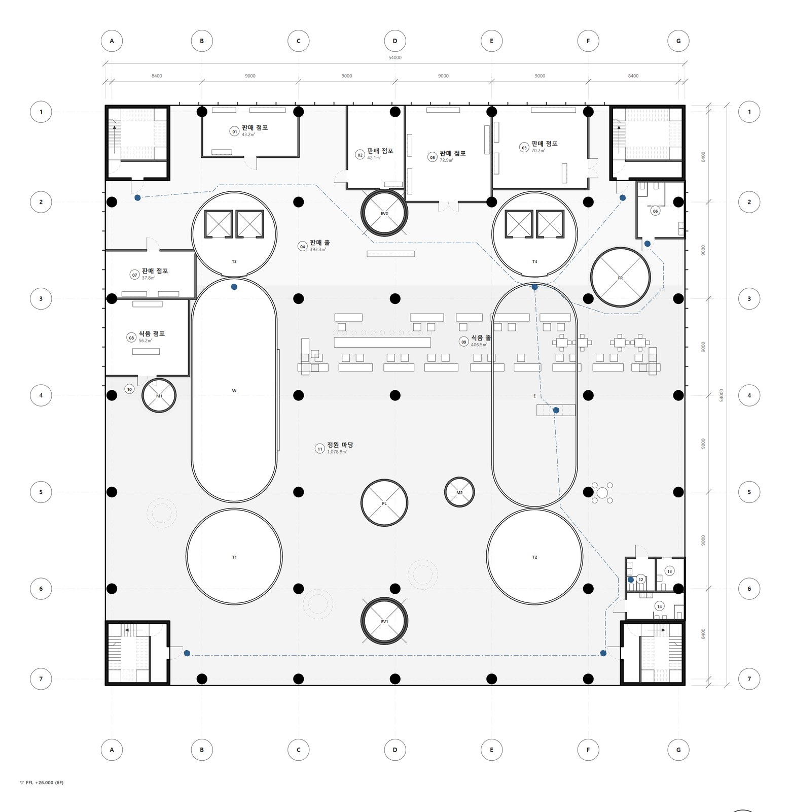

Native-resolution tiles:

- (0,0)..(800,800) [PNG](images/FLOOR_6F/tiles/x00000_y00000_w0800_h0800.png) · SHA256 `e6840ee7f45c7d13d95ab163666592ca41c636904ea120a6f4e585fd34dbdd22`
- (800,0)..(1600,800) [PNG](images/FLOOR_6F/tiles/x00800_y00000_w0800_h0800.png) · SHA256 `a383865362f8a7201311b268d704adb8410cc44dc093b00f2107277f86391eea`
- (1600,0)..(2400,800) [PNG](images/FLOOR_6F/tiles/x01600_y00000_w0800_h0800.png) · SHA256 `9e6f4a0c9b64b116152e1552fdcfd79b1d9d4b050783f295d2c25cabcf4e7150`
- (2400,0)..(2898,800) [PNG](images/FLOOR_6F/tiles/x02400_y00000_w0498_h0800.png) · SHA256 `10c03a89d1b8a50700827ac1d1c1405c06f0416d0e5215bd51fd1a591a6740ed`
- (0,800)..(800,1600) [PNG](images/FLOOR_6F/tiles/x00000_y00800_w0800_h0800.png) · SHA256 `46b4554ff21c68ab36dccc4ae866d5dfb2216d3ac5065f580c82c155c17c200a`
- (800,800)..(1600,1600) [PNG](images/FLOOR_6F/tiles/x00800_y00800_w0800_h0800.png) · SHA256 `d7c12c5ee8602cbc2a90f32de4fb362fb27210a89ad258c2558fe597f4a48f0b`
- (1600,800)..(2400,1600) [PNG](images/FLOOR_6F/tiles/x01600_y00800_w0800_h0800.png) · SHA256 `8d360eb05dfd32d80716103fd10ebd97069636524f703aaafa2306edc92706b6`
- (2400,800)..(2898,1600) [PNG](images/FLOOR_6F/tiles/x02400_y00800_w0498_h0800.png) · SHA256 `dbd302eaeea2c92cbe17ef6d758054a450a758e55b8f8779a3475291479ad1a7`
- (0,1600)..(800,2400) [PNG](images/FLOOR_6F/tiles/x00000_y01600_w0800_h0800.png) · SHA256 `381baecedf19d130966ab8584c4014b6a2f1eae22733c64bcc16017bef1f777d`
- (800,1600)..(1600,2400) [PNG](images/FLOOR_6F/tiles/x00800_y01600_w0800_h0800.png) · SHA256 `cf86848fdb1bd098ab8b25e7b42e31d7cf73605a40c8d573fd9a6b0186127f2e`
- (1600,1600)..(2400,2400) [PNG](images/FLOOR_6F/tiles/x01600_y01600_w0800_h0800.png) · SHA256 `71899f5084d2963434f2f51fd5259a9256fb69687554e7485d2039eee46e13eb`
- (2400,1600)..(2898,2400) [PNG](images/FLOOR_6F/tiles/x02400_y01600_w0498_h0800.png) · SHA256 `c07216f7459c87274819b59486d9b650fe2bd29b5a27a650000fb9e06bca2ef8`
- (0,2400)..(800,2976) [PNG](images/FLOOR_6F/tiles/x00000_y02400_w0800_h0576.png) · SHA256 `a9deb877faa9c4308b511923e41061f1a609551fa78ccd7f2b77371a9b059410`
- (800,2400)..(1600,2976) [PNG](images/FLOOR_6F/tiles/x00800_y02400_w0800_h0576.png) · SHA256 `2b4f4889aa7afe5d28c69a948eeeea77115d47e42e20569c315a6a83db103c10`
- (1600,2400)..(2400,2976) [PNG](images/FLOOR_6F/tiles/x01600_y02400_w0800_h0576.png) · SHA256 `73d76d2e458323e32885fcd7a14803ae26678f6963a2edfa8572bdea6fb144a5`
- (2400,2400)..(2898,2976) [PNG](images/FLOOR_6F/tiles/x02400_y02400_w0498_h0576.png) · SHA256 `1362bf81e317093a33ba8acb016cf81d4f570fdcda605f6f45fa70a021281fca`

## FLOOR_7F

Original name: `FLOOR_7F.png`
SHA256: `8c31abaa6024732b6f35d407ad9a2ff0b392254ab0bc5e2e5587affd84284eea`
Dimensions: 2898×2976 pixels

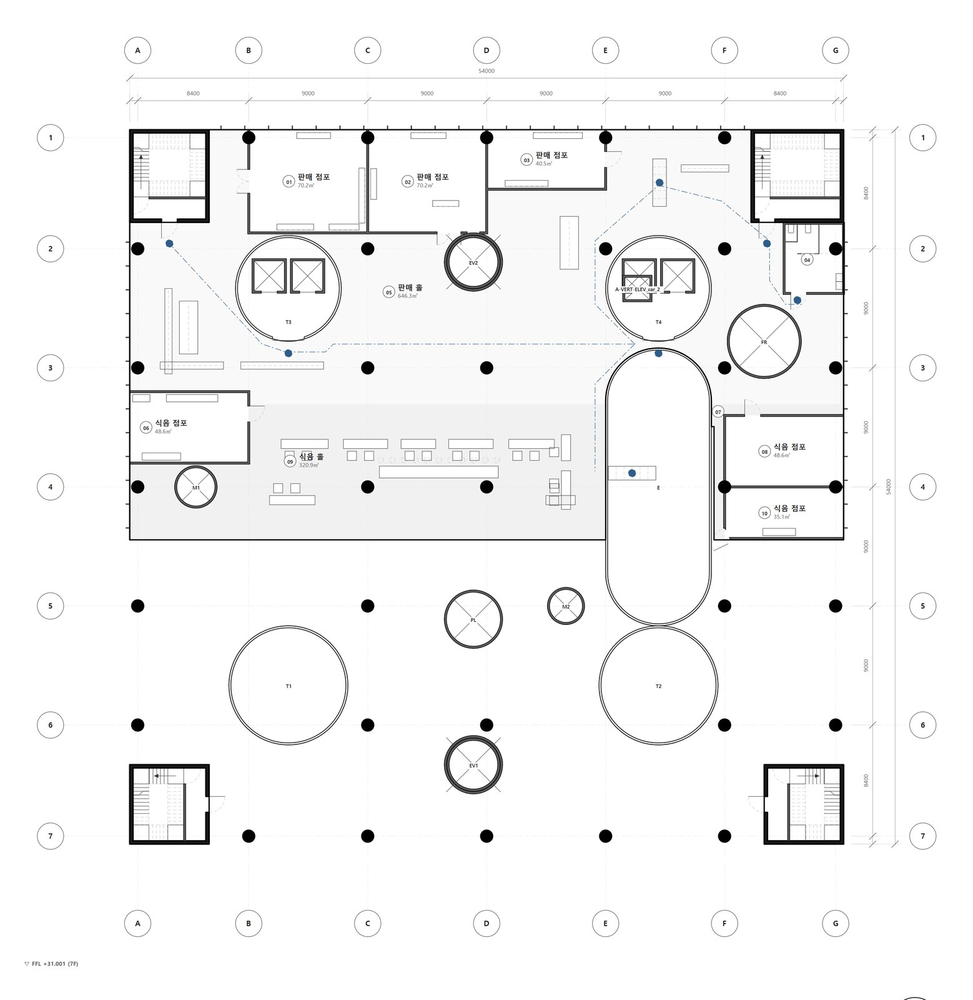

Native-resolution tiles:

- (0,0)..(800,800) [PNG](images/FLOOR_7F/tiles/x00000_y00000_w0800_h0800.png) · SHA256 `0a0578f955ce41af687112511401d537e4f24c1a7634bf82ef074ecb11c55f1e`
- (800,0)..(1600,800) [PNG](images/FLOOR_7F/tiles/x00800_y00000_w0800_h0800.png) · SHA256 `6c959638f5f58bbf6dbeced9b3c6d5e60ecfe2acb3cc6b2d6ec3ac200d4e65d4`
- (1600,0)..(2400,800) [PNG](images/FLOOR_7F/tiles/x01600_y00000_w0800_h0800.png) · SHA256 `b58ee31244644f405b4615784bedea80e8589720a38dab7b4541ebf236a87d28`
- (2400,0)..(2898,800) [PNG](images/FLOOR_7F/tiles/x02400_y00000_w0498_h0800.png) · SHA256 `16e6e988c06fff8ef820f9dccf31f37ea4712f6ab677bab8984b88ea98ec4f65`
- (0,800)..(800,1600) [PNG](images/FLOOR_7F/tiles/x00000_y00800_w0800_h0800.png) · SHA256 `164b68306c6bb5b1f85a3cfe4a30abfee3d6c6231d211a5228723efd6e952f65`
- (800,800)..(1600,1600) [PNG](images/FLOOR_7F/tiles/x00800_y00800_w0800_h0800.png) · SHA256 `6c7331492d420668091fb7be5f18833d87c44b7a105105d9af8f53a051843f7c`
- (1600,800)..(2400,1600) [PNG](images/FLOOR_7F/tiles/x01600_y00800_w0800_h0800.png) · SHA256 `3edc09a3e7c4e4b12f0c35344b9e2feab8464e30616cc3bb741d83d601a79c7c`
- (2400,800)..(2898,1600) [PNG](images/FLOOR_7F/tiles/x02400_y00800_w0498_h0800.png) · SHA256 `0d2e68647c1c7f913f595bfc46d47040cfb000ad225798a5fb711da148e04bae`
- (0,1600)..(800,2400) [PNG](images/FLOOR_7F/tiles/x00000_y01600_w0800_h0800.png) · SHA256 `e44edbbd1d521612427f907fa9d791bbfe0a3ec2f7ac87f86491e1dc3de5e573`
- (800,1600)..(1600,2400) [PNG](images/FLOOR_7F/tiles/x00800_y01600_w0800_h0800.png) · SHA256 `299c31cd305c4513975d6f20f5c9f6b6438a6839c0f6c4832cf76b25afa012ca`
- (1600,1600)..(2400,2400) [PNG](images/FLOOR_7F/tiles/x01600_y01600_w0800_h0800.png) · SHA256 `df7a16abfcc5cecdeebc94903dfa285d73914892f64fa33fb70c6acbf6597a3e`
- (2400,1600)..(2898,2400) [PNG](images/FLOOR_7F/tiles/x02400_y01600_w0498_h0800.png) · SHA256 `120bb322d594bbaa4c6aeffd4987a8fc135ae488d5d12b54cfab65a970ed4534`
- (0,2400)..(800,2976) [PNG](images/FLOOR_7F/tiles/x00000_y02400_w0800_h0576.png) · SHA256 `f11b66d7a6599f2d14e50b0336d2e9b49e07e3d9777512881ec2d518ea14fb07`
- (800,2400)..(1600,2976) [PNG](images/FLOOR_7F/tiles/x00800_y02400_w0800_h0576.png) · SHA256 `f664736860c920049e874ccddbfde24b1836aed5d195fc2a4dd612c036a9ebfb`
- (1600,2400)..(2400,2976) [PNG](images/FLOOR_7F/tiles/x01600_y02400_w0800_h0576.png) · SHA256 `d1954aec64f4e4019801c461d51300411a07f0552868dc299a644848b151c732`
- (2400,2400)..(2898,2976) [PNG](images/FLOOR_7F/tiles/x02400_y02400_w0498_h0576.png) · SHA256 `ddd275d9edf0e921b569c2dbc5835f0dbaf279e38cc28646f27f091116448c02`

## FLOOR_8F

Original name: `FLOOR_8F.png`
SHA256: `5f62ab8b6761c2fb18ad1dd302bdef41e4dee8bca6272b2b2bffdb416ef381b7`
Dimensions: 2898×2976 pixels

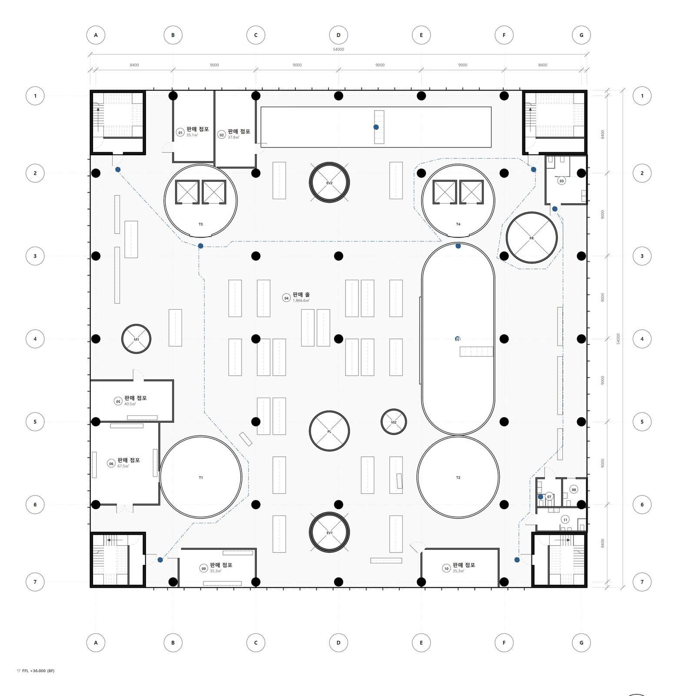

Native-resolution tiles:

- (0,0)..(800,800) [PNG](images/FLOOR_8F/tiles/x00000_y00000_w0800_h0800.png) · SHA256 `d5fa1c66808202f1cd95e04ea4e0b79b16b7c3993e20be9b3ea548dcc9db8f0e`
- (800,0)..(1600,800) [PNG](images/FLOOR_8F/tiles/x00800_y00000_w0800_h0800.png) · SHA256 `6a2245099d9ac1b4a0c5d89a02b804b3f31a07ea4948130a5832246b260128db`
- (1600,0)..(2400,800) [PNG](images/FLOOR_8F/tiles/x01600_y00000_w0800_h0800.png) · SHA256 `40bf633f0e2ba960547f6cceea57a13241934dee7a45d6a58378f419d775066e`
- (2400,0)..(2898,800) [PNG](images/FLOOR_8F/tiles/x02400_y00000_w0498_h0800.png) · SHA256 `8ac58f393f3b020fec2f1b97aaa8879ab5e2a9b9775d0aea1176e74e7cb59826`
- (0,800)..(800,1600) [PNG](images/FLOOR_8F/tiles/x00000_y00800_w0800_h0800.png) · SHA256 `dbda7c1527585a40f313943c5c12c22f413134bc143ac2831e396f824a730f0a`
- (800,800)..(1600,1600) [PNG](images/FLOOR_8F/tiles/x00800_y00800_w0800_h0800.png) · SHA256 `7e3488ee912ff9c6f02b0d03f9b778141337582c401eabfeebdd6f2871286253`
- (1600,800)..(2400,1600) [PNG](images/FLOOR_8F/tiles/x01600_y00800_w0800_h0800.png) · SHA256 `9047c1d99b8b319723855b6d50c37746fbdd88dbfe5482c83a706775c075e587`
- (2400,800)..(2898,1600) [PNG](images/FLOOR_8F/tiles/x02400_y00800_w0498_h0800.png) · SHA256 `e4cd377171dc3ce175fa9c5d929171647524ffd1c3dc77ecf372e06794c909d3`
- (0,1600)..(800,2400) [PNG](images/FLOOR_8F/tiles/x00000_y01600_w0800_h0800.png) · SHA256 `a25227cd1f87f1000616c4918cf1004286029ca5c273158dfeac1576b76aefab`
- (800,1600)..(1600,2400) [PNG](images/FLOOR_8F/tiles/x00800_y01600_w0800_h0800.png) · SHA256 `2a8f23c9c57d01c8ddac37459253fcff3779b02e6668fbb4e01d06fbc42e83b6`
- (1600,1600)..(2400,2400) [PNG](images/FLOOR_8F/tiles/x01600_y01600_w0800_h0800.png) · SHA256 `5a1866a5b5aac3fbd2182fb5ad0e7539ab8dbc6a5eb342436e3af6faff5862a4`
- (2400,1600)..(2898,2400) [PNG](images/FLOOR_8F/tiles/x02400_y01600_w0498_h0800.png) · SHA256 `e8806dde8fd699462840996a04749d27acd348b1a5d0012b312df082f470566e`
- (0,2400)..(800,2976) [PNG](images/FLOOR_8F/tiles/x00000_y02400_w0800_h0576.png) · SHA256 `e0cb50e7ee5eabc12f1b524b68ad03a4e6181f08a64ac8fc6b665f342ca1f5ad`
- (800,2400)..(1600,2976) [PNG](images/FLOOR_8F/tiles/x00800_y02400_w0800_h0576.png) · SHA256 `4912477fbaa846db0ebdbe4e5849c95301422ef029eb6d9cace32d1aa95bcb93`
- (1600,2400)..(2400,2976) [PNG](images/FLOOR_8F/tiles/x01600_y02400_w0800_h0576.png) · SHA256 `af22423350e0e3ef8c55e1769432b555fb252bca217e3bebf889dd4c0cc5ce28`
- (2400,2400)..(2898,2976) [PNG](images/FLOOR_8F/tiles/x02400_y02400_w0498_h0576.png) · SHA256 `1362bf81e317093a33ba8acb016cf81d4f570fdcda605f6f45fa70a021281fca`

## FLOOR_9F

Original name: `FLOOR_9F.png`
SHA256: `9d5196a2b64e38e450039feef53580348d3b6dbe31962853f3bdc3f9da4d6edb`
Dimensions: 2898×2976 pixels

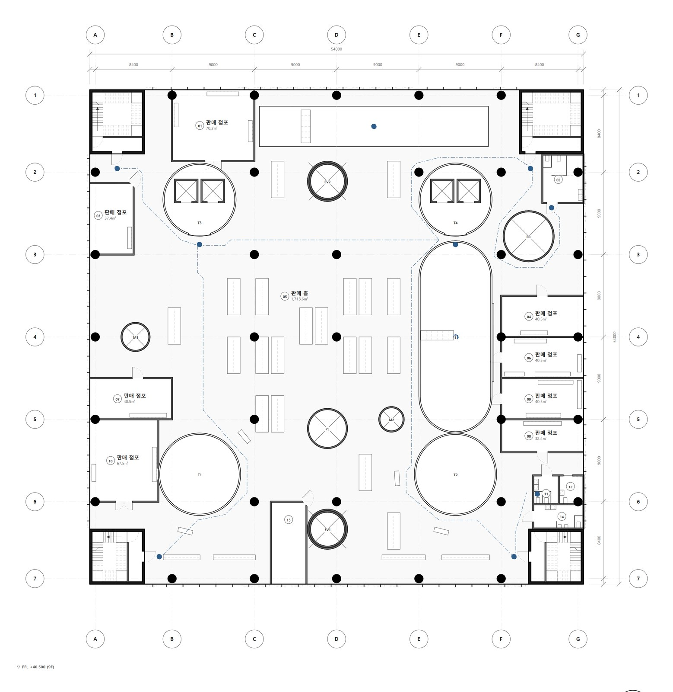

Native-resolution tiles:

- (0,0)..(800,800) [PNG](images/FLOOR_9F/tiles/x00000_y00000_w0800_h0800.png) · SHA256 `e19a22daf3f08998c423955be4bca62c0feaf791f0f10d292523fc5a15c10c56`
- (800,0)..(1600,800) [PNG](images/FLOOR_9F/tiles/x00800_y00000_w0800_h0800.png) · SHA256 `d4c1b033209be2579922c8ec7b3637b5968d997df7861b3c54043da1d879d64b`
- (1600,0)..(2400,800) [PNG](images/FLOOR_9F/tiles/x01600_y00000_w0800_h0800.png) · SHA256 `bf937e39d10e8c9a083c596246b7f65fb6a35fa31b6b00152bb4791d328f4127`
- (2400,0)..(2898,800) [PNG](images/FLOOR_9F/tiles/x02400_y00000_w0498_h0800.png) · SHA256 `1c56ebf69aa110fcf54eadfb2b2d2ebbeff3cc97b15bcb9a73ad9277120dc80e`
- (0,800)..(800,1600) [PNG](images/FLOOR_9F/tiles/x00000_y00800_w0800_h0800.png) · SHA256 `6885b9c95dfc5c4bc9f1b14f5d25c1d00b7551c06c604ce1071b4fe3b89e7d62`
- (800,800)..(1600,1600) [PNG](images/FLOOR_9F/tiles/x00800_y00800_w0800_h0800.png) · SHA256 `b07528f9787164b86d67cda225777e37ecc95bcaed5f1c00fa980f9e9da2bfea`
- (1600,800)..(2400,1600) [PNG](images/FLOOR_9F/tiles/x01600_y00800_w0800_h0800.png) · SHA256 `b8104ec670c81e76b26ba9c8a42203e1d68ec9de3a73df7d3d7d424e8abc93f0`
- (2400,800)..(2898,1600) [PNG](images/FLOOR_9F/tiles/x02400_y00800_w0498_h0800.png) · SHA256 `66c4d5f0ec0a29826c32e960b5216ada44bcecae8034857feb51093965aeebba`
- (0,1600)..(800,2400) [PNG](images/FLOOR_9F/tiles/x00000_y01600_w0800_h0800.png) · SHA256 `503a215413b9bbee07553d596eabbf51a56f05d8e271b695413e0d4ff6e603e6`
- (800,1600)..(1600,2400) [PNG](images/FLOOR_9F/tiles/x00800_y01600_w0800_h0800.png) · SHA256 `284f5f37307e71ceb7fbc83365d65bb5b0f463b264ed585f66b3eeff0764611c`
- (1600,1600)..(2400,2400) [PNG](images/FLOOR_9F/tiles/x01600_y01600_w0800_h0800.png) · SHA256 `bc1ea02f0ed7ab68ab175f9a839b09e693828da4384d9d51f34acedc7a0f6303`
- (2400,1600)..(2898,2400) [PNG](images/FLOOR_9F/tiles/x02400_y01600_w0498_h0800.png) · SHA256 `584ad54eebcc8a34b16506c90688281664186138b406e3956a4933b35bb92489`
- (0,2400)..(800,2976) [PNG](images/FLOOR_9F/tiles/x00000_y02400_w0800_h0576.png) · SHA256 `2dc310efc664d0cff40b5c1e774731f698b0ef6be161a3d62473daf651ed2f2d`
- (800,2400)..(1600,2976) [PNG](images/FLOOR_9F/tiles/x00800_y02400_w0800_h0576.png) · SHA256 `e091a28437758b8105af4492d0a4409fdcf2dd36d482d4ab4d975c66bbbdd1a6`
- (1600,2400)..(2400,2976) [PNG](images/FLOOR_9F/tiles/x01600_y02400_w0800_h0576.png) · SHA256 `783794710f4e130cfdf74cd62268ae91ab58426a5234219061c3247d078ac4f3`
- (2400,2400)..(2898,2976) [PNG](images/FLOOR_9F/tiles/x02400_y02400_w0498_h0576.png) · SHA256 `1362bf81e317093a33ba8acb016cf81d4f570fdcda605f6f45fa70a021281fca`

## FLOOR_10F

Original name: `FLOOR_10F.png`
SHA256: `4d6e3bda250e740b6b102b8b2e828583aaf4966898b579601864567b43ff8420`
Dimensions: 2898×2976 pixels

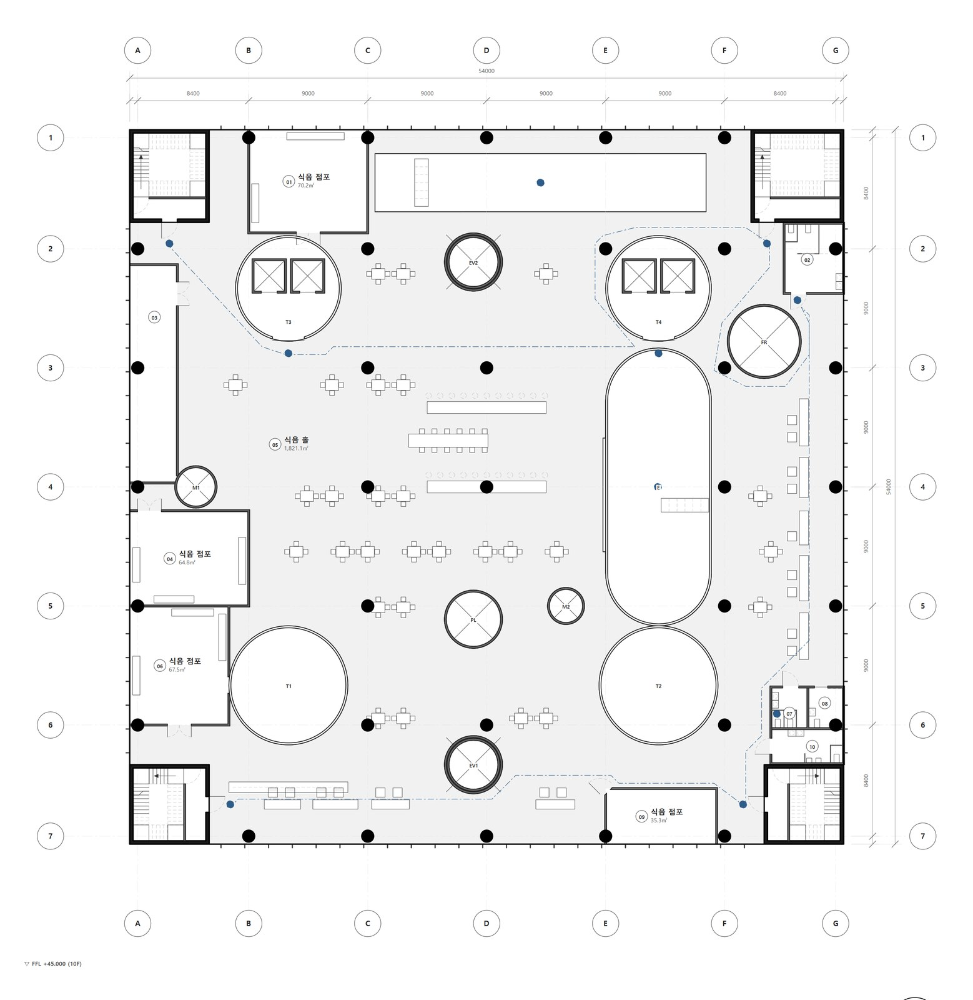

Native-resolution tiles:

- (0,0)..(800,800) [PNG](images/FLOOR_10F/tiles/x00000_y00000_w0800_h0800.png) · SHA256 `949c64e72a0c45ab2ff13e4f5345685f05f1d96fd078f3a0489e010e8def7ac0`
- (800,0)..(1600,800) [PNG](images/FLOOR_10F/tiles/x00800_y00000_w0800_h0800.png) · SHA256 `a1987023f0866f90a5ab440f2fc1461e2d98d996ff129be4fb7ac8acab8b44b1`
- (1600,0)..(2400,800) [PNG](images/FLOOR_10F/tiles/x01600_y00000_w0800_h0800.png) · SHA256 `ed53f6a96594e4dee2075bd17ee1604272c2db63b8f6adb6b0bb0a67f3e66bc9`
- (2400,0)..(2898,800) [PNG](images/FLOOR_10F/tiles/x02400_y00000_w0498_h0800.png) · SHA256 `bed01b9532f79c17cfecd249b71b23711edd64be7d8335a05b0cff2a1d784277`
- (0,800)..(800,1600) [PNG](images/FLOOR_10F/tiles/x00000_y00800_w0800_h0800.png) · SHA256 `88b17551994750d333f45e2143bfa2ce9757263c22bc04459ce4975da70bed7a`
- (800,800)..(1600,1600) [PNG](images/FLOOR_10F/tiles/x00800_y00800_w0800_h0800.png) · SHA256 `41e707d9e92987e9f59d24c4394e3973ed613dc5f24c5ceb568c433d63180620`
- (1600,800)..(2400,1600) [PNG](images/FLOOR_10F/tiles/x01600_y00800_w0800_h0800.png) · SHA256 `95ee7aef65f7c4ff95d2aee8ddfa9e310d4cd4dc7ecf395b55c54f5f18ece7b4`
- (2400,800)..(2898,1600) [PNG](images/FLOOR_10F/tiles/x02400_y00800_w0498_h0800.png) · SHA256 `508ea68bc2a02e83c8fbee731439b289c78da33ff26d1178ef7bc8cf730d7299`
- (0,1600)..(800,2400) [PNG](images/FLOOR_10F/tiles/x00000_y01600_w0800_h0800.png) · SHA256 `0e1918ba243630ada381f606317bf68b3ce38098f28d1934cc42d1565dcb6b32`
- (800,1600)..(1600,2400) [PNG](images/FLOOR_10F/tiles/x00800_y01600_w0800_h0800.png) · SHA256 `d5d41d416faa3cc2bad6a83f6db265260a6c0c215f6840e6cf431872c7c09bad`
- (1600,1600)..(2400,2400) [PNG](images/FLOOR_10F/tiles/x01600_y01600_w0800_h0800.png) · SHA256 `d1c0b9c54f4506c328668be3a49e34d0a01994f6e3482fba160d0dc682e914e6`
- (2400,1600)..(2898,2400) [PNG](images/FLOOR_10F/tiles/x02400_y01600_w0498_h0800.png) · SHA256 `f20017594a0ad67b75014a5084137a34f19fb144c1bbce20f25e4f5c593bd130`
- (0,2400)..(800,2976) [PNG](images/FLOOR_10F/tiles/x00000_y02400_w0800_h0576.png) · SHA256 `d0021892082691a8f190649cccbd6233328489b8fcf07a3fec275329d4afe7ea`
- (800,2400)..(1600,2976) [PNG](images/FLOOR_10F/tiles/x00800_y02400_w0800_h0576.png) · SHA256 `47c6223b09bd7353064d3c303bf6502bf412e88252c51e2445455dfcd7ed64c8`
- (1600,2400)..(2400,2976) [PNG](images/FLOOR_10F/tiles/x01600_y02400_w0800_h0576.png) · SHA256 `51ea30141db9fc2c47a86f95a7053798b3a070cce8fc23b93c5c9eed867601cf`
- (2400,2400)..(2898,2976) [PNG](images/FLOOR_10F/tiles/x02400_y02400_w0498_h0576.png) · SHA256 `1362bf81e317093a33ba8acb016cf81d4f570fdcda605f6f45fa70a021281fca`

## FLOOR_11F

Original name: `FLOOR_11F.png`
SHA256: `c3369bb83e5b0d6763e2ad1da13271f840721fb907e4388fb105684851d224a9`
Dimensions: 2898×2976 pixels

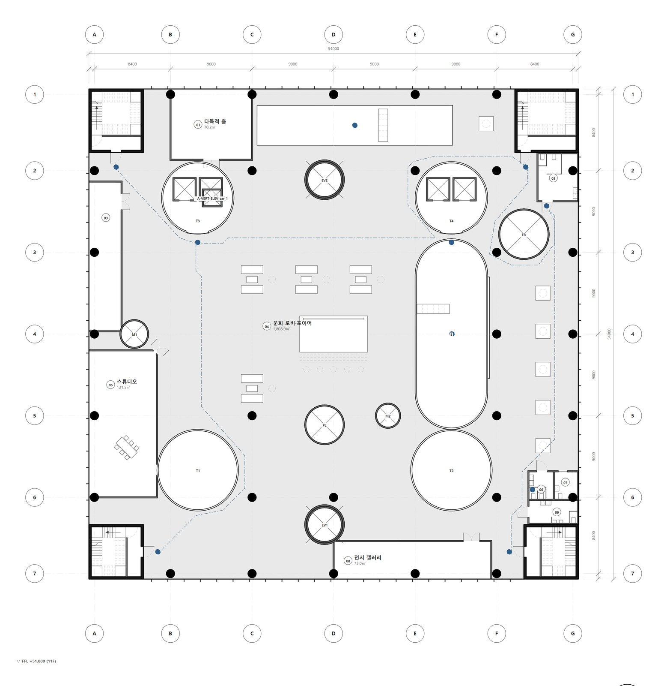

Native-resolution tiles:

- (0,0)..(800,800) [PNG](images/FLOOR_11F/tiles/x00000_y00000_w0800_h0800.png) · SHA256 `d40b65faefd43664baf94b212e8a056e09362cca114ad23af0aa8ca52a10486f`
- (800,0)..(1600,800) [PNG](images/FLOOR_11F/tiles/x00800_y00000_w0800_h0800.png) · SHA256 `fd6fe3597a3334fd75c3e84e274b6c8a0459316add1ab3e9550500461dfb5203`
- (1600,0)..(2400,800) [PNG](images/FLOOR_11F/tiles/x01600_y00000_w0800_h0800.png) · SHA256 `011fb903aa4036d860fb8c9b2609c3b7fb18dd56dab5400ce2a2c2a9e5758419`
- (2400,0)..(2898,800) [PNG](images/FLOOR_11F/tiles/x02400_y00000_w0498_h0800.png) · SHA256 `bed01b9532f79c17cfecd249b71b23711edd64be7d8335a05b0cff2a1d784277`
- (0,800)..(800,1600) [PNG](images/FLOOR_11F/tiles/x00000_y00800_w0800_h0800.png) · SHA256 `c45c9c95058bfcdea9ce8d71bbd568afa50da46b18cb1fb965a71d9089fa0c49`
- (800,800)..(1600,1600) [PNG](images/FLOOR_11F/tiles/x00800_y00800_w0800_h0800.png) · SHA256 `fc17b60b9a35346c443c2905da79ff7bad0c48b4c8187a592ba35c0973cd1e94`
- (1600,800)..(2400,1600) [PNG](images/FLOOR_11F/tiles/x01600_y00800_w0800_h0800.png) · SHA256 `4a7aac489f5b08f9ca9aad464666be109f2e62c6f273f70c78be5b9747ee31b9`
- (2400,800)..(2898,1600) [PNG](images/FLOOR_11F/tiles/x02400_y00800_w0498_h0800.png) · SHA256 `35a3f4841de40caf9c9d95b60e90ba040c10d3becdfd52cbb23ae0c063cb3061`
- (0,1600)..(800,2400) [PNG](images/FLOOR_11F/tiles/x00000_y01600_w0800_h0800.png) · SHA256 `717d5f99c6a1cc23a494417f025d708591b0032d9ec349528b1df26bb5899daa`
- (800,1600)..(1600,2400) [PNG](images/FLOOR_11F/tiles/x00800_y01600_w0800_h0800.png) · SHA256 `2ddfaf034301e4bb18989d832f8bfbcee847401c8c64315302d4e71cd921c614`
- (1600,1600)..(2400,2400) [PNG](images/FLOOR_11F/tiles/x01600_y01600_w0800_h0800.png) · SHA256 `5c4f9235df7520fac953f240757db67a1c0cd45e8c119dfc303762c5c2208eac`
- (2400,1600)..(2898,2400) [PNG](images/FLOOR_11F/tiles/x02400_y01600_w0498_h0800.png) · SHA256 `d11c1f284a21baf356e20d1c74ffc2473a09ee796e42ae666bd7f541547e1bff`
- (0,2400)..(800,2976) [PNG](images/FLOOR_11F/tiles/x00000_y02400_w0800_h0576.png) · SHA256 `74cdf40b60ac2c59982e82fc8a0a1a2bac1d94e99f68404510195756ae455fc0`
- (800,2400)..(1600,2976) [PNG](images/FLOOR_11F/tiles/x00800_y02400_w0800_h0576.png) · SHA256 `867a5ee774fb985b3fa311eb5b72e45b8592bf4b7fbea18d70c1b4c6e422129b`
- (1600,2400)..(2400,2976) [PNG](images/FLOOR_11F/tiles/x01600_y02400_w0800_h0576.png) · SHA256 `3411cda5d583561e19ed4254c1e8dfdd6e052949148e5138a7da317c3c439a69`
- (2400,2400)..(2898,2976) [PNG](images/FLOOR_11F/tiles/x02400_y02400_w0498_h0576.png) · SHA256 `1362bf81e317093a33ba8acb016cf81d4f570fdcda605f6f45fa70a021281fca`

## FLOOR_12F

Original name: `FLOOR_12F.png`
SHA256: `18a6a0a0bad68dc852297f677f6c2ed799c28b58668a8c62e0a16aa4695641bf`
Dimensions: 2898×2976 pixels

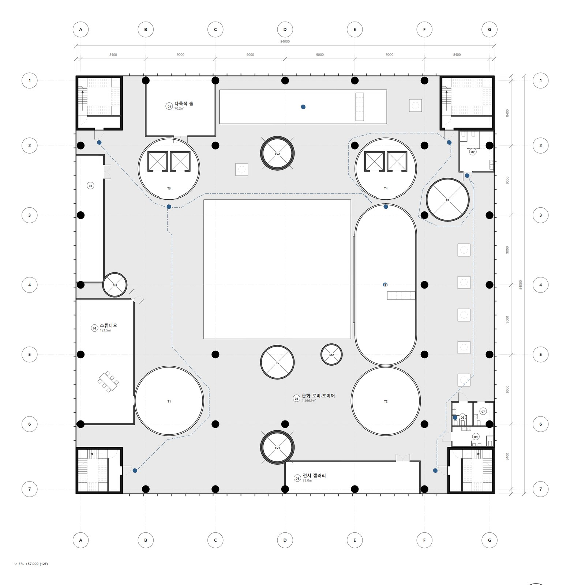

Native-resolution tiles:

- (0,0)..(800,800) [PNG](images/FLOOR_12F/tiles/x00000_y00000_w0800_h0800.png) · SHA256 `3d5ba426d7447548e3be034e160422f4bc9586c6471901b88d6e113e64838630`
- (800,0)..(1600,800) [PNG](images/FLOOR_12F/tiles/x00800_y00000_w0800_h0800.png) · SHA256 `549310bb717181c498ce4b356e7fea2e6627359c3086eab3d1391f52bd9ba24a`
- (1600,0)..(2400,800) [PNG](images/FLOOR_12F/tiles/x01600_y00000_w0800_h0800.png) · SHA256 `45254e1dd0f9ad166faec85ddfb13b56c9876d32039974eaf5efc3fe28cbbc52`
- (2400,0)..(2898,800) [PNG](images/FLOOR_12F/tiles/x02400_y00000_w0498_h0800.png) · SHA256 `5fe094d35d670d81df419c4e5d3589599229ef76a7a664f54ed3ee20bd99ba53`
- (0,800)..(800,1600) [PNG](images/FLOOR_12F/tiles/x00000_y00800_w0800_h0800.png) · SHA256 `ecb91cb73967861c09b96d4672266e5a1d2106f6ed8247c8faa3401768a74a98`
- (800,800)..(1600,1600) [PNG](images/FLOOR_12F/tiles/x00800_y00800_w0800_h0800.png) · SHA256 `116a970b2c5134247885c7b85d1d07d6c6b566681f8e533d33a7b450e2108d1c`
- (1600,800)..(2400,1600) [PNG](images/FLOOR_12F/tiles/x01600_y00800_w0800_h0800.png) · SHA256 `e9deef2c4712fd4527cfcccdba078d7139a75ba31883668db6d9dfb7e5a12f4c`
- (2400,800)..(2898,1600) [PNG](images/FLOOR_12F/tiles/x02400_y00800_w0498_h0800.png) · SHA256 `ca2c631b3ddf186921ab9c0ca5e123d2e1a6f26daaa300abd9c0feeb026e2372`
- (0,1600)..(800,2400) [PNG](images/FLOOR_12F/tiles/x00000_y01600_w0800_h0800.png) · SHA256 `6cfcb13c448e54f243a5210facd470dbe5865122bc870cb6474c195d0925359d`
- (800,1600)..(1600,2400) [PNG](images/FLOOR_12F/tiles/x00800_y01600_w0800_h0800.png) · SHA256 `0987f7461432d7f812544b155e4e8d774e2b19c90b25bbf178e89d4c50e8923d`
- (1600,1600)..(2400,2400) [PNG](images/FLOOR_12F/tiles/x01600_y01600_w0800_h0800.png) · SHA256 `bccd537cb548911158d01c80aed1ca9b8753d916ff318f95a4bf51137ae25c7f`
- (2400,1600)..(2898,2400) [PNG](images/FLOOR_12F/tiles/x02400_y01600_w0498_h0800.png) · SHA256 `9ec1e42fbea28efa2fbef4716270dbf1720c26244f7017ad1a89d6886e1e0c8c`
- (0,2400)..(800,2976) [PNG](images/FLOOR_12F/tiles/x00000_y02400_w0800_h0576.png) · SHA256 `95ec7529b933190b7adcc952e8167da3aa049f359b522e936feb92b83aab2406`
- (800,2400)..(1600,2976) [PNG](images/FLOOR_12F/tiles/x00800_y02400_w0800_h0576.png) · SHA256 `b5acbb7404006c474812041bb1fc24aa26c92cd936e16b28f60a3d78bd62cd53`
- (1600,2400)..(2400,2976) [PNG](images/FLOOR_12F/tiles/x01600_y02400_w0800_h0576.png) · SHA256 `84e638aabd46c289da22301eab6f292180d9cd7ac8b82e1f3b06e9a4c60d3d76`
- (2400,2400)..(2898,2976) [PNG](images/FLOOR_12F/tiles/x02400_y02400_w0498_h0576.png) · SHA256 `1362bf81e317093a33ba8acb016cf81d4f570fdcda605f6f45fa70a021281fca`

## FLOOR_13F

Original name: `FLOOR_13F.png`
SHA256: `87934a276750adc373f19f48522c8ff6e5b2638349727f1e2cf6a1e2b8d40998`
Dimensions: 2898×2976 pixels

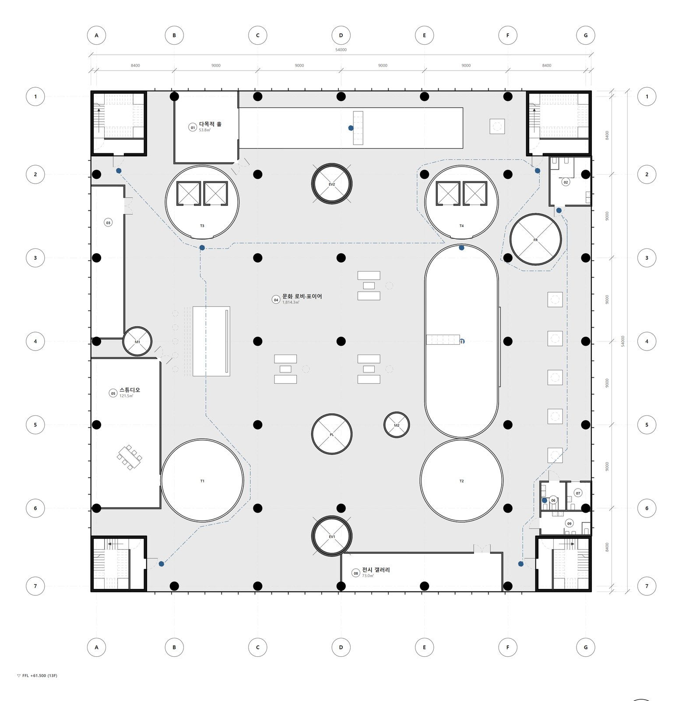

Native-resolution tiles:

- (0,0)..(800,800) [PNG](images/FLOOR_13F/tiles/x00000_y00000_w0800_h0800.png) · SHA256 `4ba1df9b3f4ef8485ba4ebd0d27367f410f4b45fb9780e8bd5667f7834810ad1`
- (800,0)..(1600,800) [PNG](images/FLOOR_13F/tiles/x00800_y00000_w0800_h0800.png) · SHA256 `efbe1db28c0c3f7bc2f902f3f874ff1eb6c211e90a4e63a93c0dc4e595a7af89`
- (1600,0)..(2400,800) [PNG](images/FLOOR_13F/tiles/x01600_y00000_w0800_h0800.png) · SHA256 `f9240ff4723af67c7f67be6c2d6a655a1df738941b0406bc5a3b7c7a67662065`
- (2400,0)..(2898,800) [PNG](images/FLOOR_13F/tiles/x02400_y00000_w0498_h0800.png) · SHA256 `5fe094d35d670d81df419c4e5d3589599229ef76a7a664f54ed3ee20bd99ba53`
- (0,800)..(800,1600) [PNG](images/FLOOR_13F/tiles/x00000_y00800_w0800_h0800.png) · SHA256 `f14864e22fa49212a90e9b326a9b83aaf123b315473542fb231826cebf2fd148`
- (800,800)..(1600,1600) [PNG](images/FLOOR_13F/tiles/x00800_y00800_w0800_h0800.png) · SHA256 `c12bbe1148a7003fface218d4947a0a1ffefb5f7141e423e973a249b5d4db4ab`
- (1600,800)..(2400,1600) [PNG](images/FLOOR_13F/tiles/x01600_y00800_w0800_h0800.png) · SHA256 `5e3db865b1874022a56e720d653ff5f2e7fb5bdbd9086a74632956979838191e`
- (2400,800)..(2898,1600) [PNG](images/FLOOR_13F/tiles/x02400_y00800_w0498_h0800.png) · SHA256 `ca2c631b3ddf186921ab9c0ca5e123d2e1a6f26daaa300abd9c0feeb026e2372`
- (0,1600)..(800,2400) [PNG](images/FLOOR_13F/tiles/x00000_y01600_w0800_h0800.png) · SHA256 `6e7b417a0dbb0255f12390a0e5040dc77bee1477dd128c6e6d8be9528c75b7a8`
- (800,1600)..(1600,2400) [PNG](images/FLOOR_13F/tiles/x00800_y01600_w0800_h0800.png) · SHA256 `8e2003a689ddad3dcd74312d7475a03585ac8881e3388a87c204509664fc7e88`
- (1600,1600)..(2400,2400) [PNG](images/FLOOR_13F/tiles/x01600_y01600_w0800_h0800.png) · SHA256 `1bbcea29593366da686223071f902a5c513d5acfce421631b41575d094c5e9f4`
- (2400,1600)..(2898,2400) [PNG](images/FLOOR_13F/tiles/x02400_y01600_w0498_h0800.png) · SHA256 `9ec1e42fbea28efa2fbef4716270dbf1720c26244f7017ad1a89d6886e1e0c8c`
- (0,2400)..(800,2976) [PNG](images/FLOOR_13F/tiles/x00000_y02400_w0800_h0576.png) · SHA256 `53970f7ac4919dc3dcb841a0fa8a75decce564ef2a3c6c5883d3937f33d517f2`
- (800,2400)..(1600,2976) [PNG](images/FLOOR_13F/tiles/x00800_y02400_w0800_h0576.png) · SHA256 `7648aa2f6ee155f9f76271a988f03c55cda1a99512cd5b39917025f233d69e87`
- (1600,2400)..(2400,2976) [PNG](images/FLOOR_13F/tiles/x01600_y02400_w0800_h0576.png) · SHA256 `e98696fc27dbbf30be607bc3a8390f4e0d2b6719f3f62be2773e0a1804900fb5`
- (2400,2400)..(2898,2976) [PNG](images/FLOOR_13F/tiles/x02400_y02400_w0498_h0576.png) · SHA256 `1362bf81e317093a33ba8acb016cf81d4f570fdcda605f6f45fa70a021281fca`

## FLOOR_14F

Original name: `FLOOR_14F.png`
SHA256: `7cfad40ff94e397c51bb24aae6ddec91cef0502a51ecaca7b42563349269e56e`
Dimensions: 2898×2976 pixels

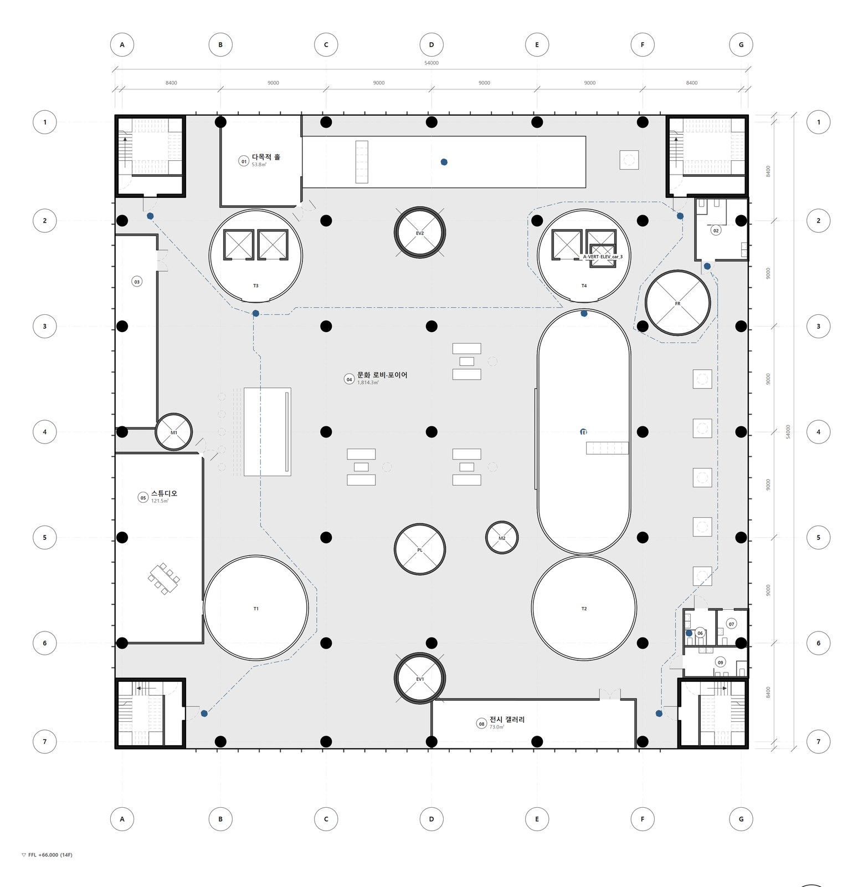

Native-resolution tiles:

- (0,0)..(800,800) [PNG](images/FLOOR_14F/tiles/x00000_y00000_w0800_h0800.png) · SHA256 `88e3e171f486ce8d25fc78993dbd7b917cfe9dfe6531d87a83ce5339c042f7c1`
- (800,0)..(1600,800) [PNG](images/FLOOR_14F/tiles/x00800_y00000_w0800_h0800.png) · SHA256 `22bdfb5f25a17c70f61150894bedb228b5b440d7db8f16a18848941cac0bae77`
- (1600,0)..(2400,800) [PNG](images/FLOOR_14F/tiles/x01600_y00000_w0800_h0800.png) · SHA256 `fb5a35640a0e20b9734fe84cb8ea377ae9a395df68dfcb9f0c00a17b84d366af`
- (2400,0)..(2898,800) [PNG](images/FLOOR_14F/tiles/x02400_y00000_w0498_h0800.png) · SHA256 `bf940fd6a097a9a65df592b7e4a51a078464b58841182baea8b201f979d37aeb`
- (0,800)..(800,1600) [PNG](images/FLOOR_14F/tiles/x00000_y00800_w0800_h0800.png) · SHA256 `eb6f453384dfb304d401f1fbbafd296c6d99e3989d020f1dcc1e8648f59f33f6`
- (800,800)..(1600,1600) [PNG](images/FLOOR_14F/tiles/x00800_y00800_w0800_h0800.png) · SHA256 `00a5260a06f609d3577a42745e528cc03873dff09656a88d9e736f3ec084333e`
- (1600,800)..(2400,1600) [PNG](images/FLOOR_14F/tiles/x01600_y00800_w0800_h0800.png) · SHA256 `ce053df101e7ad0866f1be607854fae331f05f96d5cc6ad763bcd204ea70a040`
- (2400,800)..(2898,1600) [PNG](images/FLOOR_14F/tiles/x02400_y00800_w0498_h0800.png) · SHA256 `f6dec64df6932ed3feef6b552588e01c49d027adf0a9d620512b7fab2ef91102`
- (0,1600)..(800,2400) [PNG](images/FLOOR_14F/tiles/x00000_y01600_w0800_h0800.png) · SHA256 `f822588d66eb4fcd1118c21dfdb2cf5830576b5e2aae33c20d90f44ede8fb0c2`
- (800,1600)..(1600,2400) [PNG](images/FLOOR_14F/tiles/x00800_y01600_w0800_h0800.png) · SHA256 `deb0d0ae07fb82985a98463f9a482159982c443c6502ded67f18ab343eec8355`
- (1600,1600)..(2400,2400) [PNG](images/FLOOR_14F/tiles/x01600_y01600_w0800_h0800.png) · SHA256 `a114170dd263b3d2b8be14a91aa53873dbf354b7dd429ab36b1b2b71123bbf57`
- (2400,1600)..(2898,2400) [PNG](images/FLOOR_14F/tiles/x02400_y01600_w0498_h0800.png) · SHA256 `9ec1e42fbea28efa2fbef4716270dbf1720c26244f7017ad1a89d6886e1e0c8c`
- (0,2400)..(800,2976) [PNG](images/FLOOR_14F/tiles/x00000_y02400_w0800_h0576.png) · SHA256 `b6ede771da33d541fff3f6050958b307e1b47ae63e1869a187020335e900c52d`
- (800,2400)..(1600,2976) [PNG](images/FLOOR_14F/tiles/x00800_y02400_w0800_h0576.png) · SHA256 `552bb94eeb75333d032f0a2d9046463b9aa432af904a67a4aa671ed253985593`
- (1600,2400)..(2400,2976) [PNG](images/FLOOR_14F/tiles/x01600_y02400_w0800_h0576.png) · SHA256 `03aa9134a01b723fd2986611c3dcf04bae7979952a00a24148d4ea4285489f71`
- (2400,2400)..(2898,2976) [PNG](images/FLOOR_14F/tiles/x02400_y02400_w0498_h0576.png) · SHA256 `1362bf81e317093a33ba8acb016cf81d4f570fdcda605f6f45fa70a021281fca`

## FLOOR_15F

Original name: `FLOOR_15F.png`
SHA256: `16043385a65f41cff7e861bf2ffcc0598bd451a3f9a128a14a51e68ab532f15a`
Dimensions: 2898×2976 pixels

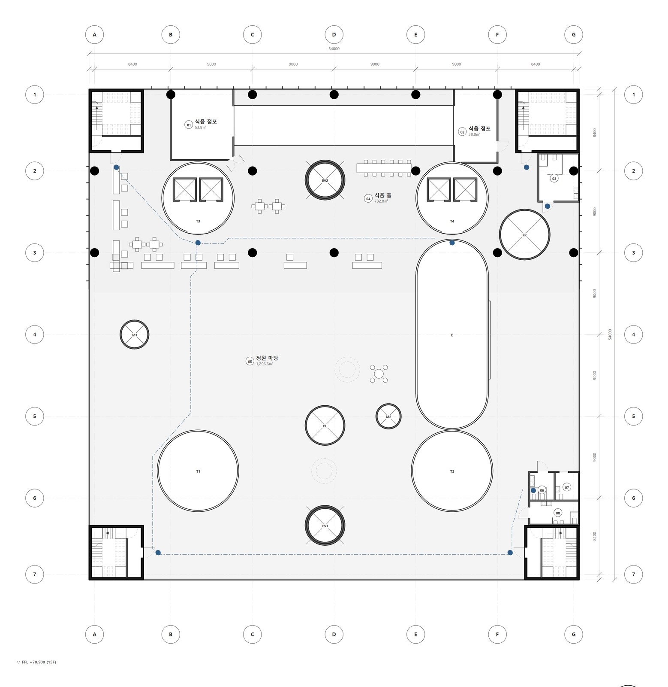

Native-resolution tiles:

- (0,0)..(800,800) [PNG](images/FLOOR_15F/tiles/x00000_y00000_w0800_h0800.png) · SHA256 `e2ed8842eed1a3b3ac45852eea249286ac510bd1dbf3368e24a5f65f174c6c30`
- (800,0)..(1600,800) [PNG](images/FLOOR_15F/tiles/x00800_y00000_w0800_h0800.png) · SHA256 `b758a188b54cac5cc5e219c21078f9e1f748254d170f7a2b1ae0664f7e80e414`
- (1600,0)..(2400,800) [PNG](images/FLOOR_15F/tiles/x01600_y00000_w0800_h0800.png) · SHA256 `4fcef678ad08bdd614f1a18dfc55e2eb9d960467cb17fda77e26c35747ddce25`
- (2400,0)..(2898,800) [PNG](images/FLOOR_15F/tiles/x02400_y00000_w0498_h0800.png) · SHA256 `a3811a21cb562da6b6d3c44d73d672b2c3cbb0f466f7c148aa22d4ca840f7077`
- (0,800)..(800,1600) [PNG](images/FLOOR_15F/tiles/x00000_y00800_w0800_h0800.png) · SHA256 `5b5653e3acab0c974b3b5a6a50c0128ea80b038cc83102df9263b2ec8fce1bd5`
- (800,800)..(1600,1600) [PNG](images/FLOOR_15F/tiles/x00800_y00800_w0800_h0800.png) · SHA256 `b31269323afe58f8afc3ac78308ebf1c26c92f06d646cbd48e563ee580842232`
- (1600,800)..(2400,1600) [PNG](images/FLOOR_15F/tiles/x01600_y00800_w0800_h0800.png) · SHA256 `66d4a1d95b2ce308aa95a8074c10589fff8eb922cdd2564a10535bf6aa5fcac6`
- (2400,800)..(2898,1600) [PNG](images/FLOOR_15F/tiles/x02400_y00800_w0498_h0800.png) · SHA256 `2f633daf9c68452e8f490847ec0ed94e8f27e4358552c383a5ed7d0e0155070a`
- (0,1600)..(800,2400) [PNG](images/FLOOR_15F/tiles/x00000_y01600_w0800_h0800.png) · SHA256 `5f15f322d07af0aa98378c837326df3a6a7d4315d149c96a04a749657a0b6da4`
- (800,1600)..(1600,2400) [PNG](images/FLOOR_15F/tiles/x00800_y01600_w0800_h0800.png) · SHA256 `d8cc148ffec7cc0ef6baf989955e96331ed94d0100f4bac2cd180f8095e64c70`
- (1600,1600)..(2400,2400) [PNG](images/FLOOR_15F/tiles/x01600_y01600_w0800_h0800.png) · SHA256 `df5df04c345bcc0cc4fbb74a6e0fe23f3be8429f4ce98fbc7892a46a42e2da7e`
- (2400,1600)..(2898,2400) [PNG](images/FLOOR_15F/tiles/x02400_y01600_w0498_h0800.png) · SHA256 `99378877a34b08856d5f011aefada39a68cfbba2cc0efe828a845cb1c2b3efc1`
- (0,2400)..(800,2976) [PNG](images/FLOOR_15F/tiles/x00000_y02400_w0800_h0576.png) · SHA256 `d4ce0b913d3cb5c5ec8ba1418910b9670ea71673be03291d0af9ad09f2ac1945`
- (800,2400)..(1600,2976) [PNG](images/FLOOR_15F/tiles/x00800_y02400_w0800_h0576.png) · SHA256 `8d0ebf635bd42b3606bb9bf294fc01b80e741781eaf94082c94e60b659a6f582`
- (1600,2400)..(2400,2976) [PNG](images/FLOOR_15F/tiles/x01600_y02400_w0800_h0576.png) · SHA256 `8cdff29d95c6fbc20b1dc0b3b1a5f8b8c764bf8016e28d2385ba767e93eb0c53`
- (2400,2400)..(2898,2976) [PNG](images/FLOOR_15F/tiles/x02400_y02400_w0498_h0576.png) · SHA256 `1362bf81e317093a33ba8acb016cf81d4f570fdcda605f6f45fa70a021281fca`

**Approval:** No architecture, material or print approval follows automatically from a successful byte/geometry packet validation.
