# Connector-inspectable visual review packet

Generated from original image pixels, not a style reinterpretation.

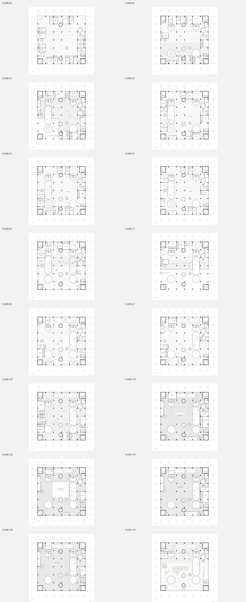

Each tile is **lossless PNG at native pixel scale**. Coordinates are from the top-left of each original image.

## FLOOR_B2

Original name: `FLOOR_B2.png`
SHA256: `ced45d7fcc6df5af981a5f8edfb876372b8f81dce59448a691d1d070734af8b2`
Dimensions: 2898×2976 pixels

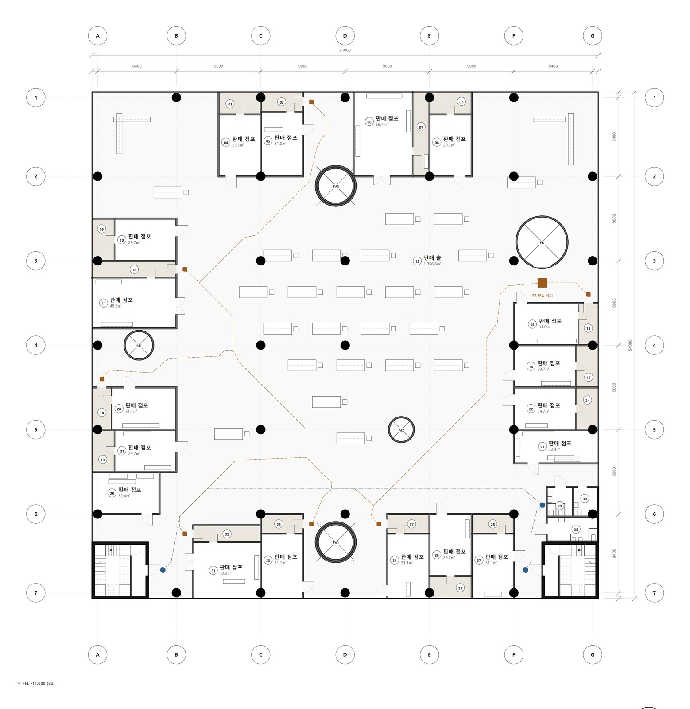

Native-resolution tiles:

- (0,0)..(800,800) [PNG](images/FLOOR_B2/tiles/x00000_y00000_w0800_h0800.png) · SHA256 `abdd14c8e927749f9dc55b76833f9fa9a1f024fc45019b2b9ed55a36685c2e52`
- (800,0)..(1600,800) [PNG](images/FLOOR_B2/tiles/x00800_y00000_w0800_h0800.png) · SHA256 `6ada24baf812c702a5242ca62c50d23bac3f01b10565ce36f1090b6de962e596`
- (1600,0)..(2400,800) [PNG](images/FLOOR_B2/tiles/x01600_y00000_w0800_h0800.png) · SHA256 `15f3da0430d7f05c04c28ce0f338ab8744b3733615856db4375bf15c68f3c9ff`
- (2400,0)..(2898,800) [PNG](images/FLOOR_B2/tiles/x02400_y00000_w0498_h0800.png) · SHA256 `6be6ec78b3508c17d2acb9c60398457041f49e8df7a8f16f26fc827cd1c7fc69`
- (0,800)..(800,1600) [PNG](images/FLOOR_B2/tiles/x00000_y00800_w0800_h0800.png) · SHA256 `c81d1d4632b2a52ef6c0af7e38b82fecb6678cce0189e16aaeeb3ce2c5465e0f`
- (800,800)..(1600,1600) [PNG](images/FLOOR_B2/tiles/x00800_y00800_w0800_h0800.png) · SHA256 `860c42012a57746fcf8590d23957e733ef4b5107cb86673a96c8e5d950d5c9db`
- (1600,800)..(2400,1600) [PNG](images/FLOOR_B2/tiles/x01600_y00800_w0800_h0800.png) · SHA256 `9e7cc0374d5faf29716fbcee0b70b200b7cbe9277fb5a71bb775e38247020ff4`
- (2400,800)..(2898,1600) [PNG](images/FLOOR_B2/tiles/x02400_y00800_w0498_h0800.png) · SHA256 `76674e45f1c344bc2f391aa900d0f2194207af47669d2f6f4aefe7a5f167cb02`
- (0,1600)..(800,2400) [PNG](images/FLOOR_B2/tiles/x00000_y01600_w0800_h0800.png) · SHA256 `3ec5f8a1a5cc539226ab4972d4129577a30fa4e6c90013989f0e7f6e46e46d0b`
- (800,1600)..(1600,2400) [PNG](images/FLOOR_B2/tiles/x00800_y01600_w0800_h0800.png) · SHA256 `1aaf1bbf76c1d557d69be4b33eb7c8ade9b71408d2dcc469ecf5f05e7eac8026`
- (1600,1600)..(2400,2400) [PNG](images/FLOOR_B2/tiles/x01600_y01600_w0800_h0800.png) · SHA256 `e159b37962242216b66432f21200bc5714c0593b9cfaca9abd7e773a414ede4b`
- (2400,1600)..(2898,2400) [PNG](images/FLOOR_B2/tiles/x02400_y01600_w0498_h0800.png) · SHA256 `0659cfc6404d61dbe1dfb30676c9de89d9c80776d729f218a28b0b209d93669d`
- (0,2400)..(800,2976) [PNG](images/FLOOR_B2/tiles/x00000_y02400_w0800_h0576.png) · SHA256 `422b69408d95670b6e0a414083d4aec386d6300fe01d07efe302e2604eed078e`
- (800,2400)..(1600,2976) [PNG](images/FLOOR_B2/tiles/x00800_y02400_w0800_h0576.png) · SHA256 `f6bd2092debc9b5fbfa90cdbe91ed19df06d24554129e8edab8b10dd326baf8b`
- (1600,2400)..(2400,2976) [PNG](images/FLOOR_B2/tiles/x01600_y02400_w0800_h0576.png) · SHA256 `003b629b5ad986b2a4ad1675b085b13c5ea97d0315e58ab075f47198f06ebf53`
- (2400,2400)..(2898,2976) [PNG](images/FLOOR_B2/tiles/x02400_y02400_w0498_h0576.png) · SHA256 `ab712b89ba14187559e1af1292a522c4f83df372d29ea0670f1f6cc0d5b81677`

## FLOOR_B1

Original name: `FLOOR_B1.png`
SHA256: `c234c5789dca0e3badd5d3e84552bb041df9f0bdcf13cb3df1dec80c4b56db9f`
Dimensions: 2898×2976 pixels

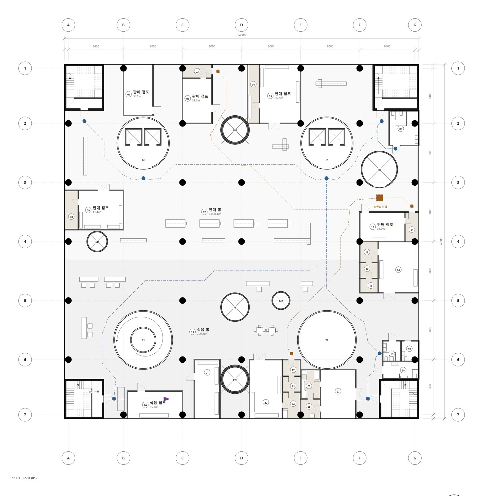

Native-resolution tiles:

- (0,0)..(800,800) [PNG](images/FLOOR_B1/tiles/x00000_y00000_w0800_h0800.png) · SHA256 `abe353408a8eee6ed23c579487e877b386979ec1b3d1ed2f599e3949f64dd0c8`
- (800,0)..(1600,800) [PNG](images/FLOOR_B1/tiles/x00800_y00000_w0800_h0800.png) · SHA256 `b360f3a614afc45c0f49b4f08fe36f019b2f90c2573bdd55a9183c9fc0bee09b`
- (1600,0)..(2400,800) [PNG](images/FLOOR_B1/tiles/x01600_y00000_w0800_h0800.png) · SHA256 `59be5b70bd9523dba10bebee045a5b66ea7bd056e9fc1443d88553ee112062ad`
- (2400,0)..(2898,800) [PNG](images/FLOOR_B1/tiles/x02400_y00000_w0498_h0800.png) · SHA256 `eeb9fcb1fef9a6a761bd67d9632747396a4c8ec4ea13b09e8d66941fbb61a0bc`
- (0,800)..(800,1600) [PNG](images/FLOOR_B1/tiles/x00000_y00800_w0800_h0800.png) · SHA256 `e1d60537b8a2a2c0bb9b8c26cc57f2627ce29071565adca859edd61bbae954a8`
- (800,800)..(1600,1600) [PNG](images/FLOOR_B1/tiles/x00800_y00800_w0800_h0800.png) · SHA256 `95a262003de54310f91fbe4a1b8700ac687474de17b1456650c5ce9f695c1712`
- (1600,800)..(2400,1600) [PNG](images/FLOOR_B1/tiles/x01600_y00800_w0800_h0800.png) · SHA256 `bf4dca9cb741955d1c6bb79fc3061bbcd2246568d6044888c7ba7870afb86bfd`
- (2400,800)..(2898,1600) [PNG](images/FLOOR_B1/tiles/x02400_y00800_w0498_h0800.png) · SHA256 `896b70a2267d4ec70f15e6f1069e89774082b4eb4a0832bda00a1d4e75211860`
- (0,1600)..(800,2400) [PNG](images/FLOOR_B1/tiles/x00000_y01600_w0800_h0800.png) · SHA256 `fbd7b2b190f23a83dfa3ee2cb8e32987c15b7438b552e6c67f516a0de460d6a1`
- (800,1600)..(1600,2400) [PNG](images/FLOOR_B1/tiles/x00800_y01600_w0800_h0800.png) · SHA256 `a47780c495ad9653a8d1e6051cac616a1ff3aaec4189260c73e4a7e247fcaa1f`
- (1600,1600)..(2400,2400) [PNG](images/FLOOR_B1/tiles/x01600_y01600_w0800_h0800.png) · SHA256 `305d565584abdc004ca56c21d09fcb24f19e5f8cec741480494c0f377dcc34da`
- (2400,1600)..(2898,2400) [PNG](images/FLOOR_B1/tiles/x02400_y01600_w0498_h0800.png) · SHA256 `07647e657146f357c9f19f3cea62f9db8485a4fadd56b4cc23015d374b37234c`
- (0,2400)..(800,2976) [PNG](images/FLOOR_B1/tiles/x00000_y02400_w0800_h0576.png) · SHA256 `2d616a9752c9fda7074bf9688c04327c9848b082502291208311ec605828b989`
- (800,2400)..(1600,2976) [PNG](images/FLOOR_B1/tiles/x00800_y02400_w0800_h0576.png) · SHA256 `96a4fa13fa5ec4f26843e1f7c4a969f52ac3c42debfefc1acf9c7bfaecd1b582`
- (1600,2400)..(2400,2976) [PNG](images/FLOOR_B1/tiles/x01600_y02400_w0800_h0576.png) · SHA256 `17c6cc7442b3dfa12daf38854f949e2ebc0ed33f31eeb34cf0ff465b99585c78`
- (2400,2400)..(2898,2976) [PNG](images/FLOOR_B1/tiles/x02400_y02400_w0498_h0576.png) · SHA256 `1362bf81e317093a33ba8acb016cf81d4f570fdcda605f6f45fa70a021281fca`

## FLOOR_2F

Original name: `FLOOR_2F.png`
SHA256: `8b07c64a21a9aea1fab1ad24703fafdaeac0709bf13e3f7bb21b3862138932b4`
Dimensions: 2898×2976 pixels

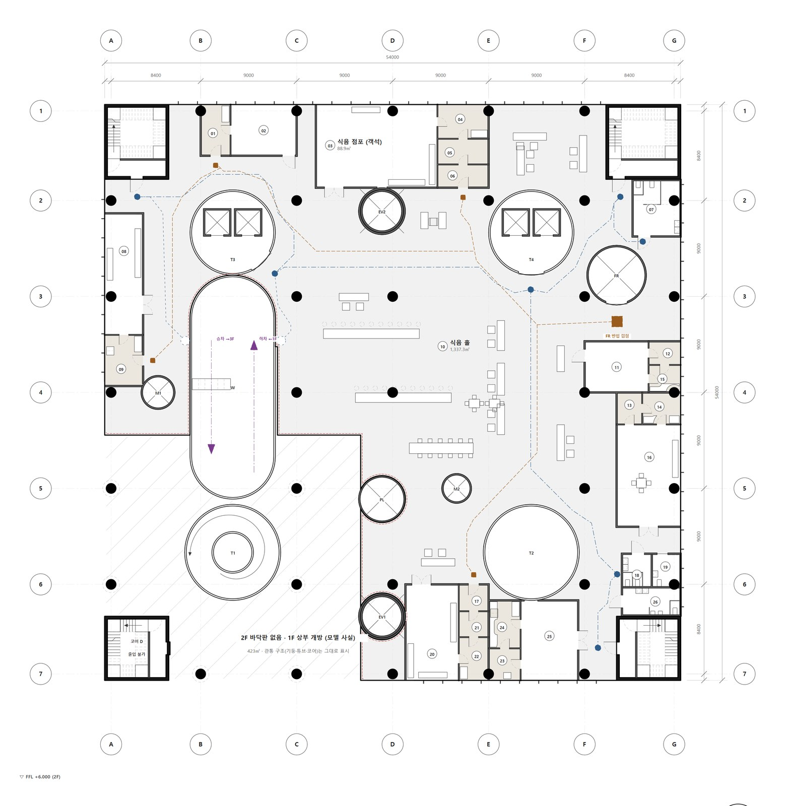

Native-resolution tiles:

- (0,0)..(800,800) [PNG](images/FLOOR_2F/tiles/x00000_y00000_w0800_h0800.png) · SHA256 `0943a3af1f7dbdaca1376749c51e200a72b0c583c0e0eaa6663abe278f075150`
- (800,0)..(1600,800) [PNG](images/FLOOR_2F/tiles/x00800_y00000_w0800_h0800.png) · SHA256 `0eed1801cd9edf4b20f4bdc299541d35bbce890faf58d9fb0a600a2cfb9ddf4d`
- (1600,0)..(2400,800) [PNG](images/FLOOR_2F/tiles/x01600_y00000_w0800_h0800.png) · SHA256 `248da0de67f0677ed147ed7dbfa3147d71a731bf267c66b976575cfc2dfc6411`
- (2400,0)..(2898,800) [PNG](images/FLOOR_2F/tiles/x02400_y00000_w0498_h0800.png) · SHA256 `fc15c778116851eec9891905fe50d69cae2f6e2fc3a5402f7917cc839b1fb42e`
- (0,800)..(800,1600) [PNG](images/FLOOR_2F/tiles/x00000_y00800_w0800_h0800.png) · SHA256 `6043e2ff32cf96ba4f59f79f8c01f60e7b6740ad7701a5d834b35123196c9aa6`
- (800,800)..(1600,1600) [PNG](images/FLOOR_2F/tiles/x00800_y00800_w0800_h0800.png) · SHA256 `5cdd3c0ca0d4520717c5de10a31fda6ced07731429ab90bce1086843fa28564e`
- (1600,800)..(2400,1600) [PNG](images/FLOOR_2F/tiles/x01600_y00800_w0800_h0800.png) · SHA256 `ed03fd8138805bbbaaa59f4a4a7f88af34cf8092445e87fab6a260bdc2d669d3`
- (2400,800)..(2898,1600) [PNG](images/FLOOR_2F/tiles/x02400_y00800_w0498_h0800.png) · SHA256 `4e5b411e55687bbcbb56e70b661a7c6086b77fdee2efd23fbedc6c990727522d`
- (0,1600)..(800,2400) [PNG](images/FLOOR_2F/tiles/x00000_y01600_w0800_h0800.png) · SHA256 `5638c5fcfc1115708b0d1d00216acc469fa6bd29fcf624dfd10beb8cbb9f4c5d`
- (800,1600)..(1600,2400) [PNG](images/FLOOR_2F/tiles/x00800_y01600_w0800_h0800.png) · SHA256 `a78d047f3c35b4482a4b2d81e5e1541652cbbaf0667706bdc4bd1f88a1373a86`
- (1600,1600)..(2400,2400) [PNG](images/FLOOR_2F/tiles/x01600_y01600_w0800_h0800.png) · SHA256 `9efc3c98a95e346943300d842246b4983c1c277f6222838f117fbf7bec1910f3`
- (2400,1600)..(2898,2400) [PNG](images/FLOOR_2F/tiles/x02400_y01600_w0498_h0800.png) · SHA256 `f7d4cefa00fd753548d8e435e58494b8f3cb9082d022ad1a42533cb90d8f2833`
- (0,2400)..(800,2976) [PNG](images/FLOOR_2F/tiles/x00000_y02400_w0800_h0576.png) · SHA256 `dd9731d2091ada4d883dc683d7642da26013e7b32b44554e8f3aa40ba3e3aaf6`
- (800,2400)..(1600,2976) [PNG](images/FLOOR_2F/tiles/x00800_y02400_w0800_h0576.png) · SHA256 `e3af74365203dbbb2716d9ad63e4ea1b9682c532d577a7a95c57d6fbf55a36fb`
- (1600,2400)..(2400,2976) [PNG](images/FLOOR_2F/tiles/x01600_y02400_w0800_h0576.png) · SHA256 `c8bc7232dadaf67f5792d7a78014a75ddaf0630cf16e475dab70e1430f49ba26`
- (2400,2400)..(2898,2976) [PNG](images/FLOOR_2F/tiles/x02400_y02400_w0498_h0576.png) · SHA256 `1362bf81e317093a33ba8acb016cf81d4f570fdcda605f6f45fa70a021281fca`

## FLOOR_3F

Original name: `FLOOR_3F.png`
SHA256: `781311c6d81dd4f2542d90462184e64f2405ac92f4515d141cc46f8175da9853`
Dimensions: 2898×2976 pixels

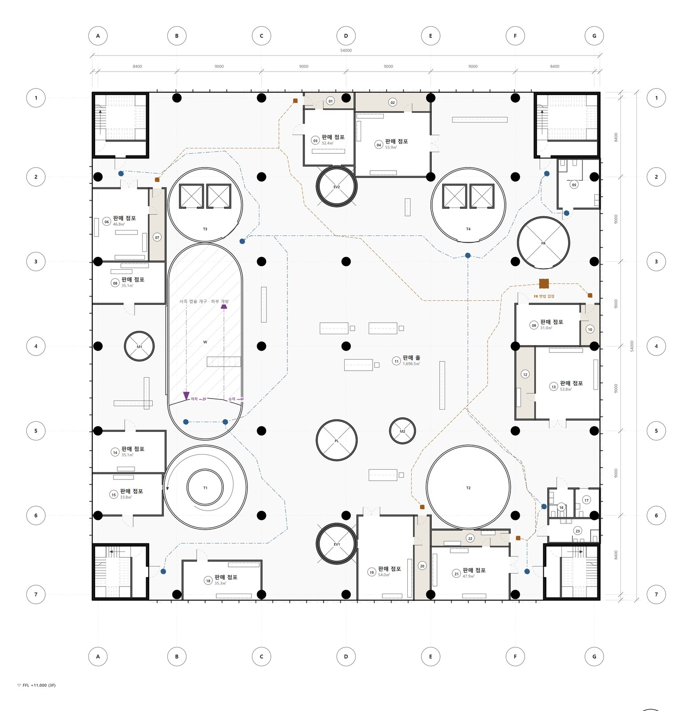

Native-resolution tiles:

- (0,0)..(800,800) [PNG](images/FLOOR_3F/tiles/x00000_y00000_w0800_h0800.png) · SHA256 `469b147567ffa348346e15d9ad0e17a7ba7b052b7d87581513ac79a6197d4c08`
- (800,0)..(1600,800) [PNG](images/FLOOR_3F/tiles/x00800_y00000_w0800_h0800.png) · SHA256 `3fb2030b372ddddd8e29965ad58f90e32173cfe589be19f0b44ec917de0e6e21`
- (1600,0)..(2400,800) [PNG](images/FLOOR_3F/tiles/x01600_y00000_w0800_h0800.png) · SHA256 `6e527a6e53786ee3731c149effe099e8e8f994bbfbe96a2e8ccac608405ae8d7`
- (2400,0)..(2898,800) [PNG](images/FLOOR_3F/tiles/x02400_y00000_w0498_h0800.png) · SHA256 `1dd85e2b3b8bab10e30984ac720f21aed2b8da165101b6fff0bee14c1fb18e2c`
- (0,800)..(800,1600) [PNG](images/FLOOR_3F/tiles/x00000_y00800_w0800_h0800.png) · SHA256 `fff907820a75fb74b156db522609362aec62fbc78891369b3ae0079b6ddbe339`
- (800,800)..(1600,1600) [PNG](images/FLOOR_3F/tiles/x00800_y00800_w0800_h0800.png) · SHA256 `1b135589379ea5e6c8bd46d2b58701e2e13fe830fc8c110dac67fcbee0f1fb25`
- (1600,800)..(2400,1600) [PNG](images/FLOOR_3F/tiles/x01600_y00800_w0800_h0800.png) · SHA256 `ad1ae565c96c9348b4e34473216fde34732c916e6d4c3a35ada5edee1619e850`
- (2400,800)..(2898,1600) [PNG](images/FLOOR_3F/tiles/x02400_y00800_w0498_h0800.png) · SHA256 `9d07deaa3bbb2b38e61ce21d4f236ac4893181fbf93500fa01fc6368ddc4ecb0`
- (0,1600)..(800,2400) [PNG](images/FLOOR_3F/tiles/x00000_y01600_w0800_h0800.png) · SHA256 `dc8608e30c821dabb5d294621f490352d8eb6f2ced2ef629dcf975506aa98755`
- (800,1600)..(1600,2400) [PNG](images/FLOOR_3F/tiles/x00800_y01600_w0800_h0800.png) · SHA256 `bd2c2c51dc4ba17fa6859d0673f580d683f6a695871459d923e19c5ed1384b05`
- (1600,1600)..(2400,2400) [PNG](images/FLOOR_3F/tiles/x01600_y01600_w0800_h0800.png) · SHA256 `ae7b1ce66f32616431764eaa59f351fb82de589900526bbad8f1b988380157ec`
- (2400,1600)..(2898,2400) [PNG](images/FLOOR_3F/tiles/x02400_y01600_w0498_h0800.png) · SHA256 `4f5bf959fb5cac66ed588607031911c4243ced37582f0a808700dd21f05c108a`
- (0,2400)..(800,2976) [PNG](images/FLOOR_3F/tiles/x00000_y02400_w0800_h0576.png) · SHA256 `264a0b95bd95c3e78c24c8bdd24a95f9d59b010116d3514479a5d34d70e37c7c`
- (800,2400)..(1600,2976) [PNG](images/FLOOR_3F/tiles/x00800_y02400_w0800_h0576.png) · SHA256 `da776564282d89696c73e209f33970aa75b03380f9ebe0dfb6420c6490e82fbb`
- (1600,2400)..(2400,2976) [PNG](images/FLOOR_3F/tiles/x01600_y02400_w0800_h0576.png) · SHA256 `9c4a8f6540f319a707488ca1e050074e2ebce7ee2545ef4772996c3d5818276c`
- (2400,2400)..(2898,2976) [PNG](images/FLOOR_3F/tiles/x02400_y02400_w0498_h0576.png) · SHA256 `1362bf81e317093a33ba8acb016cf81d4f570fdcda605f6f45fa70a021281fca`

## FLOOR_4F

Original name: `FLOOR_4F.png`
SHA256: `3d19cec273bacb31d0bac3c04cb5c85568e9902747839d32ee2e76b600822ab1`
Dimensions: 2898×2976 pixels

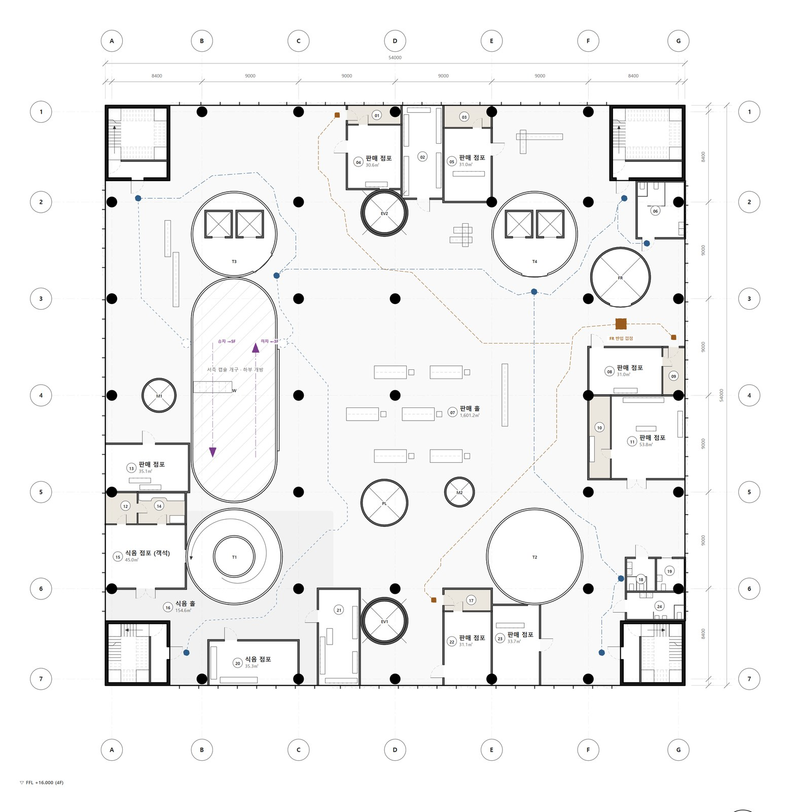

Native-resolution tiles:

- (0,0)..(800,800) [PNG](images/FLOOR_4F/tiles/x00000_y00000_w0800_h0800.png) · SHA256 `a4136ee67fceabd3aaf8b66e6b7943fe60443e9a171ebc6654e0076ff54d8b95`
- (800,0)..(1600,800) [PNG](images/FLOOR_4F/tiles/x00800_y00000_w0800_h0800.png) · SHA256 `254bffc65e29bfcc119f081e47138ee6666544a997244e8be4442405fbcd2dbf`
- (1600,0)..(2400,800) [PNG](images/FLOOR_4F/tiles/x01600_y00000_w0800_h0800.png) · SHA256 `3915e62ffcda1cd4b167e8a49464a383e0d37758e75924136bf26453173a54cf`
- (2400,0)..(2898,800) [PNG](images/FLOOR_4F/tiles/x02400_y00000_w0498_h0800.png) · SHA256 `de59258741fa00f52f5d549225544fb6c52c9d1c6ae7be717d8a9e740d0b9acf`
- (0,800)..(800,1600) [PNG](images/FLOOR_4F/tiles/x00000_y00800_w0800_h0800.png) · SHA256 `71c3858b5c2e605bc3d27b0ed79a8f4e97d5293519d3b01c3b466a5f902f8d7d`
- (800,800)..(1600,1600) [PNG](images/FLOOR_4F/tiles/x00800_y00800_w0800_h0800.png) · SHA256 `bd7709e6736b3fcc7b72643c7b06aec8ceb32460635c59c4e867a99843012700`
- (1600,800)..(2400,1600) [PNG](images/FLOOR_4F/tiles/x01600_y00800_w0800_h0800.png) · SHA256 `46c3be5543c225394c960c250781fededb0c58ad87274b82061852742a7be6a3`
- (2400,800)..(2898,1600) [PNG](images/FLOOR_4F/tiles/x02400_y00800_w0498_h0800.png) · SHA256 `6410174ab7137571aee3ce0cf547b5ef9bbb405137aa8c8252eb4d141b70a4e7`
- (0,1600)..(800,2400) [PNG](images/FLOOR_4F/tiles/x00000_y01600_w0800_h0800.png) · SHA256 `2fa2f2a13404e28c8deb1cf197b511b2185478d57e390b1b8d5e1c55d491da33`
- (800,1600)..(1600,2400) [PNG](images/FLOOR_4F/tiles/x00800_y01600_w0800_h0800.png) · SHA256 `6230b035c727f439344f17fab1eb9eae59b12c64d7667a2405a9b93fa358f57b`
- (1600,1600)..(2400,2400) [PNG](images/FLOOR_4F/tiles/x01600_y01600_w0800_h0800.png) · SHA256 `dc6efd3ffe624981148253eed2fcb0b42f78d2c35c455003e9a19eeb16ac6249`
- (2400,1600)..(2898,2400) [PNG](images/FLOOR_4F/tiles/x02400_y01600_w0498_h0800.png) · SHA256 `04b7b5c6b8e59560b1b4bd934f32af8c1347712b123992fd3d22da93aac224f5`
- (0,2400)..(800,2976) [PNG](images/FLOOR_4F/tiles/x00000_y02400_w0800_h0576.png) · SHA256 `48ecea2fea9b370df973108586b7e6ab4fd9316fd09ce102a380e0f09d723d1d`
- (800,2400)..(1600,2976) [PNG](images/FLOOR_4F/tiles/x00800_y02400_w0800_h0576.png) · SHA256 `2dffcda2d78d80427b04a0bb4bf8268897e934624ea98af94a655abef111a4a7`
- (1600,2400)..(2400,2976) [PNG](images/FLOOR_4F/tiles/x01600_y02400_w0800_h0576.png) · SHA256 `dce2db4db7b0391537b4507e00a9f197b0a0f9b91e498121341eaff5914ee7f6`
- (2400,2400)..(2898,2976) [PNG](images/FLOOR_4F/tiles/x02400_y02400_w0498_h0576.png) · SHA256 `1362bf81e317093a33ba8acb016cf81d4f570fdcda605f6f45fa70a021281fca`

## FLOOR_5F

Original name: `FLOOR_5F.png`
SHA256: `b77a52d10f854c7517ccb337efb9a187496425a59def4db73472ef11a3d9ebd9`
Dimensions: 2898×2976 pixels

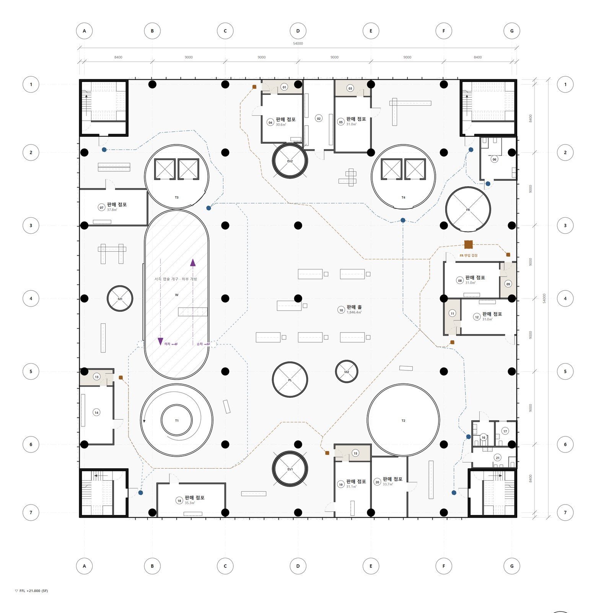

Native-resolution tiles:

- (0,0)..(800,800) [PNG](images/FLOOR_5F/tiles/x00000_y00000_w0800_h0800.png) · SHA256 `e55cbffdbb393f30de3068b418e659e1e1b0c0125f877112f59838c9506f7391`
- (800,0)..(1600,800) [PNG](images/FLOOR_5F/tiles/x00800_y00000_w0800_h0800.png) · SHA256 `645e1a774207d076e86ec0535b7823b90365a5a3f1c5565ebc7b36ad02890bbe`
- (1600,0)..(2400,800) [PNG](images/FLOOR_5F/tiles/x01600_y00000_w0800_h0800.png) · SHA256 `04a87a409b12b42b796889fae4d2603b33532ab1d5ce9946895e6634a13f20ff`
- (2400,0)..(2898,800) [PNG](images/FLOOR_5F/tiles/x02400_y00000_w0498_h0800.png) · SHA256 `fc2565673cf643a12742413c92baea5fbfd9b2f54cdf78b44c3b5e14796bbdfb`
- (0,800)..(800,1600) [PNG](images/FLOOR_5F/tiles/x00000_y00800_w0800_h0800.png) · SHA256 `fd164bf4ee829ce90b83be75a60327b7fd7e7d4d50ae80138a1cc457e1208e41`
- (800,800)..(1600,1600) [PNG](images/FLOOR_5F/tiles/x00800_y00800_w0800_h0800.png) · SHA256 `478051548cfe7041f1e68abb4b7ceef6f41964b930db07785b4c118d4c912b2f`
- (1600,800)..(2400,1600) [PNG](images/FLOOR_5F/tiles/x01600_y00800_w0800_h0800.png) · SHA256 `418803a774a7739fd2ded957b20f55439be58f68200b5724faae864c704f9426`
- (2400,800)..(2898,1600) [PNG](images/FLOOR_5F/tiles/x02400_y00800_w0498_h0800.png) · SHA256 `49ca32312fb1116420a3d49faba8fbb0dd3ae7230718609c625cafe5ce468eb2`
- (0,1600)..(800,2400) [PNG](images/FLOOR_5F/tiles/x00000_y01600_w0800_h0800.png) · SHA256 `5d08c4d8261b8870629df74a9563895ca711d0f1ca8da30728c3ecb1e3ad8ad2`
- (800,1600)..(1600,2400) [PNG](images/FLOOR_5F/tiles/x00800_y01600_w0800_h0800.png) · SHA256 `dba6cad91280bc0b6432bb874169d1a1362f857acd9d448b5220e47350b269d2`
- (1600,1600)..(2400,2400) [PNG](images/FLOOR_5F/tiles/x01600_y01600_w0800_h0800.png) · SHA256 `2669d3099c38172b8fd154acf0be1a7b45166db0414da8c75cae6ae558feffdc`
- (2400,1600)..(2898,2400) [PNG](images/FLOOR_5F/tiles/x02400_y01600_w0498_h0800.png) · SHA256 `0398b59c71a43e4b612838d3c0185fb358f9f47007f8e4c308936a659bd6d70f`
- (0,2400)..(800,2976) [PNG](images/FLOOR_5F/tiles/x00000_y02400_w0800_h0576.png) · SHA256 `7c2558cbcc43381e950baf3a0ef4e6f92a7f17bfb32d5b538b6d815eb65d0204`
- (800,2400)..(1600,2976) [PNG](images/FLOOR_5F/tiles/x00800_y02400_w0800_h0576.png) · SHA256 `6f186642d68be1bedad75a6ee68b919567cc00486dc22dd5853c444df76d7613`
- (1600,2400)..(2400,2976) [PNG](images/FLOOR_5F/tiles/x01600_y02400_w0800_h0576.png) · SHA256 `f9984aa0e027dd3cf8985bc4d07e7de205a55452f2f14b812280ef94e1305cb6`
- (2400,2400)..(2898,2976) [PNG](images/FLOOR_5F/tiles/x02400_y02400_w0498_h0576.png) · SHA256 `1362bf81e317093a33ba8acb016cf81d4f570fdcda605f6f45fa70a021281fca`

## FLOOR_6F

Original name: `FLOOR_6F.png`
SHA256: `eff4a0076a201df3bfc4eac39bf7313e94de715ae4c5ed919358200169abde3c`
Dimensions: 2898×2976 pixels

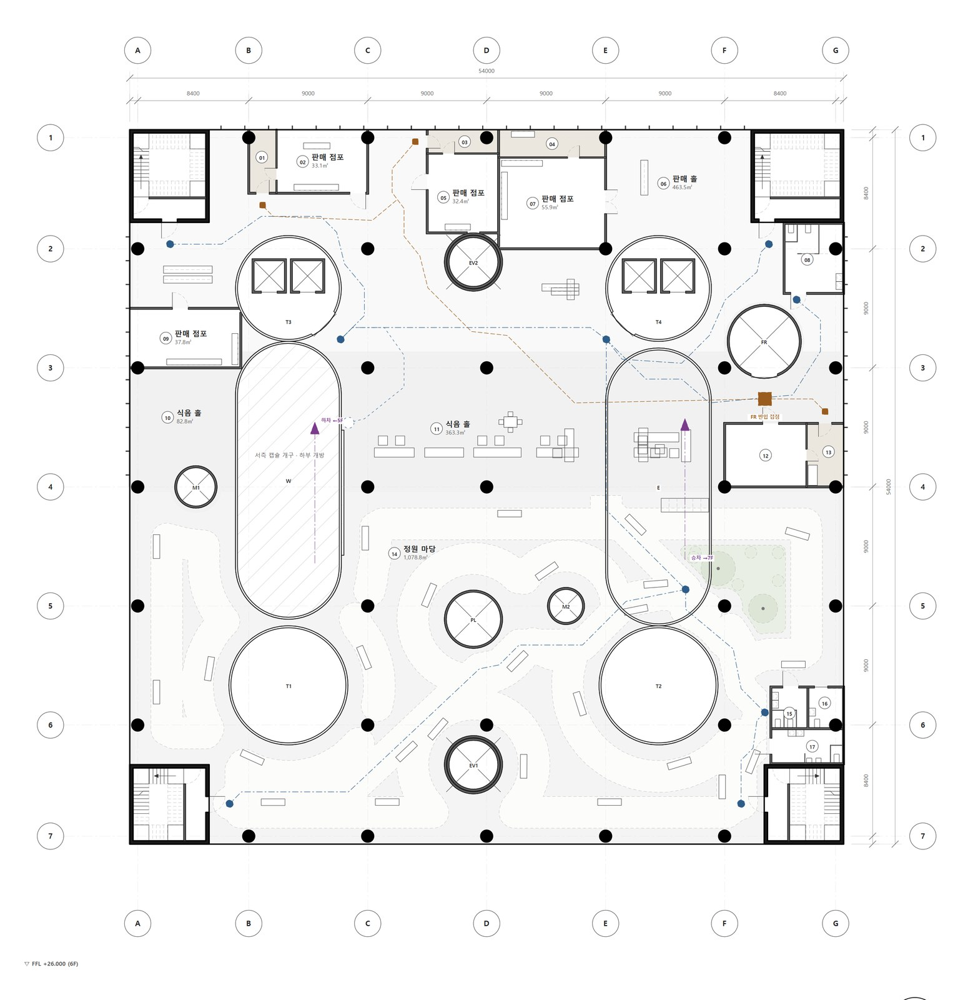

Native-resolution tiles:

- (0,0)..(800,800) [PNG](images/FLOOR_6F/tiles/x00000_y00000_w0800_h0800.png) · SHA256 `fe9fc0ec6508c59e88151953c1349fe811e22296d7cf38e64625fedb36fd931e`
- (800,0)..(1600,800) [PNG](images/FLOOR_6F/tiles/x00800_y00000_w0800_h0800.png) · SHA256 `4aed869acbb136f6c366145408a5e593b58bb1f6831177280d0a53517b6914f8`
- (1600,0)..(2400,800) [PNG](images/FLOOR_6F/tiles/x01600_y00000_w0800_h0800.png) · SHA256 `410862c35d3113333bc9dfb64205f918f9b668929fd738c0b57a56a3bf9c903f`
- (2400,0)..(2898,800) [PNG](images/FLOOR_6F/tiles/x02400_y00000_w0498_h0800.png) · SHA256 `33b1d7ce56c8580b3f41a2a96c3f64b80476fbf14c9fa5b700574b869510870d`
- (0,800)..(800,1600) [PNG](images/FLOOR_6F/tiles/x00000_y00800_w0800_h0800.png) · SHA256 `71502c92372ec66aa49e2a35f0f1ea4720dee74c57f0b4f448e52319672259ef`
- (800,800)..(1600,1600) [PNG](images/FLOOR_6F/tiles/x00800_y00800_w0800_h0800.png) · SHA256 `e743760b4c2b9f8d159481b0361e7bd4898925454665702940ea7df85f4ee3d1`
- (1600,800)..(2400,1600) [PNG](images/FLOOR_6F/tiles/x01600_y00800_w0800_h0800.png) · SHA256 `530bc57c641bde4a3def3d69e88bde18483538ec9371c705ad949d2b83c6e3aa`
- (2400,800)..(2898,1600) [PNG](images/FLOOR_6F/tiles/x02400_y00800_w0498_h0800.png) · SHA256 `1da008ab4808509ecb43eff8415ec97017c5cc6b3a5c4c0d416aec4eeae3d9dd`
- (0,1600)..(800,2400) [PNG](images/FLOOR_6F/tiles/x00000_y01600_w0800_h0800.png) · SHA256 `fe014ca66cb7a0501c8231136324931601b349f5537234653a497739112d6cd6`
- (800,1600)..(1600,2400) [PNG](images/FLOOR_6F/tiles/x00800_y01600_w0800_h0800.png) · SHA256 `fb2acff0c25e6ff76484196001a6f916ae75f20b35b1dcffad3be4b457b2800a`
- (1600,1600)..(2400,2400) [PNG](images/FLOOR_6F/tiles/x01600_y01600_w0800_h0800.png) · SHA256 `dcc5d85c8b882a7d76a289d1292d8ab1d0b53bb94335fc58ed9704862d285f3d`
- (2400,1600)..(2898,2400) [PNG](images/FLOOR_6F/tiles/x02400_y01600_w0498_h0800.png) · SHA256 `a1b0eef05dd38efafc562d394fe6dc20772004f3157f8fe7d3227fcf1028b35f`
- (0,2400)..(800,2976) [PNG](images/FLOOR_6F/tiles/x00000_y02400_w0800_h0576.png) · SHA256 `0210c4e156b6326b81b3a1c1dc37dcb5019abb00275ac6bb5c150a22b18c4dd6`
- (800,2400)..(1600,2976) [PNG](images/FLOOR_6F/tiles/x00800_y02400_w0800_h0576.png) · SHA256 `d8dcd2d3c6cc1dac378a3559e5963679bbe13ca846ef74af697425387ac6137c`
- (1600,2400)..(2400,2976) [PNG](images/FLOOR_6F/tiles/x01600_y02400_w0800_h0576.png) · SHA256 `1ddd762efba6b326b19d56370c0ff2a42e53bdb4eaa05d3014d99c0de69eec04`
- (2400,2400)..(2898,2976) [PNG](images/FLOOR_6F/tiles/x02400_y02400_w0498_h0576.png) · SHA256 `1362bf81e317093a33ba8acb016cf81d4f570fdcda605f6f45fa70a021281fca`

## FLOOR_7F

Original name: `FLOOR_7F.png`
SHA256: `ce52a34485deba798cd5ce34f4b9e7120d30863b85cbded4338c9d539195082b`
Dimensions: 2898×2976 pixels

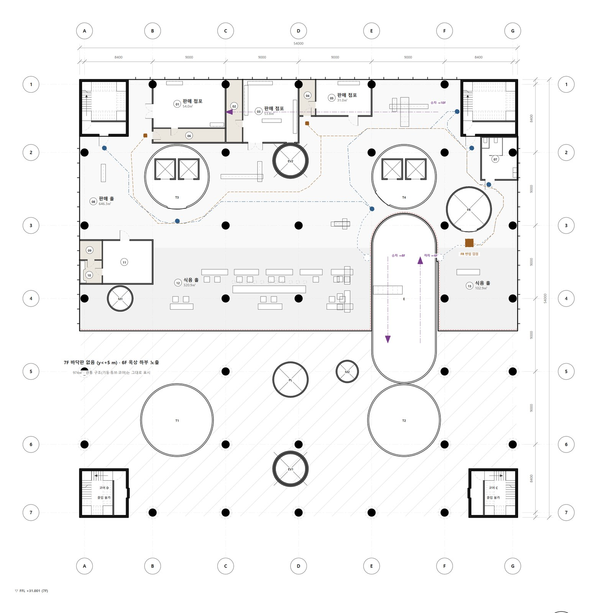

Native-resolution tiles:

- (0,0)..(800,800) [PNG](images/FLOOR_7F/tiles/x00000_y00000_w0800_h0800.png) · SHA256 `12a5ea4170cc77fd6af2ae0b710e4249903cba5dfa6542c0436fde8dc8469df5`
- (800,0)..(1600,800) [PNG](images/FLOOR_7F/tiles/x00800_y00000_w0800_h0800.png) · SHA256 `9b78b9bbdc79decf40ff877a7e1564dfa959a2bbe64d4f81f445a969c1c924f2`
- (1600,0)..(2400,800) [PNG](images/FLOOR_7F/tiles/x01600_y00000_w0800_h0800.png) · SHA256 `4fa35126f38d7ed7869727ef97876a41e59a921fba9e769196890a0cdf7be970`
- (2400,0)..(2898,800) [PNG](images/FLOOR_7F/tiles/x02400_y00000_w0498_h0800.png) · SHA256 `344d35781a49d70ca6934217be1e05c34e15459797d5f6a00bf6167908b429fa`
- (0,800)..(800,1600) [PNG](images/FLOOR_7F/tiles/x00000_y00800_w0800_h0800.png) · SHA256 `2b436cb07d8307bc7a423a83d73e9555e4036264cbd7eadf3411b77d8efa6715`
- (800,800)..(1600,1600) [PNG](images/FLOOR_7F/tiles/x00800_y00800_w0800_h0800.png) · SHA256 `c2940f0316ea7a99dc5f99c5ee1257dd2c2f535ca5183e48a950d2c2e5708c0e`
- (1600,800)..(2400,1600) [PNG](images/FLOOR_7F/tiles/x01600_y00800_w0800_h0800.png) · SHA256 `c62da38d74e12afd765237ca598075655f1ec64303249dca7303be09bb9c1194`
- (2400,800)..(2898,1600) [PNG](images/FLOOR_7F/tiles/x02400_y00800_w0498_h0800.png) · SHA256 `8ea304d28ef2965657b1c94cb0781416972427723696ea789c287aeef6cec779`
- (0,1600)..(800,2400) [PNG](images/FLOOR_7F/tiles/x00000_y01600_w0800_h0800.png) · SHA256 `ffe4c461f4b9dd9ee58a1e7406a679d2e42b9492df5925d0acfd9bf9f1a64617`
- (800,1600)..(1600,2400) [PNG](images/FLOOR_7F/tiles/x00800_y01600_w0800_h0800.png) · SHA256 `58263ffd23a919552fbc571a48b9b731b9605767d8871a5d9ca244f6750fb557`
- (1600,1600)..(2400,2400) [PNG](images/FLOOR_7F/tiles/x01600_y01600_w0800_h0800.png) · SHA256 `908e66f72b72a6bbed2cc3bd9522eda437e98584ba02a9ce001ea9c6f9a6fb9a`
- (2400,1600)..(2898,2400) [PNG](images/FLOOR_7F/tiles/x02400_y01600_w0498_h0800.png) · SHA256 `d4a2138b89b459a7ce3c52b216ce305a31e8f4b6f507339b46ee527f771438de`
- (0,2400)..(800,2976) [PNG](images/FLOOR_7F/tiles/x00000_y02400_w0800_h0576.png) · SHA256 `77ae4f04cc03a24d4867aa76ea55c135504c3700b5411bf727bc558b044dbc12`
- (800,2400)..(1600,2976) [PNG](images/FLOOR_7F/tiles/x00800_y02400_w0800_h0576.png) · SHA256 `127b289dbfc85de7bc0e569c85690a772a8f858f0a1e83950535442561138dbf`
- (1600,2400)..(2400,2976) [PNG](images/FLOOR_7F/tiles/x01600_y02400_w0800_h0576.png) · SHA256 `b98a4f5e684032be0b90d8e23a41a0b700292916186e6655aadfc90d5a0b92bf`
- (2400,2400)..(2898,2976) [PNG](images/FLOOR_7F/tiles/x02400_y02400_w0498_h0576.png) · SHA256 `58b6db5782e4bebf292552c39a80c5224fdb00d1ff0c2e72a18ae88a29c4c11e`

## FLOOR_8F

Original name: `FLOOR_8F.png`
SHA256: `efb9d01d616411bb14a0d5ea004651b731dabe26af28d818ece71d01a3ee9605`
Dimensions: 2898×2976 pixels

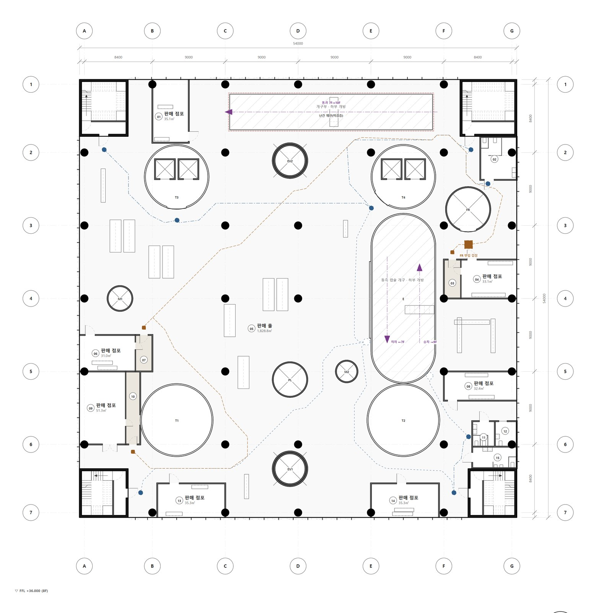

Native-resolution tiles:

- (0,0)..(800,800) [PNG](images/FLOOR_8F/tiles/x00000_y00000_w0800_h0800.png) · SHA256 `38a2c93827a415e14bbb0f2ffd585228be48c4b85739d16e541e1bb48a3a1d46`
- (800,0)..(1600,800) [PNG](images/FLOOR_8F/tiles/x00800_y00000_w0800_h0800.png) · SHA256 `a51ea854a3af38a254fd2cc5c220a48747bbcac2de5e762e089bb9b054d98b8d`
- (1600,0)..(2400,800) [PNG](images/FLOOR_8F/tiles/x01600_y00000_w0800_h0800.png) · SHA256 `15c982a312363c57fd914b9944bd18bbafb615294ded4fb0a427e37d04986abc`
- (2400,0)..(2898,800) [PNG](images/FLOOR_8F/tiles/x02400_y00000_w0498_h0800.png) · SHA256 `4a1f9dc6236cfa9c7ec8173bf82aaa8c894f8ee5f9a7be98ae60709b7179f75c`
- (0,800)..(800,1600) [PNG](images/FLOOR_8F/tiles/x00000_y00800_w0800_h0800.png) · SHA256 `0a6428a3fa81cff0a35482ee3904c5a7a610ecaf43abade75bb73c78d0a0de34`
- (800,800)..(1600,1600) [PNG](images/FLOOR_8F/tiles/x00800_y00800_w0800_h0800.png) · SHA256 `6a9b366d5d114667318480a015ceb7a02074883cded92361423f149a729bff35`
- (1600,800)..(2400,1600) [PNG](images/FLOOR_8F/tiles/x01600_y00800_w0800_h0800.png) · SHA256 `dcc2ff182c691fe1c13a1e01bee394c36ce466bd3f2422c599ac3a6e3d1e110a`
- (2400,800)..(2898,1600) [PNG](images/FLOOR_8F/tiles/x02400_y00800_w0498_h0800.png) · SHA256 `c0986b7bb86c4b0edcd0a4a08a7f4dbc3703eccd0c036d5248e95751a00cd7c1`
- (0,1600)..(800,2400) [PNG](images/FLOOR_8F/tiles/x00000_y01600_w0800_h0800.png) · SHA256 `302a4505538c35267ca0ec6a820b29dfef7eb7efc3e5a5a63823063f32425730`
- (800,1600)..(1600,2400) [PNG](images/FLOOR_8F/tiles/x00800_y01600_w0800_h0800.png) · SHA256 `0de557cc7e4cd5cdb323e97335ddfb95953b8af61a488840e8ccf84797dcbf3c`
- (1600,1600)..(2400,2400) [PNG](images/FLOOR_8F/tiles/x01600_y01600_w0800_h0800.png) · SHA256 `539e8438831597b7ef0184a176b088eddc0b741e5434c86c9f93a11ca4a91a25`
- (2400,1600)..(2898,2400) [PNG](images/FLOOR_8F/tiles/x02400_y01600_w0498_h0800.png) · SHA256 `f42bd9482aad13e5d7741db4eefd6b147a3b5b6b6dbf8d3e82e3bcc6dd2e3d5e`
- (0,2400)..(800,2976) [PNG](images/FLOOR_8F/tiles/x00000_y02400_w0800_h0576.png) · SHA256 `a2b89a00e9bfd979847cc059c022d5d16a0cc09f1ea365139f9cc7876d414e17`
- (800,2400)..(1600,2976) [PNG](images/FLOOR_8F/tiles/x00800_y02400_w0800_h0576.png) · SHA256 `6d97fc68144d46e3358b933a4de3d21d035829dde46b8f3e21fedaadf61a0c81`
- (1600,2400)..(2400,2976) [PNG](images/FLOOR_8F/tiles/x01600_y02400_w0800_h0576.png) · SHA256 `d0adc9f948e9f4a5963f7eb6e41da407a31bbf670d462e30ca8c49809b59fb62`
- (2400,2400)..(2898,2976) [PNG](images/FLOOR_8F/tiles/x02400_y02400_w0498_h0576.png) · SHA256 `1362bf81e317093a33ba8acb016cf81d4f570fdcda605f6f45fa70a021281fca`

## FLOOR_9F

Original name: `FLOOR_9F.png`
SHA256: `03769c0873ace829702c3901b60b817373b678372075c89fcf9d2c77cb22f0aa`
Dimensions: 2898×2976 pixels

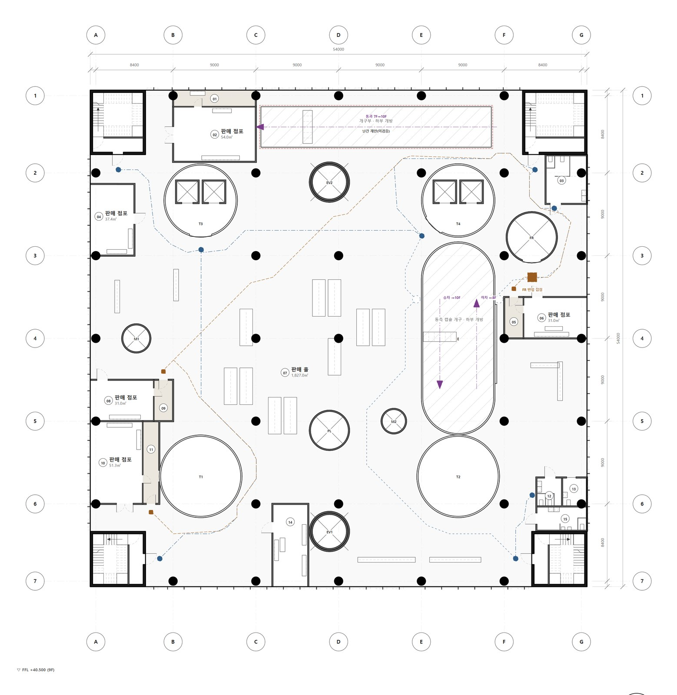

Native-resolution tiles:

- (0,0)..(800,800) [PNG](images/FLOOR_9F/tiles/x00000_y00000_w0800_h0800.png) · SHA256 `718e7cd44dbbd8c74891a59f743137a08a45f824a58bd13b0c401708388ee856`
- (800,0)..(1600,800) [PNG](images/FLOOR_9F/tiles/x00800_y00000_w0800_h0800.png) · SHA256 `775a87e3a72ecdd936e6199ccf84eb5d2029a2ea8d6bcd3ed19db6c1dcf02e02`
- (1600,0)..(2400,800) [PNG](images/FLOOR_9F/tiles/x01600_y00000_w0800_h0800.png) · SHA256 `1bb9287ab8e5fe7f40671b454e6296c1cb2b994e4618c18c4f17ad553c1168ed`
- (2400,0)..(2898,800) [PNG](images/FLOOR_9F/tiles/x02400_y00000_w0498_h0800.png) · SHA256 `b46f377dab2afedc79b4241e9e119b01d957e1084b34e9101edc65e64be75b53`
- (0,800)..(800,1600) [PNG](images/FLOOR_9F/tiles/x00000_y00800_w0800_h0800.png) · SHA256 `1293d90c72bdadc04e0382c7705f60f80d1bcdfc5a9bd720b2822d619d6cb5c4`
- (800,800)..(1600,1600) [PNG](images/FLOOR_9F/tiles/x00800_y00800_w0800_h0800.png) · SHA256 `9ade1adff20b40fb80aa2f2389eefdd97e29ea237d3f92742c722c964e592c8a`
- (1600,800)..(2400,1600) [PNG](images/FLOOR_9F/tiles/x01600_y00800_w0800_h0800.png) · SHA256 `8431ba6511eac8e0bff04c04a6359008145c20910120e43c526a483b07d0e074`
- (2400,800)..(2898,1600) [PNG](images/FLOOR_9F/tiles/x02400_y00800_w0498_h0800.png) · SHA256 `9c649fa68cda78618b43b812c7e64e6b6bac1249dfd908b0bef086d3d3c777ca`
- (0,1600)..(800,2400) [PNG](images/FLOOR_9F/tiles/x00000_y01600_w0800_h0800.png) · SHA256 `63509022ee77a37eca45caeca1f6c3abafa727f4d62bce24144e4045410f8600`
- (800,1600)..(1600,2400) [PNG](images/FLOOR_9F/tiles/x00800_y01600_w0800_h0800.png) · SHA256 `bf32493a6db7d388a29af15a7f3a2f124f65a1357b9650c1f2e10a423c4eb038`
- (1600,1600)..(2400,2400) [PNG](images/FLOOR_9F/tiles/x01600_y01600_w0800_h0800.png) · SHA256 `997afa8fccd1ed409fc864ec4f55c210e29f140a84ea370059a8127328161ec2`
- (2400,1600)..(2898,2400) [PNG](images/FLOOR_9F/tiles/x02400_y01600_w0498_h0800.png) · SHA256 `a4ec09a2835eb9811ac836b89e61cc28237115e738a12811073437658f22d03f`
- (0,2400)..(800,2976) [PNG](images/FLOOR_9F/tiles/x00000_y02400_w0800_h0576.png) · SHA256 `f5a47bd41c7e8df601cabaa21f62d0109f929a8e3cde5421c9ecc4692c935a72`
- (800,2400)..(1600,2976) [PNG](images/FLOOR_9F/tiles/x00800_y02400_w0800_h0576.png) · SHA256 `bed3fe87f0ec6630d1a2431acd82f2ea14bc8881e26d5128aeaf249644a92b55`
- (1600,2400)..(2400,2976) [PNG](images/FLOOR_9F/tiles/x01600_y02400_w0800_h0576.png) · SHA256 `d442ac938846179653c450fbdccab3d9f434d661a16d0ccf087b90ae1ac00cb5`
- (2400,2400)..(2898,2976) [PNG](images/FLOOR_9F/tiles/x02400_y02400_w0498_h0576.png) · SHA256 `1362bf81e317093a33ba8acb016cf81d4f570fdcda605f6f45fa70a021281fca`

## FLOOR_10F

Original name: `FLOOR_10F.png`
SHA256: `48d2a3c1117f2b3fa50be289791b74b5ac45b8dbd61765790bded00db351d3b1`
Dimensions: 2898×2976 pixels

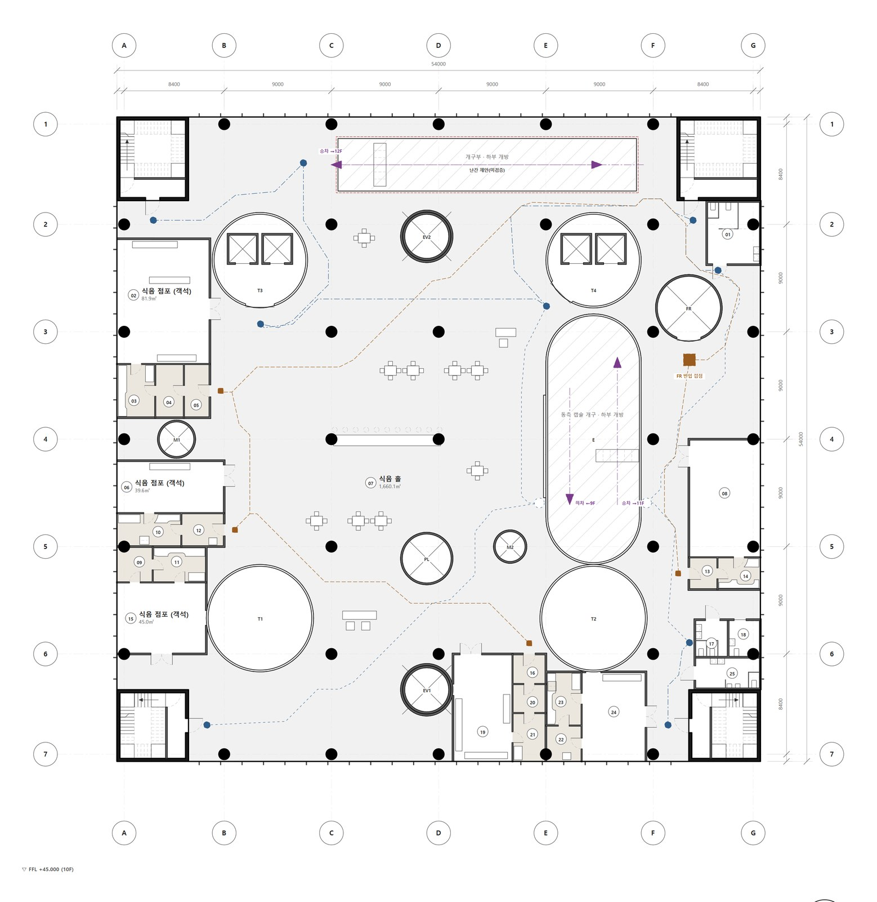

Native-resolution tiles:

- (0,0)..(800,800) [PNG](images/FLOOR_10F/tiles/x00000_y00000_w0800_h0800.png) · SHA256 `48ceaeb89099f9f4ac6ec1057904c213bf3b3827e5c250022e975cb7ce25ba7e`
- (800,0)..(1600,800) [PNG](images/FLOOR_10F/tiles/x00800_y00000_w0800_h0800.png) · SHA256 `0f82ae4123a0e1f0249fbce81d1c5a5bab0b86584aaaad85362731f183a33491`
- (1600,0)..(2400,800) [PNG](images/FLOOR_10F/tiles/x01600_y00000_w0800_h0800.png) · SHA256 `aeb2402abdd3aae1cb5409c6becbd03a5e4fd3113d421c44d28e5e7e992e0de0`
- (2400,0)..(2898,800) [PNG](images/FLOOR_10F/tiles/x02400_y00000_w0498_h0800.png) · SHA256 `c6f128a9adac547cf3be187163da63d4e30d70052a4064b5b995dd764a8da20b`
- (0,800)..(800,1600) [PNG](images/FLOOR_10F/tiles/x00000_y00800_w0800_h0800.png) · SHA256 `fbac998a735a144f32363c75b62d3b0ccdfbd603b7f0a439f1febd7cab356794`
- (800,800)..(1600,1600) [PNG](images/FLOOR_10F/tiles/x00800_y00800_w0800_h0800.png) · SHA256 `f79c24cc1252c14669314a2f524353c719c8233c85deb7af14af0ca5a2afd2e0`
- (1600,800)..(2400,1600) [PNG](images/FLOOR_10F/tiles/x01600_y00800_w0800_h0800.png) · SHA256 `6bd17cb1a6a8efb98a9cc2055c33f91ad1bdef0bfb34bf0bc88248af74d73cd4`
- (2400,800)..(2898,1600) [PNG](images/FLOOR_10F/tiles/x02400_y00800_w0498_h0800.png) · SHA256 `99a0d3fb968008e66586694e8f6ef3cd9b3ee1420fdcbf3db3c582dfe3a66f95`
- (0,1600)..(800,2400) [PNG](images/FLOOR_10F/tiles/x00000_y01600_w0800_h0800.png) · SHA256 `8b7971c5539ee220c95d54b9bedaa1757248beb3e46b782b4096631b7b098cb6`
- (800,1600)..(1600,2400) [PNG](images/FLOOR_10F/tiles/x00800_y01600_w0800_h0800.png) · SHA256 `dc6ffbe290ee26cc582bd1edea4fe7486ad54b6b8ef06c3e1f4401fde4d02182`
- (1600,1600)..(2400,2400) [PNG](images/FLOOR_10F/tiles/x01600_y01600_w0800_h0800.png) · SHA256 `21ac98121c32e3a5069f76acb8cb4981453135d5f09f866dec9c237814300f46`
- (2400,1600)..(2898,2400) [PNG](images/FLOOR_10F/tiles/x02400_y01600_w0498_h0800.png) · SHA256 `9ea11a6c7b00f863d438c8fdfcf238d889d3eea5b4fecebaea302bb1c5daab19`
- (0,2400)..(800,2976) [PNG](images/FLOOR_10F/tiles/x00000_y02400_w0800_h0576.png) · SHA256 `ac00c48ef334ae04e231a85d365daaa166f2bf062396e6656bef24f90a7d7980`
- (800,2400)..(1600,2976) [PNG](images/FLOOR_10F/tiles/x00800_y02400_w0800_h0576.png) · SHA256 `08dbf9966415c3cbf0b5ec0520c3f977709fa2c1c06654e499fcc6e9601764c0`
- (1600,2400)..(2400,2976) [PNG](images/FLOOR_10F/tiles/x01600_y02400_w0800_h0576.png) · SHA256 `e19a32bf289c49acb0ae1fba438700c7bd9c1faf971805223a7ea5cd0c79eb2d`
- (2400,2400)..(2898,2976) [PNG](images/FLOOR_10F/tiles/x02400_y02400_w0498_h0576.png) · SHA256 `1362bf81e317093a33ba8acb016cf81d4f570fdcda605f6f45fa70a021281fca`

## FLOOR_11F

Original name: `FLOOR_11F.png`
SHA256: `177a216f8811bfa543a97eb4c5c3ad29eea3cffd64fae4f4adfcc101b2394e26`
Dimensions: 2898×2976 pixels

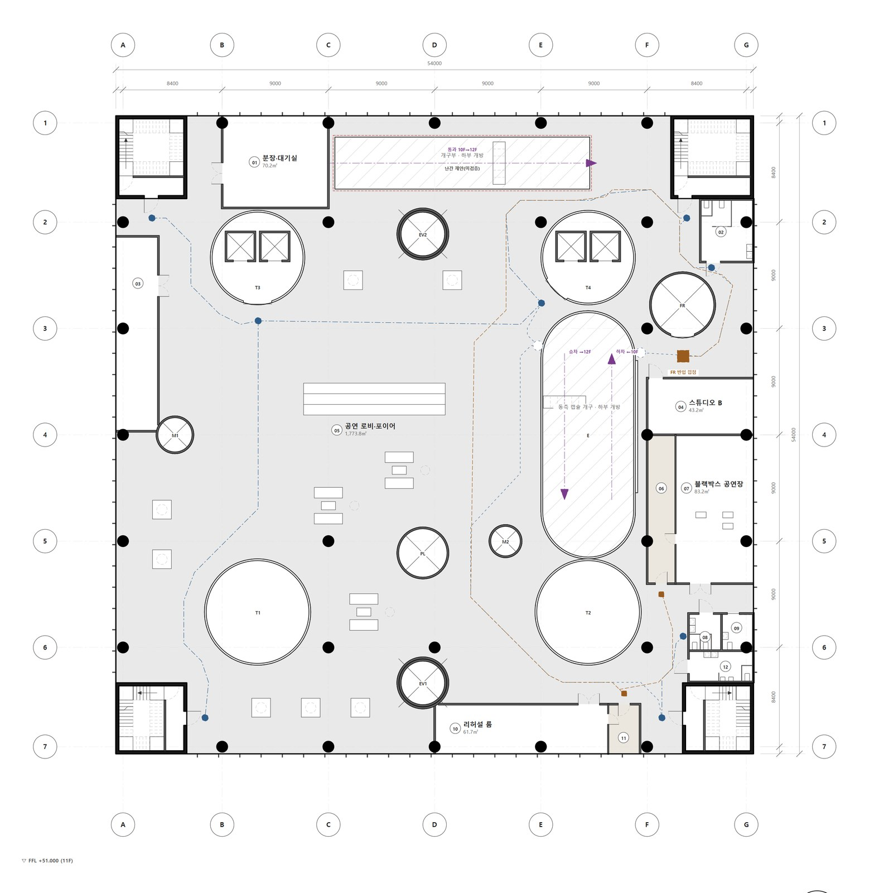

Native-resolution tiles:

- (0,0)..(800,800) [PNG](images/FLOOR_11F/tiles/x00000_y00000_w0800_h0800.png) · SHA256 `90c2825cef84753f9ac6781c0059fd172632f6d14355f68e417486a53703ddc6`
- (800,0)..(1600,800) [PNG](images/FLOOR_11F/tiles/x00800_y00000_w0800_h0800.png) · SHA256 `fb0e16c99a362b51c258e67f450064048f239e4be176cfd2d163357f1d58ca3e`
- (1600,0)..(2400,800) [PNG](images/FLOOR_11F/tiles/x01600_y00000_w0800_h0800.png) · SHA256 `f69011e6500d5509a9c112e2aa55e2de0e0970061553d56ea3e1fe8ace58831a`
- (2400,0)..(2898,800) [PNG](images/FLOOR_11F/tiles/x02400_y00000_w0498_h0800.png) · SHA256 `bed01b9532f79c17cfecd249b71b23711edd64be7d8335a05b0cff2a1d784277`
- (0,800)..(800,1600) [PNG](images/FLOOR_11F/tiles/x00000_y00800_w0800_h0800.png) · SHA256 `500d099417580e1069e36c0dc715d88e0a4fab8f5789448571c97364daf02479`
- (800,800)..(1600,1600) [PNG](images/FLOOR_11F/tiles/x00800_y00800_w0800_h0800.png) · SHA256 `86d27987569417342106280d8957d9ed54e13183444b23277f7942618a0cec05`
- (1600,800)..(2400,1600) [PNG](images/FLOOR_11F/tiles/x01600_y00800_w0800_h0800.png) · SHA256 `8f8531c18453d415f3816dc1e49251ba71ea63918e11caf8ca3b56e16a672c00`
- (2400,800)..(2898,1600) [PNG](images/FLOOR_11F/tiles/x02400_y00800_w0498_h0800.png) · SHA256 `8d395a4cf8b0a6cbbad2120fd2f98b42f1de6d6e148f2ad446a7b4364e0a3427`
- (0,1600)..(800,2400) [PNG](images/FLOOR_11F/tiles/x00000_y01600_w0800_h0800.png) · SHA256 `0180d5ca7adce092d7742cea1887990bd10a45c9389941ae8b8927f1d9e5a26a`
- (800,1600)..(1600,2400) [PNG](images/FLOOR_11F/tiles/x00800_y01600_w0800_h0800.png) · SHA256 `a49560b2847d26d3193b01ded836fc3c2e677cb45cb9e53fa782f9b582f0babf`
- (1600,1600)..(2400,2400) [PNG](images/FLOOR_11F/tiles/x01600_y01600_w0800_h0800.png) · SHA256 `d712b95f05494a333ba20c05e60f289a51de80eeed803600fa0bcdc9701c9af8`
- (2400,1600)..(2898,2400) [PNG](images/FLOOR_11F/tiles/x02400_y01600_w0498_h0800.png) · SHA256 `867b7da58c201023b259a53b396294ced9e71c078c81bd538c1d289c7887d839`
- (0,2400)..(800,2976) [PNG](images/FLOOR_11F/tiles/x00000_y02400_w0800_h0576.png) · SHA256 `8fa37a8480c8c42f7da4fa7928e1ef6e505d3522561ee6c98c41d3fce24a02b7`
- (800,2400)..(1600,2976) [PNG](images/FLOOR_11F/tiles/x00800_y02400_w0800_h0576.png) · SHA256 `984de11170b1dac45c9cbce88fcc190d67a2b0922d1a83876a7c6ed8fe253c9d`
- (1600,2400)..(2400,2976) [PNG](images/FLOOR_11F/tiles/x01600_y02400_w0800_h0576.png) · SHA256 `736dcabef8a922b6706999423a7834e9c8de6fc16ab99e9550e2c3a4208bf691`
- (2400,2400)..(2898,2976) [PNG](images/FLOOR_11F/tiles/x02400_y02400_w0498_h0576.png) · SHA256 `1362bf81e317093a33ba8acb016cf81d4f570fdcda605f6f45fa70a021281fca`

## FLOOR_12F

Original name: `FLOOR_12F.png`
SHA256: `791acaaea969e37d634706505fc42339b3f1ae911c667a7967227d221e661031`
Dimensions: 2898×2976 pixels

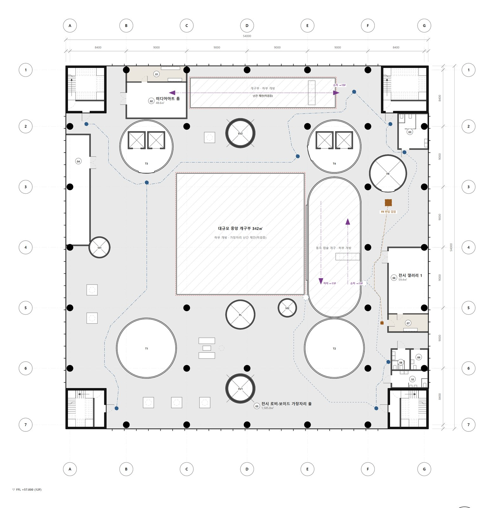

Native-resolution tiles:

- (0,0)..(800,800) [PNG](images/FLOOR_12F/tiles/x00000_y00000_w0800_h0800.png) · SHA256 `f21130b9f37ed9284347b7ee6b0a09f7203ae76d2494d7cbe36894b8a768030b`
- (800,0)..(1600,800) [PNG](images/FLOOR_12F/tiles/x00800_y00000_w0800_h0800.png) · SHA256 `25570a4647f6384d63a56f22c107bd085a6820bd77e24b00bdef06d8da480f4f`
- (1600,0)..(2400,800) [PNG](images/FLOOR_12F/tiles/x01600_y00000_w0800_h0800.png) · SHA256 `a6153ceb779e05cb9f1afb96f3747e5d8f17c03b22d6b45caa1f5d6d02cf3177`
- (2400,0)..(2898,800) [PNG](images/FLOOR_12F/tiles/x02400_y00000_w0498_h0800.png) · SHA256 `0142087db75ff30e5b04705fb2d758f5b5279d25809748b3afc634dd658d1c30`
- (0,800)..(800,1600) [PNG](images/FLOOR_12F/tiles/x00000_y00800_w0800_h0800.png) · SHA256 `7fd9c5539741235459bfb76a4acad4ad25462e59af047c81f7d3754e92332cfe`
- (800,800)..(1600,1600) [PNG](images/FLOOR_12F/tiles/x00800_y00800_w0800_h0800.png) · SHA256 `0cd91ae7db4c84b79695b5278c6aa462f58818e6123ac770d23f87a511a56064`
- (1600,800)..(2400,1600) [PNG](images/FLOOR_12F/tiles/x01600_y00800_w0800_h0800.png) · SHA256 `137eac2e58d31a91288f67ba6cce1ebd4e8668b50d7b71b292917fbf60ea119f`
- (2400,800)..(2898,1600) [PNG](images/FLOOR_12F/tiles/x02400_y00800_w0498_h0800.png) · SHA256 `c8be03535a1cc10510f6e5d9d313f09386b5e49481d2cf58bf491e40f2bd123a`
- (0,1600)..(800,2400) [PNG](images/FLOOR_12F/tiles/x00000_y01600_w0800_h0800.png) · SHA256 `ea813bc5250bfd4658b5ba1e2671e31cc1de58c71aaecd6a8fef44f5528730a2`
- (800,1600)..(1600,2400) [PNG](images/FLOOR_12F/tiles/x00800_y01600_w0800_h0800.png) · SHA256 `de2be067fe8caa45e2de29a517fa7404a5f1f3ceb023959e5d6db247be259314`
- (1600,1600)..(2400,2400) [PNG](images/FLOOR_12F/tiles/x01600_y01600_w0800_h0800.png) · SHA256 `36e4723d4ff8a24a7afb78702eaa9d1b6273974bd0ac4e6b7f242c242b4f8619`
- (2400,1600)..(2898,2400) [PNG](images/FLOOR_12F/tiles/x02400_y01600_w0498_h0800.png) · SHA256 `ee75e440750c02429008989b6fe2abc1257237b50b2496a378977ec44b89c0d7`
- (0,2400)..(800,2976) [PNG](images/FLOOR_12F/tiles/x00000_y02400_w0800_h0576.png) · SHA256 `e2b1154d8f02f970d68b512aa332c97e79b405f6f03bb1602ffd614382aeb153`
- (800,2400)..(1600,2976) [PNG](images/FLOOR_12F/tiles/x00800_y02400_w0800_h0576.png) · SHA256 `75dda1456d0aa6949eda0bfa1d0b665d559bd30e38cf749f8a1dc98ab2d6fbf5`
- (1600,2400)..(2400,2976) [PNG](images/FLOOR_12F/tiles/x01600_y02400_w0800_h0576.png) · SHA256 `7ede8078392f6861df286acc08c487d339b44dcde15f072238eda4cff87e7bb6`
- (2400,2400)..(2898,2976) [PNG](images/FLOOR_12F/tiles/x02400_y02400_w0498_h0576.png) · SHA256 `1362bf81e317093a33ba8acb016cf81d4f570fdcda605f6f45fa70a021281fca`

## FLOOR_13F

Original name: `FLOOR_13F.png`
SHA256: `bb35fd3cf150a3f7aaea80b5220c0f4ba98de908f9432490fbb0306f15a273a6`
Dimensions: 2898×2976 pixels

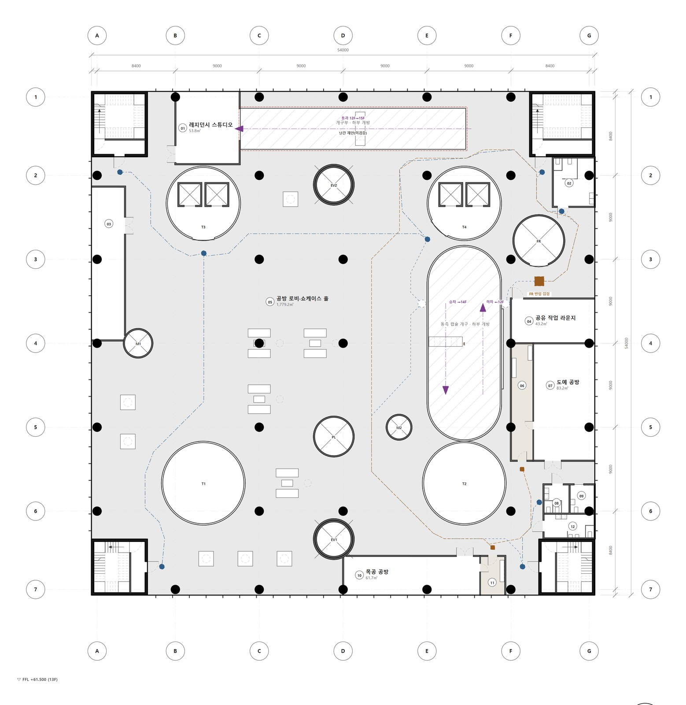

Native-resolution tiles:

- (0,0)..(800,800) [PNG](images/FLOOR_13F/tiles/x00000_y00000_w0800_h0800.png) · SHA256 `8d3b53f5e072a21e092ad3b6f010d44a9b99ec22bf591741cd5eee52a87a2856`
- (800,0)..(1600,800) [PNG](images/FLOOR_13F/tiles/x00800_y00000_w0800_h0800.png) · SHA256 `c34aa31ffd9ac175b07785216b56833eb5026ca269e7234b222a3e81688adce0`
- (1600,0)..(2400,800) [PNG](images/FLOOR_13F/tiles/x01600_y00000_w0800_h0800.png) · SHA256 `2dfff8b5e7c500e8c41986e8038c8ede71f52f5c12770194c3360463962d5a0b`
- (2400,0)..(2898,800) [PNG](images/FLOOR_13F/tiles/x02400_y00000_w0498_h0800.png) · SHA256 `5fe094d35d670d81df419c4e5d3589599229ef76a7a664f54ed3ee20bd99ba53`
- (0,800)..(800,1600) [PNG](images/FLOOR_13F/tiles/x00000_y00800_w0800_h0800.png) · SHA256 `70765dc7b2b8576c1a29531999dbb8d8aefee17035ae583a79dea05da7bfd1d5`
- (800,800)..(1600,1600) [PNG](images/FLOOR_13F/tiles/x00800_y00800_w0800_h0800.png) · SHA256 `c7e02f91bd92fd77692a4fe474a2cac50480de48eb40216a6e09d7e740a9e61f`
- (1600,800)..(2400,1600) [PNG](images/FLOOR_13F/tiles/x01600_y00800_w0800_h0800.png) · SHA256 `445a419fe1d58fc0d7c7387c91b5f2a7792f812afff9e1fd342d1649934bd03f`
- (2400,800)..(2898,1600) [PNG](images/FLOOR_13F/tiles/x02400_y00800_w0498_h0800.png) · SHA256 `32aba337bd8f96b7bfd33791c7ca0c08d4c881d0b67719357871c04d99b96d3d`
- (0,1600)..(800,2400) [PNG](images/FLOOR_13F/tiles/x00000_y01600_w0800_h0800.png) · SHA256 `8566c2372721546a23ddc0d289e07bc3e58e8c8472736234c6acc276a48935aa`
- (800,1600)..(1600,2400) [PNG](images/FLOOR_13F/tiles/x00800_y01600_w0800_h0800.png) · SHA256 `92819cd670fd35f4c1d5537c6b94171b8439df2911a3a9f59822d7303ffb8d87`
- (1600,1600)..(2400,2400) [PNG](images/FLOOR_13F/tiles/x01600_y01600_w0800_h0800.png) · SHA256 `c9951d87c67841fa7ca299cdbf8794398dfa22da6ccffa9ba3c7bfdd7b866eb8`
- (2400,1600)..(2898,2400) [PNG](images/FLOOR_13F/tiles/x02400_y01600_w0498_h0800.png) · SHA256 `9ac0ea07380b7f9002dbd15c5ba2253665d19e7396e590cf32cc2c52508d6a20`
- (0,2400)..(800,2976) [PNG](images/FLOOR_13F/tiles/x00000_y02400_w0800_h0576.png) · SHA256 `2b80b41c5d85f421cb8018eff57a2ec836af488e684c670d76d4dbe6e0ee97b8`
- (800,2400)..(1600,2976) [PNG](images/FLOOR_13F/tiles/x00800_y02400_w0800_h0576.png) · SHA256 `1760b9328590bd6c1529946f291972b753e9372e23bfa624c21cccb72c350db6`
- (1600,2400)..(2400,2976) [PNG](images/FLOOR_13F/tiles/x01600_y02400_w0800_h0576.png) · SHA256 `eded92610f6a373ed6c0ab3a943d85d015ad9dea6f36b1fb19012e5c3362015f`
- (2400,2400)..(2898,2976) [PNG](images/FLOOR_13F/tiles/x02400_y02400_w0498_h0576.png) · SHA256 `1362bf81e317093a33ba8acb016cf81d4f570fdcda605f6f45fa70a021281fca`

## FLOOR_14F

Original name: `FLOOR_14F.png`
SHA256: `1066fb23c602240b06c9d3579c998a0c223477a20051c9038f6b8903a0a0b736`
Dimensions: 2898×2976 pixels

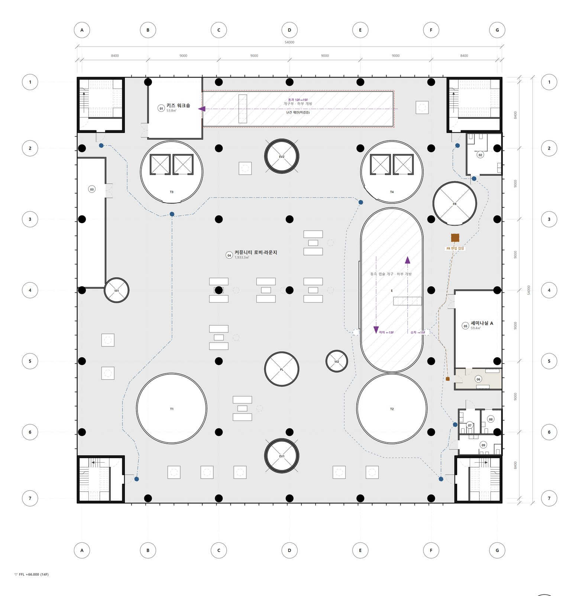

Native-resolution tiles:

- (0,0)..(800,800) [PNG](images/FLOOR_14F/tiles/x00000_y00000_w0800_h0800.png) · SHA256 `61641963e93f759fcfb5189ab16e2c8375d1eef0b5bb3d72e779c1202600eb95`
- (800,0)..(1600,800) [PNG](images/FLOOR_14F/tiles/x00800_y00000_w0800_h0800.png) · SHA256 `5a4979c60cf0e0343b219ed34b120ebc4da697445dfa8160571b12af74b1e3cd`
- (1600,0)..(2400,800) [PNG](images/FLOOR_14F/tiles/x01600_y00000_w0800_h0800.png) · SHA256 `b5ec882640305bb05499c18c696bed13bb9a9a00e0f50d395ea1fb9a118d8f7c`
- (2400,0)..(2898,800) [PNG](images/FLOOR_14F/tiles/x02400_y00000_w0498_h0800.png) · SHA256 `bf940fd6a097a9a65df592b7e4a51a078464b58841182baea8b201f979d37aeb`
- (0,800)..(800,1600) [PNG](images/FLOOR_14F/tiles/x00000_y00800_w0800_h0800.png) · SHA256 `9d2e28433ea4e2974b23aeb8d290efb2aa79d99720697f8d43650a1f4ec5cb1b`
- (800,800)..(1600,1600) [PNG](images/FLOOR_14F/tiles/x00800_y00800_w0800_h0800.png) · SHA256 `ae923a6dafdc6ef4d80317c4319e47c31a962ffb51b8fef91252465924d11524`
- (1600,800)..(2400,1600) [PNG](images/FLOOR_14F/tiles/x01600_y00800_w0800_h0800.png) · SHA256 `824c59b29cc1afeddbc09c24595270919f5115fc2cd63bcedfd5948c3d97328e`
- (2400,800)..(2898,1600) [PNG](images/FLOOR_14F/tiles/x02400_y00800_w0498_h0800.png) · SHA256 `1fed482b33570da8b8c849a3247ef1209b1fcce1afa7ea1ffbda5c7db11dd11a`
- (0,1600)..(800,2400) [PNG](images/FLOOR_14F/tiles/x00000_y01600_w0800_h0800.png) · SHA256 `3d2cda4086a9610cc5520909fc8ee2acccc6445f83bebd853398b63081f39c46`
- (800,1600)..(1600,2400) [PNG](images/FLOOR_14F/tiles/x00800_y01600_w0800_h0800.png) · SHA256 `8b78db37164a6d151eb7018ad4d3b25e92f70d187e2ac7c5881c9b564d2cd7a5`
- (1600,1600)..(2400,2400) [PNG](images/FLOOR_14F/tiles/x01600_y01600_w0800_h0800.png) · SHA256 `0193c10818cdf4dea842aa142d12e36e498bb22dd402d41a99cffebe0bed74fe`
- (2400,1600)..(2898,2400) [PNG](images/FLOOR_14F/tiles/x02400_y01600_w0498_h0800.png) · SHA256 `fba198256e246cbfc330f6ea50e885da68cc78617502dac6a4113cb1f6b6a944`
- (0,2400)..(800,2976) [PNG](images/FLOOR_14F/tiles/x00000_y02400_w0800_h0576.png) · SHA256 `b135878e9e6e3fa9adbd21b33b7b2eff85580d00a6f94603e9cd6a7076235ada`
- (800,2400)..(1600,2976) [PNG](images/FLOOR_14F/tiles/x00800_y02400_w0800_h0576.png) · SHA256 `259e681c8fcec104420fe519f0a7ab24f9b7b09250a82adf86279ee4a60763d1`
- (1600,2400)..(2400,2976) [PNG](images/FLOOR_14F/tiles/x01600_y02400_w0800_h0576.png) · SHA256 `7ede8078392f6861df286acc08c487d339b44dcde15f072238eda4cff87e7bb6`
- (2400,2400)..(2898,2976) [PNG](images/FLOOR_14F/tiles/x02400_y02400_w0498_h0576.png) · SHA256 `1362bf81e317093a33ba8acb016cf81d4f570fdcda605f6f45fa70a021281fca`

## FLOOR_15F

Original name: `FLOOR_15F.png`
SHA256: `8cfdd1e5404155924fef1636f2d940155476a3e046c4c1d8e6c655b049db941c`
Dimensions: 2898×2976 pixels

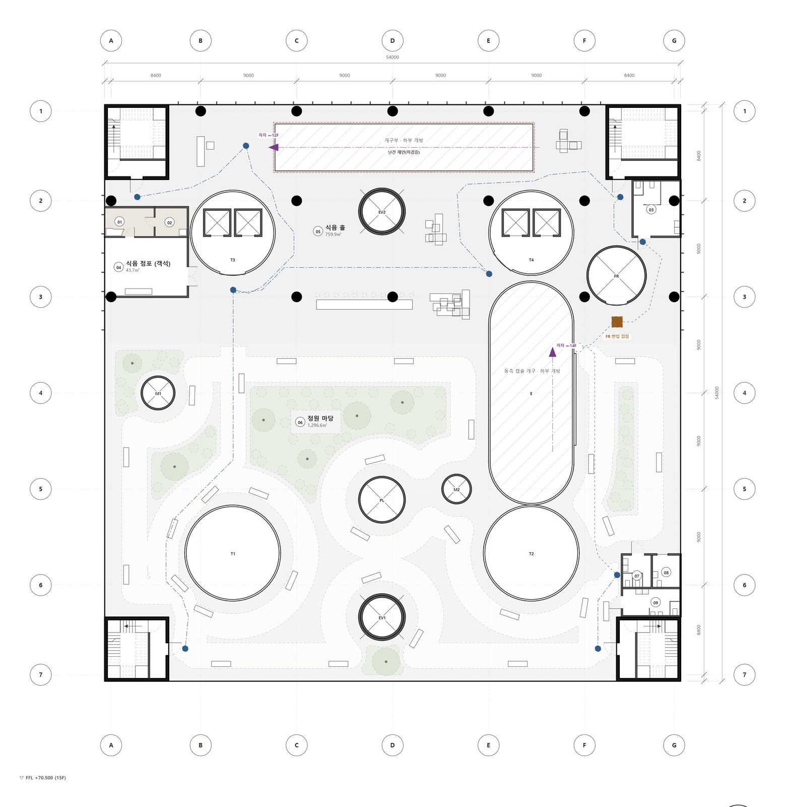

Native-resolution tiles:

- (0,0)..(800,800) [PNG](images/FLOOR_15F/tiles/x00000_y00000_w0800_h0800.png) · SHA256 `bf2eea250807521ae2795493f6501f4c889e1a6c025f05002158c99306bd1c27`
- (800,0)..(1600,800) [PNG](images/FLOOR_15F/tiles/x00800_y00000_w0800_h0800.png) · SHA256 `b2cffcd376a6d6638afbe5305349a683ae4b27fc308a132985f0490a09a80998`
- (1600,0)..(2400,800) [PNG](images/FLOOR_15F/tiles/x01600_y00000_w0800_h0800.png) · SHA256 `a1cf8e4ccf74d2fcbd9d090eaab7f05e9dc7c4b158d2118a2eb9242570f5a367`
- (2400,0)..(2898,800) [PNG](images/FLOOR_15F/tiles/x02400_y00000_w0498_h0800.png) · SHA256 `a3811a21cb562da6b6d3c44d73d672b2c3cbb0f466f7c148aa22d4ca840f7077`
- (0,800)..(800,1600) [PNG](images/FLOOR_15F/tiles/x00000_y00800_w0800_h0800.png) · SHA256 `2ca0f49ca44b6ec9bf947d175155c03713b105201a43dfe6e67265aca9a980fc`
- (800,800)..(1600,1600) [PNG](images/FLOOR_15F/tiles/x00800_y00800_w0800_h0800.png) · SHA256 `2654ff4db143b8592116cc17deb589a9bb1a17c90bf86b881f491cb7b832c379`
- (1600,800)..(2400,1600) [PNG](images/FLOOR_15F/tiles/x01600_y00800_w0800_h0800.png) · SHA256 `a9b41829e61889e7a6653dc645ba2fcd5d7ce043fe83998782b01959d3bd26f9`
- (2400,800)..(2898,1600) [PNG](images/FLOOR_15F/tiles/x02400_y00800_w0498_h0800.png) · SHA256 `0743a1c44facc7983fe4dae432134fee262f9dd2b6cd423b0ef898101d936407`
- (0,1600)..(800,2400) [PNG](images/FLOOR_15F/tiles/x00000_y01600_w0800_h0800.png) · SHA256 `bc7e8949f7b1820c850d76ff0f0012016d0acd7b6729b24660f98f522f1c76c4`
- (800,1600)..(1600,2400) [PNG](images/FLOOR_15F/tiles/x00800_y01600_w0800_h0800.png) · SHA256 `4f8d00069cff5b4cd2651a1686bb784f3134ebd0a446d91ef4fec0f6f3663b41`
- (1600,1600)..(2400,2400) [PNG](images/FLOOR_15F/tiles/x01600_y01600_w0800_h0800.png) · SHA256 `1676e619b609d14b885ee44dc1a56b721a03213eb0a9fef34d243152908d78dc`
- (2400,1600)..(2898,2400) [PNG](images/FLOOR_15F/tiles/x02400_y01600_w0498_h0800.png) · SHA256 `e88090cb1b7b5249d921c93a04c9c5c9ffbea4dde0702e8400905527b27bc814`
- (0,2400)..(800,2976) [PNG](images/FLOOR_15F/tiles/x00000_y02400_w0800_h0576.png) · SHA256 `918bcfede243217552a6e1bc36fcfcfc519b64eb2194cabe1b5ae233c77b9c32`
- (800,2400)..(1600,2976) [PNG](images/FLOOR_15F/tiles/x00800_y02400_w0800_h0576.png) · SHA256 `1bb55aaa4347e83163908f87f99210e794d97b5fca74f88cd9aa27c7eb7d47b3`
- (1600,2400)..(2400,2976) [PNG](images/FLOOR_15F/tiles/x01600_y02400_w0800_h0576.png) · SHA256 `9b112b347b94047fb0543d061a29c7d65c570b88ae8239a80699ea9fdc577958`
- (2400,2400)..(2898,2976) [PNG](images/FLOOR_15F/tiles/x02400_y02400_w0498_h0576.png) · SHA256 `1362bf81e317093a33ba8acb016cf81d4f570fdcda605f6f45fa70a021281fca`

**Approval:** No architecture, material or print approval follows automatically from a successful byte/geometry packet validation.
